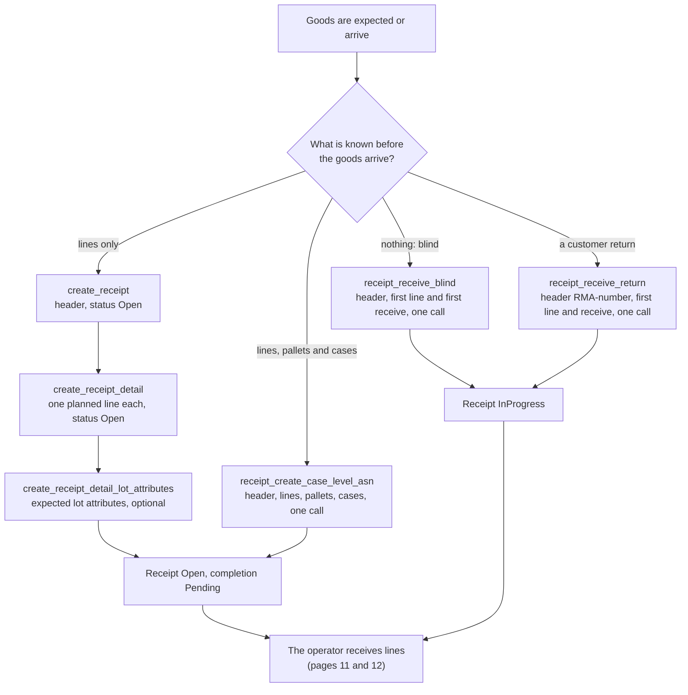

# Receiving: four ways a receipt comes to exist

A receipt is the document that holds the goods that arrive. This page shows how the document is made, by which API method, and in which status it starts.

## Diagram 1. How a receipt is created

**What this shows:** the four ways to create a receipt, the API method of each, and the status the receipt has afterwards.

Reading notes:

- A planned receipt (the first two branches) is made before the goods arrive. It stays `Open` until the first receive.
- A blind receipt and a return are made by the first receive itself. The code creates the header with status `Open`, then the first receive moves it to `InProgress` in the same transaction.
- The receipt number of a blind receipt is the next value of the `ReceiptNumber` counter, as a 10-digit number with leading zeros, unless the caller gives a number. The receipt number of a return is `RMA-` plus the RMA text.
- `receipt.receipt_number` is a text of at most 10 characters. So an RMA text of more than 6 characters cannot be received: the database refuses the number (see the findings file).
- Events: blind and return publish `process.receipt.opened`. `create_receipt` publishes nothing. The case-level ASN publishes `process.receipt.case_level_loaded`.
- A planned line carries only the plan. The command refuses a line that already has received, adjusted, rejected or damaged quantity, a completion other than `Pending`, an actual container, or a status other than `Open`.
- A planned line may name the LPN the supplier announced (`expected_lpn`). The server then plans that container (or reuses this receipt's planned one) and binds the line to it.
## What the operator does on the RF

| Way | Screens | Source |
|---|---|---|
| Planned ASN | `RCM` (menu) then `RCASN01`: scan the receipt number. Page 11. | `crates/libs/wms-lib-sql/sql/rf-screens/010_uc_rcv_01.sql:63-105`, `crates/libs/wms-lib-sql/sql/rf-screens/020_uc_asn_declarative.sql:33` |
| Case-level ASN | `RCCASE01`: scan the document number (the document itself is made through the API). Page 17. | `crates/libs/wms-lib-sql/sql/rf-screens/080_uc_case_level_declarative.sql:41` |
| Blind | `RCBLIND01`: owner code and SKU, then `RCBLIND01LINE`. Page 12. | `crates/libs/wms-lib-sql/sql/rf-screens/040_uc_blind_declarative.sql:44`, `:147` |
| Return | `RCRTN01`: owner code, RMA, SKU, then `RCRTN01LINE`. Page 12. | `crates/libs/wms-lib-sql/sql/rf-screens/050_uc_rtn_declarative.sql:41`, `:122` |
| Damaged goods received straight in | `RCDMG_RECV01`: a blind receive with damage information. Page 15. | `crates/libs/wms-lib-sql/sql/rf-screens/060_uc_dmg_receive.sql:40`, `:117` |

The RF menu `RCM` has these entries: Receive Against ASN, Receive Case-Level, Receive Blind, Receive Return, Close Receipt, Receive Damaged and Resume Serial Capture. Admin, Manager and Supervisor also see Force-Close Episode. It has no entry for hold, release or cancel. Those are buttons of the web receipt list.
## Related pages

- [Reference: creating a receipt](../../reference/inbound/30-creating-a-receipt.md)
- [Reference: adding a line](../../reference/inbound/33-adding-a-line.md)
- [Receive against an ASN](11-receive-against-asn.md)
- [Blind receiving and returns](12-receive-blind-and-return.md)
- [Case-level receiving](17-case-level-receiving.md)
