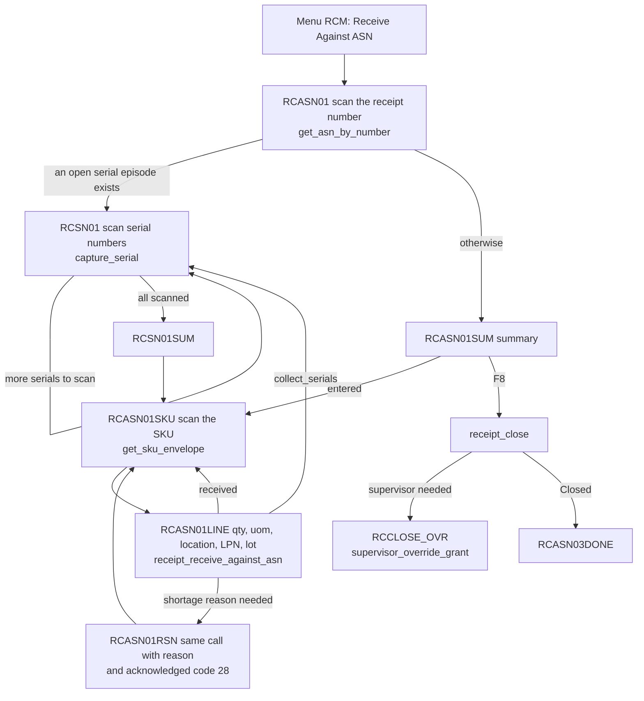
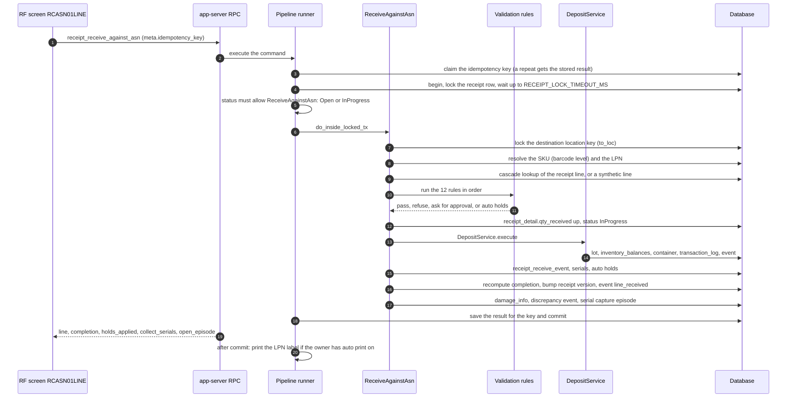

# Receiving against an ASN

This page follows one receive of one line on the RF terminal: which screen calls which API method, and what the method does inside the database.

## Diagram 1. The RF screens and the API methods

**What this shows:** the screens of the ASN flow, the method each one calls, and where each answer sends the operator next.

Reading notes:

- `get_asn_by_number` returns the receipt header, the totals, the receipt `version`, and the first open serial episode. The screen keeps the version and sends it as `expected_receipt_version` when the operator closes (F8).
- `RCASN01SUM` goes straight to `RCASN01SKU` when it opens. The summary with the F8 (close) key shows when the operator comes back to it.
- The ASN flow sends only business data: receipt, SKU, quantity, unit, locations, LPN, lot attributes. It does not send a line id. The server finds the line (Diagram 2, step 7).
- `RCASN01RSN` repeats the same call with `shortage_reason` and `acknowledged_overrides = [28]`. Code 28 needs a supervisor capability (see [13-receive-checks-and-policy.md](13-receive-checks-and-policy.md)).
- F4 on the summary opens the damaged-line screens (page 15). F6 on the close screen opens the adjust screens (page 16).

### Where it comes from

| Item | Source |
|---|---|
| Menu entries | `crates/libs/wms-lib-sql/sql/rf-screens/010_uc_rcv_01.sql:63-105` |
| Screens and routing | `crates/libs/wms-lib-sql/sql/rf-screens/020_uc_asn_declarative.sql:33-120` (RCASN01), `:144-310` (RCASN01SUM), `:322-380` (RCASN01SKU), `:406-519` (RCASN01LINE), `:563-656` (RCASN01RSN), `:682-806` (RCSN01), `:845-889` (RCSN01SUM), `:908-945` (RCASN03DONE) |
| `get_asn_by_number` and the open episode | `crates/services/app-server/src/web/rpcs/receipt_rpc/lists.rs:196-258` |
| `get_sku_envelope` | `crates/services/app-server/src/web/rpcs/receipt_rpc/receipt_views.rs:304` |
| `receipt_receive_against_asn` (`stateless_command`) | `crates/services/app-server/src/web/rpcs/receipt_commands_rpc.rs:59-75` |
| `receipt_close` (`stateful_command`, version sent by the screen) | `crates/services/app-server/src/web/rpcs/receipt_commands_rpc.rs:198-218`, `crates/libs/wms-lib-sql/sql/rf-screens/020_uc_asn_declarative.sql:175-180` |

## Diagram 2. Inside `receipt_receive_against_asn`

**What this shows:** what the server does for one receive, in order, and which tables it writes. Everything before "commit" is one database transaction.

Reading notes:

- Steps 3 to 5: the claim of the idempotency key is outside the transaction. A repeated key returns the stored result and writes nothing. The receipt row is locked `FOR UPDATE`, so commands on one receipt wait for each other. `receipt_receive_against_asn` carries no version, because two operators may receive on the same receipt at the same time.
- Step 5: only `Open` and `InProgress` allow a receive. A receipt that is `OnHold`, `Closed` or `Cancelled` refuses it.
- Step 9: the line is found by a 4-tier lookup on SKU, lot attributes, LPN and external lot. If no line matches, the owner's receipt policy `no_sku_on_asn` decides. `Allow` makes a synthetic line (expected 0). `HardError` refuses. `Warning` refuses with code 24 and the text "Receive it anyway?", but this check does not read the acknowledged codes, so a second try gets the same answer (see the findings file). A line that needs an exact lot-attribute match but expects none refuses with code 34.
- Step 10: the 12 rules and their codes are on [13-receive-checks-and-policy.md](13-receive-checks-and-policy.md).
- Step 12: `qty_received` goes up by the received quantity in base units, and the line becomes `InProgress`.
- Steps 13 and 14: `DepositService` locks the location, checks the LPN is not in use by another owner or SKU, resolves the lot by the SKU's lot policy, writes the stock and the `transaction_log` row, and publishes a deposited event. Lots are on [14-serials-lots-lpn.md](14-serials-lots-lpn.md).
- Step 16: if the receipt is `Open`, it becomes `InProgress` here, together with the version bump.
- Step 17: if the receive carries `damage_info`, a damage report for the whole received quantity is made in the same transaction (page 15).
- `holds_applied` in the answer lists auto holds placed by the SKU and the owner settings (page 13). They do not block the receive.
- The label print after the commit is best effort. A print failure does not fail the receive.

### Where it comes from

| Step | Source |
|---|---|
| Call and key (steps 1 and 2) | `crates/services/app-server/src/web/rpcs/receipt_commands_rpc.rs:64-75` |
| Claim, begin, save, commit (steps 3, 4, 18) | `crates/libs/wms-shared/src/pipeline_runner.rs:267-323`, `:326-415` |
| Lock and status check (steps 4 to 6) | `crates/libs/wms-inbound/src/service/receipt/shared/middleware/receipt_locked.rs:147-161`, `crates/libs/wms-inbound/src/service/receipt/shared/receipt_locking.rs:70-102`, `crates/libs/wms-inbound/src/repo/occ.rs:32-50`, `crates/libs/wms-inbound/src/repo/locking.rs:19-28` |
| Allowed operations by status | `crates/libs/wms-inbound/src/service/receipt/state_machine.rs:71-100` |
| Location lock, SKU and LPN (steps 7 and 8) | `crates/libs/wms-inbound/src/service/receipt/receive/receive_against_asn.rs:174-232` |
| Line lookup (step 9) | `crates/libs/wms-inbound/src/service/receipt/receive/receive_against_asn.rs:233-340`, `crates/libs/wms-inbound/src/service/receipt/cascade_lookup.rs:1-110`, `crates/libs/wms-inbound/src/service/receipt/validation/validation_pipeline.rs:80-100` |
| Rules (steps 10 and 11) | `crates/libs/wms-inbound/src/service/receipt/receive/receive_against_asn.rs:340-420`, `crates/libs/wms-inbound/src/service/receipt/validation/validation_pipeline.rs:23-40`, `:197-320` |
| Quantity update (step 12) | `crates/libs/wms-inbound/src/service/receipt/receive/receive_against_asn.rs:441-456` |
| Receipt to InProgress (step 16) | `crates/libs/wms-inbound/src/service/receipt/receive/receive_against_asn.rs:459-500`, `crates/libs/wms-inbound/src/domain/receipt/aggregate.rs:364-385` |
| Deposit and finalize (steps 13 to 16) | `crates/libs/wms-inbound/src/service/receipt/receive/receive_line_finalizer.rs:98-290`, `crates/libs/wms-inventory/src/deposit/deposit.rs:132-262` |
| Damage, discrepancy, serial episode (step 17) | `crates/libs/wms-inbound/src/service/receipt/receive/receive_against_asn.rs:508-560`, `crates/libs/wms-inbound/src/service/receipt/damage/damage_info.rs:30-60` |
| Events `line_short`, `line_over` | `crates/libs/wms-inbound/src/service/receipt/receive/receive_against_asn.rs:659-750` |
| After commit: label | `crates/libs/wms-inbound/src/service/receipt/receive/receive_against_asn.rs:591-625`, `crates/libs/wms-inbound/src/service/receipt/shared/auto_print.rs:42-91` |

## Tables written by one receive

| Table or stream | Written by |
|---|---|
| `idempotency_store` | pipeline runner |
| `receipt_detail` (`qty_received`, `status`, `to_loc`, `to_lot`, `to_container_id`, `completion`) | command and finalizer |
| `receipt` (`status`, `completion`, `version`, `effective_date`) | finalizer |
| `receipt_receive_event` (one row for each receive) | finalizer |
| `inventory_balances_lot`, `lot_attributes` (when a new lot is made) | `DepositService` |
| `inventory_balances`, `container` | `DepositService` |
| `transaction_log` | `DepositService` |
| `inventory_hold` (auto holds) | finalizer |
| `inventory_balances_serial`, `serial_capture_episode` | serial registration and the deferred capture |
| `receipt_detail_damage` | only when the receive carries `damage_info` |
| `enterprise.integration_event`: `process.receipt.line_received`, and `line_short` or `line_over`, `override_applied`, deposited event | command, finalizer, validation |

## Not confirmed by code

- Which user roles may call `receipt_receive_against_asn`. The method table lists `Admin` and `Manager`; the grants in the database also include other roles. To verify: log in as an Operator on RF and receive a line.
- Whether the F2 picker of `RCASN01` (`search_asns`) changes anything after the scan. It is a list, not a write.

## Related pages

- [Operator guide: receiving against an ASN](../../operator/02-receiving-against-asn.md)
- [Reference: receiving a line](../../reference/inbound/36-receiving-a-line.md)
- [Receive checks and receipt policy](13-receive-checks-and-policy.md)
- [Serial numbers, lots and LPNs](14-serials-lots-lpn.md)
- [Hold, adjust, close and cancel](16-hold-adjust-close-cancel.md)
