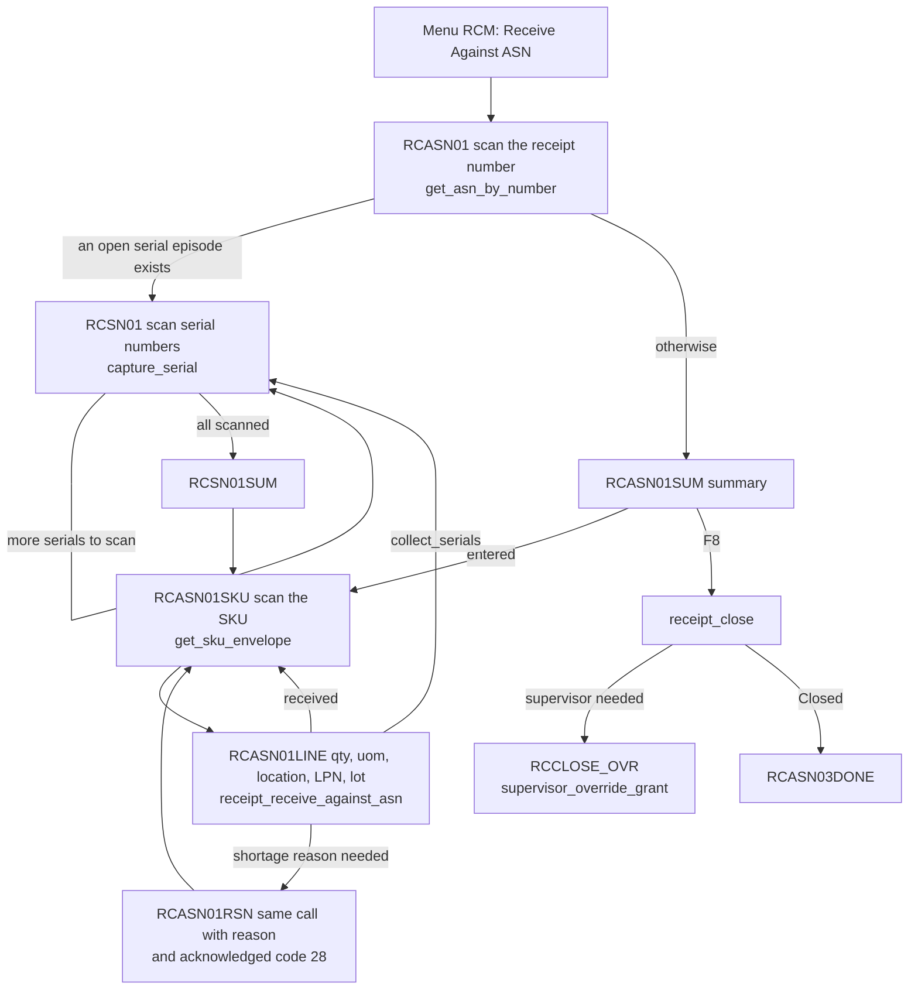
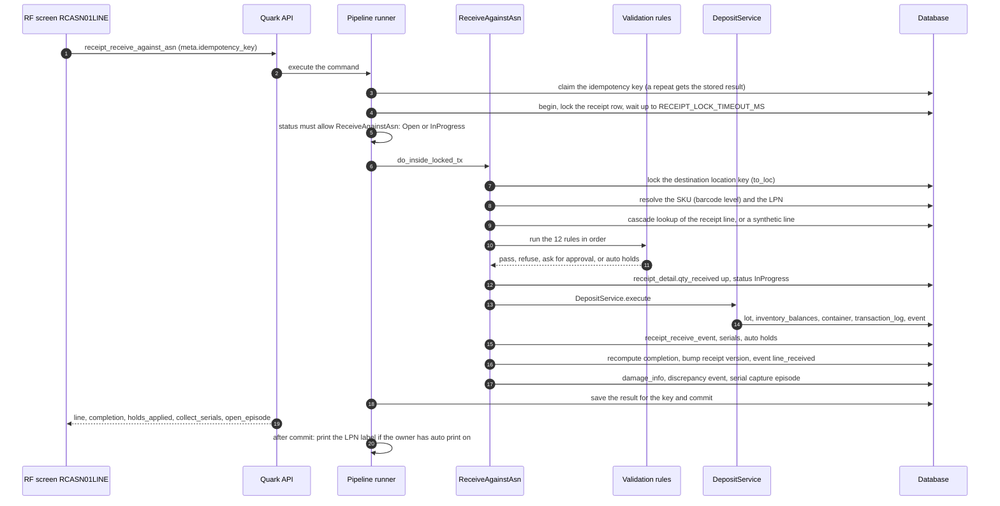

# Receiving against an ASN

This page follows one receive of one line on the RF terminal: which screen calls which API method, and what the method does inside the database.

## Diagram 1. The RF screens and the API methods

**What this shows:** the screens of the ASN flow, the method each one calls, and where each answer sends the operator next.

Reading notes:

- `get_asn_by_number` returns the receipt header, the totals, the receipt `version`, and the first open serial episode. The screen keeps the version and sends it as `expected_receipt_version` when the operator closes (F8).
- `RCASN01SUM` goes straight to `RCASN01SKU` when it opens. The summary with the F8 (close) key shows when the operator comes back to it.
- The ASN flow sends only business data: receipt, SKU, quantity, unit, locations, LPN, lot attributes. It does not send a line id. The server finds the line (Diagram 2, step 7).
- `RCASN01RSN` repeats the same call with `shortage_reason` and `acknowledged_overrides = [28]`. Code 28 needs a supervisor capability (see [Receive checks and receipt policy](13-receive-checks-and-policy.md)).
- F4 on the summary opens the damaged-line screens (page 15). F6 on the close screen opens the adjust screens (page 16).
## Diagram 2. Inside `receipt_receive_against_asn`

**What this shows:** what the server does for one receive, in order, and which tables it writes. Everything before "commit" is one database transaction.

Reading notes:

- Steps 3 to 5: the claim of the idempotency key is outside the transaction. A repeated key returns the stored result and writes nothing. The receipt row is locked `FOR UPDATE`, so commands on one receipt wait for each other. `receipt_receive_against_asn` carries no version, because two operators may receive on the same receipt at the same time.
- Step 5: only `Open` and `InProgress` allow a receive. A receipt that is `OnHold`, `Closed` or `Cancelled` refuses it.
- Step 9: the line is found by SKU, lot attributes, LPN and external lot. If
  no line matches, the owner's **No SKU on ASN** rule decides. `Allow` creates
  an unexpected line with expected quantity 0. `Warning` asks the operator to
  acknowledge the unexpected SKU before continuing. `HardError` refuses the
  receive. A line that requires an exact lot-attribute match but expects none
  is refused with code 34.
- Step 10: see [Receive checks and receipt policy](13-receive-checks-and-policy.md) for the 12 rules and their codes.
- Step 12: the received quantity increases in base units, and the line becomes
  `InProgress`.
- Steps 13 and 14: Quark checks the destination and LPN, resolves the lot from
  the SKU policy, writes the stock movement and publishes the deposited event.
  See [Serial numbers, lots and LPNs](14-serials-lots-lpn.md).
- Step 16: an `Open` receipt becomes `InProgress` and receives a new version.
- Step 17: when the receive includes damage information, Quark creates a damage
  report for the received quantity in the same transaction.
- The response lists any automatic holds applied by SKU or owner settings. They
  do not block this receive.
- The label print after the commit is best effort. A print failure does not fail the receive.

## Related pages

- [Operator guide: receiving against an ASN](../../operator/02-receiving-against-asn.md)
- [Reference: receiving a line](../../reference/inbound/36-receiving-a-line.md)
- [Receive checks and receipt policy](13-receive-checks-and-policy.md)
- [Serial numbers, lots and LPNs](14-serials-lots-lpn.md)
- [Hold, adjust, close and cancel](16-hold-adjust-close-cancel.md)
