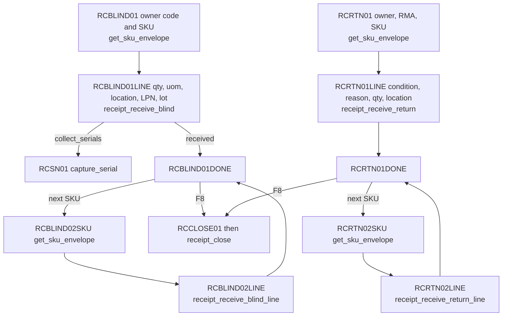
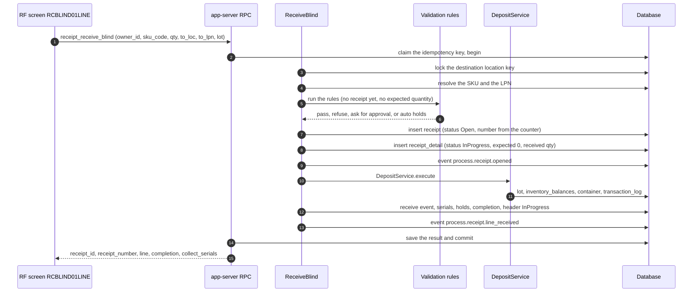
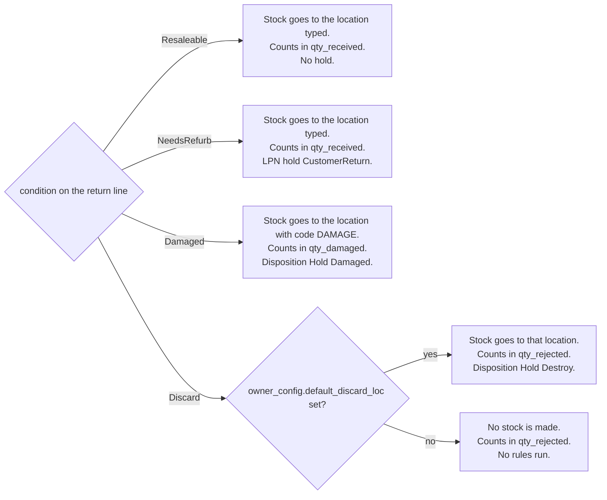

# Blind receiving and customer returns

Blind receiving and returns have no planned line. The first receive makes the receipt and its first line. Later receives add lines to the same receipt.

## Diagram 1. The RF loops

**What this shows:** the screens of the blind flow and of the return flow, and the API method each one calls.

Reading notes:

- The first screen of each flow gets the SKU envelope only. Nothing is created until the line screen is submitted.
- The blind line screen offers the receipt type `Normal` only.
- The "next SKU" screens send the `receipt_id` that the first call returned. The first call is a command that creates; the next calls lock the existing receipt.
- Serial numbers are asked on `RCSN01` when the SKU needs them and none were sent with the receive. A return line does not open a serial episode.
- Damage information can be entered on the return line screen and on `RCDMG_RECV01` (page 15).

### Where it comes from

| Item | Source |
|---|---|
| Blind screens and routing | `crates/libs/wms-lib-sql/sql/rf-screens/040_uc_blind_declarative.sql:44-126` (RCBLIND01), `:147-246` (RCBLIND01LINE), `:285-361` (RCBLIND01DONE), `:389-452` (RCBLIND02SKU), `:459-556` (RCBLIND02LINE), `:586-641` (RCBLIND_SN_SUM) |
| Blind type `Normal` only | `crates/libs/wms-lib-sql/sql/rf-screens/040_uc_blind_declarative.sql:210-213` |
| Return screens and routing | `crates/libs/wms-lib-sql/sql/rf-screens/050_uc_rtn_declarative.sql:41-104`, `:122-261`, `:270-315`; `crates/libs/wms-lib-sql/sql/rf-screens/055_uc_rtn_multi_line.sql:59-152`, `:152-219`, `:245-386` |
| Methods and classes | `crates/services/app-server/src/web/rpcs/receipt_commands_rpc.rs:36-55` |

## Diagram 2. Inside `receipt_receive_blind`

**What this shows:** the first blind receive, in order. It is one transaction. The difference from the ASN receive is that the receipt and the line do not exist yet, so the checks run before the receipt is made.

Reading notes:

- The rules of page 13 run in the same order. Quantity rules are skipped because no quantity is expected. A blind line has expected quantity 0, so its completion is `Over`.
- The header number is the next value of the `ReceiptNumber` counter (10 digits) unless the caller sends one.
- `receipt_receive_blind_line` (the next SKUs) is the same work on an existing receipt, which is locked first. It does not publish `process.receipt.opened`.
- `receipt_receive_blind` takes no receipt version and no expected version. A repeated key returns the stored result.

### Where it comes from

| Step | Source |
|---|---|
| Whole command | `crates/libs/wms-inbound/src/service/receipt/receive/receive_blind.rs:100-340` |
| Rules with `skip_qty_rollup_check = true` | `crates/libs/wms-inbound/src/service/receipt/receive/receive_blind.rs:148-176` |
| Header and first line | `crates/libs/wms-inbound/src/service/receipt/receive/receive_blind.rs:178-258` |
| Receive and finalize | `crates/libs/wms-inbound/src/service/receipt/receive/receive_blind.rs:260-330`, `crates/libs/wms-inbound/src/service/receipt/receive/receive_line_finalizer.rs:98-290` |
| Existing receipt variant | `crates/libs/wms-inbound/src/service/receipt/receive/receive_blind_line.rs:80-395` |
| Completion of a line with expected 0 | `crates/libs/wms-inbound/src/repo/completion_compute.rs:39-49` |

## Diagram 3. What the return condition changes

**What this shows:** for each return condition, where the goods go, which quantity column they count in, and which hold or disposition is set.

| Condition | Location of the stock | Quantity column | Receive bucket | Hold or disposition on the line | Source |
|---|---|---|---|---|---|
| `Resaleable` | the `to_loc` typed | `qty_received` | Received | disposition `Stock`, no hold | `crates/libs/wms-inbound/src/service/receipt/receive/return_line_finalizer.rs:184-197`, `:265-280` |
| `NeedsRefurb` | the `to_loc` typed | `qty_received` | Received | LPN hold with code `CustomerReturn` when an LPN is given; disposition `Hold` | `crates/libs/wms-inbound/src/service/receipt/receive/return_line_finalizer.rs:440-475`, `crates/libs/wms-inbound/src/service/receipt/damage/disposition_derivation.rs:43-66` |
| `Damaged` | the location with the code `DAMAGE` (fixed in code) | `qty_damaged` | Damaged | disposition `Hold` with `Damaged` | `crates/libs/wms-inbound/src/service/receipt/receive/return_line_finalizer.rs:184-197`, `:265-280` |
| `Discard` | `owner_config.default_discard_loc`, or nowhere | `qty_rejected` | Rejected | disposition `Hold` with `Destroy` | `crates/libs/wms-inbound/src/service/receipt/receive/return_line_finalizer.rs:184-197`, `:265-280` |

Reading notes:

- Rules run only when stock is made. A discarded return without `default_discard_loc` skips them.
- A `Damaged` return is checked as a "damage quarantine" destination, and a discarded one as a "discard staging" destination. The held-location rule then ignores a `Damaged` hold (or a `Destroy` hold) on that destination.
- The line also stores `return_reason` (the reason text typed) and the RMA is on the receipt header.
- `original_order_id` is accepted by `receipt_receive_return` and not used by any code.
- The receipt number of a return is `RMA-` plus the RMA. `receipt.receipt_number` has room for 10 characters, so the RMA can have at most 6.

### Where it comes from

| Item | Source |
|---|---|
| Return command | `crates/libs/wms-inbound/src/service/receipt/receive/receive_return.rs:148-215` |
| Condition to location, rules and quantity columns | `crates/libs/wms-inbound/src/service/receipt/receive/return_line_finalizer.rs:72-262` |
| Hold for `NeedsRefurb` | `crates/libs/wms-inbound/src/service/receipt/receive/return_line_finalizer.rs:440-475` |
| `original_order_id` declared, never read | `crates/libs/wms-inbound/src/service/receipt/receive/receive_return.rs:41` |
| Destination purposes | `crates/libs/wms-inbound/src/service/receipt/validation/rules/rule.rs:29-44`, `crates/libs/wms-inbound/src/service/receipt/validation/rules/held_location.rs:130-165` |

## Not confirmed by code

- Whether a location with the code `DAMAGE` exists in a real warehouse. The code fixes the string. To verify: list locations and search for `DAMAGE`.
- What the web screens show for the `Return` receipt type. Only the RF flow is read here.

## Related pages

- [Operator guide: blind receiving and returns](../../operator/03-blind-receiving-and-returns.md)
- [Ways a receipt starts](10-receiving-ways-to-start.md)
- [Receive checks and receipt policy](13-receive-checks-and-policy.md)
- [Damage](15-damage.md)
