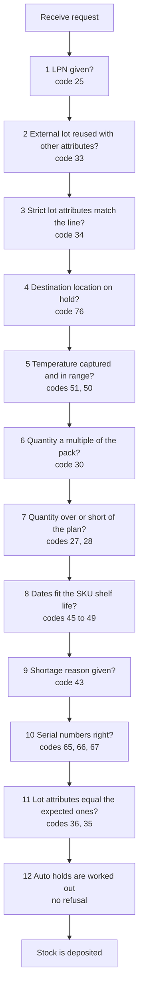
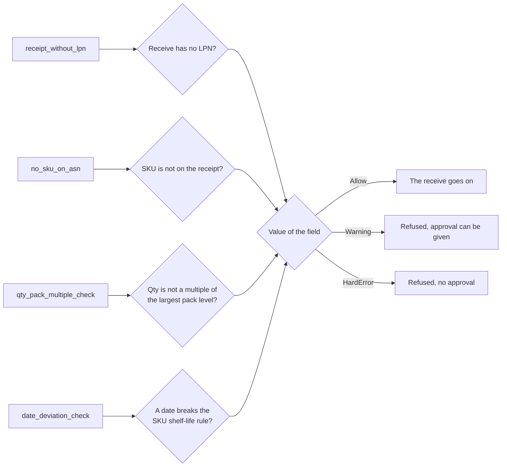
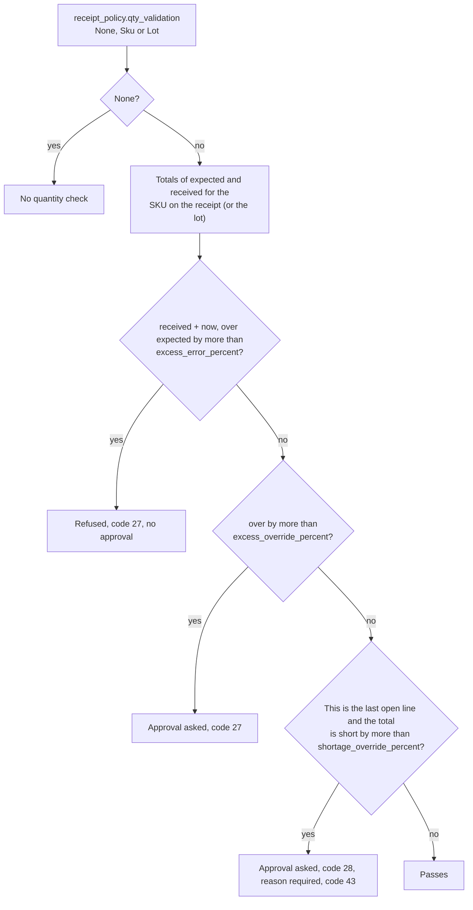
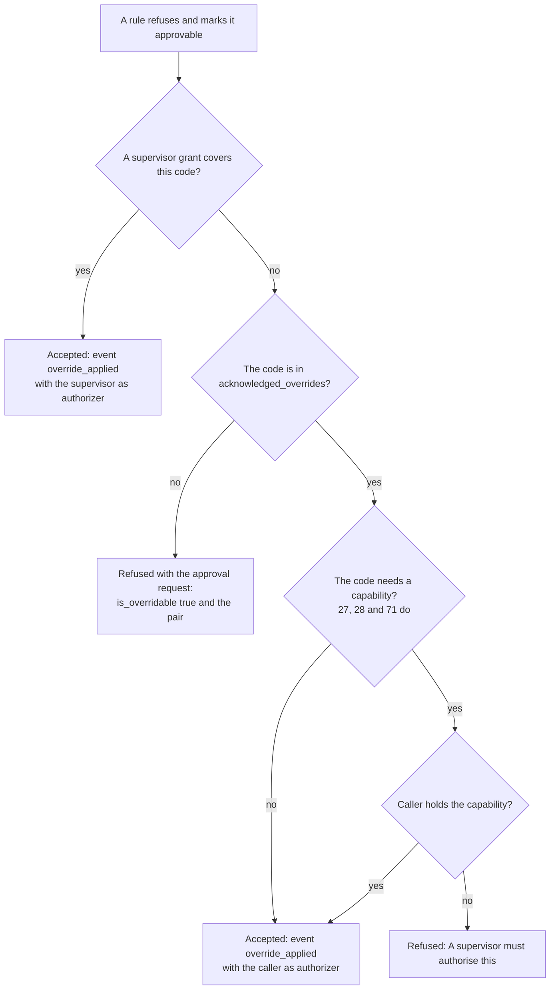
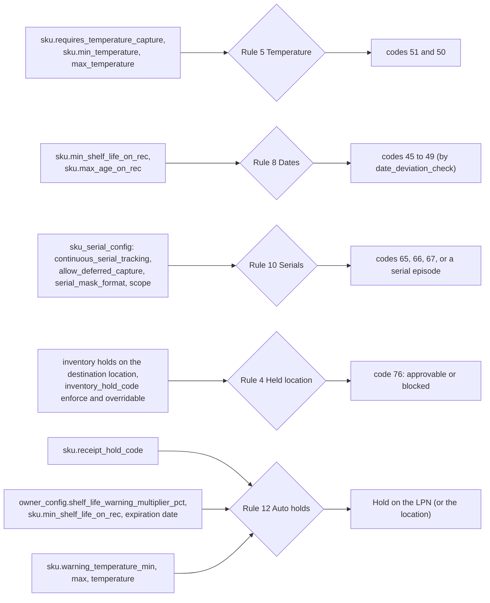

# Receiving: the checks and what the receipt policy changes

Every receive runs the same list of rules before any stock is written. This page shows the order, and which receipt policy field or SKU field changes which rule.
Only settings that code reads are drawn. Settings that nothing reads are listed at the end under "Stored only. It has no effect today."

## Diagram 1. The twelve rules, in order

**What this shows:** the order of the rules that run for `receipt_receive_against_asn`, `receipt_receive_blind`, `receipt_receive_blind_line` and the stock-making returns, and the code each one can refuse with. The first refusal ends the receive and rolls everything back.

Reading notes:

- Rules 3 and 11 run only when the receive hits a known line (receive against an ASN). A blind receive and a return have no expected attributes.
- Rules 7 and 9 are skipped when there is no plan to compare with: blind receives and returns.
- A rule can end in one of three ways. It passes, it refuses with no way round, or it refuses with an approval request (diagram 4).
- Rule 12 does not refuse. It returns the holds to place after the stock is written (diagram 5).
- A return line is checked only when its goods are put into stock (page 12).
## Diagram 2. Receipt policy fields with three values

**What this shows:** four receipt policy fields that take `Allow`, `Warning` or `HardError`, the question each one asks, and what each value does.

| Field | Question | Codes | Notes |
|---|---|---|---|
| `receipt_without_lpn` | A receive with no LPN (a generated pallet code counts as an LPN). | 25 | Rule 1. |
| `no_sku_on_asn` | No line of the receipt matches the SKU, lot attributes, LPN and external lot. `Allow` creates a synthetic line with expected 0. | 24 | `Warning` returns code 24 as approvable, but the check does not read the acknowledged codes. It is refused each time (see the findings file). |
| `qty_pack_multiple_check` | The quantity typed is not a multiple of the largest pack level above 1 (the largest `base_qty` of the SKU's pack). Skipped if the SKU has no pack or no level above 1. | 30 | `Warning` makes the failure approvable, `HardError` not. |
| `date_deviation_check` | The expiration date is not later than today plus `sku.min_shelf_life_on_rec` days, or is already past (code 45); the manufactured date is older than `sku.max_age_on_rec` days (46); the `delivery_by_date` is not later than today (47); the `best_by_date` is not later than today (48); the lot has no expiration although one is required (49). | 45 to 49 | Dates come from the lot attributes typed on the receive. A missing expiration, best-by or delivery-by is first worked out from the manufactured date and the SKU's `expire_days`, `best_by_days` and `deliver_by_days`; "today" is the warehouse day. `Allow` skips every date check. |
## Diagram 3. The quantity decision

**What this shows:** how `qty_validation` and the excess and shortage fields turn "expected 100, received so far 90, now 30" into a pass, an approval request, or a refusal.

| Field | What it does |
|---|---|
| `qty_validation` | `None` turns the check off. `Sku` compares the totals of the SKU on the receipt. `Lot` compares the totals of the lines with the scanned external lot, and falls back to the SKU when no line has it. |
| `excess_error` and `excess_error_percent` | When on, receiving more than this percent over the expected total is refused for good. Percent is `(received + now - expected) x 100 / expected`. |
| `excess_override` and `excess_override_percent` | When on, receiving more than this percent over the expected total asks for an approval. |
| both excess flags off and expected is 0 | The refusal is approvable. When `excess_error` is on and expected is 0, any receive is refused for good. |
| `shortage_override` and `shortage_override_percent` | When on, a total short by more than this percent asks for an approval and a shortage reason. Shortage is judged only when the receive goes to the last open line of the SKU. A shortage is never refused for good. |

Reading notes:

- Codes 27 and 28 need a supervisor capability. See diagram 4.
- The shortage reason must be an active value of the code list `shortage_reason`. Otherwise the receive is refused with code 43.
## Diagram 4. Who may approve

**What this shows:** what happens to a refusal that can be approved.

| Code | Capability needed to approve | Held by (baseline) |
|---|---|---|
| 27 excess | `receipt.override_qty_excess` | Supervisor only |
| 28 shortage | `receipt.override_qty_shortage` | Supervisor only |
| 71 close with a discrepancy | `receipt.override_close_discrepancy` | Supervisor only |
| 24, 25, 36, 45 to 49, 50, 76 | none: the operator's own confirmation is enough | none |

Reading notes:

- A grant is made by `supervisor_override_grant`. It is single use, expires in minutes, and is bound to the operator, the pairs, and the receipt (code 71) or the line (codes 27, 28). An Admin or a Manager cannot authorize these three codes.
- The RF screens offer an approval for only two codes: 28 on `RCASN01RSN` (the screen sends `acknowledged_overrides = [28]` with the reason) and 71 on `RCCLOSE_OVR` (a grant). For any other approvable refusal the RF shows the message and stays on the screen.
## Diagram 5. SKU, owner and location fields that change a receive

**What this shows:** the master data fields read by the rules 4, 5, 8, 10 and 12, and the visible result.

| Field | Decision it changes | What you see |
|---|---|---|
| `sku.requires_temperature_capture` | When on, a temperature must be captured. | Missing: code 51, no approval. |
| `sku.min_temperature`, `sku.max_temperature` | The captured temperature must lie between them. | Code 50, approvable. |
| `sku.min_shelf_life_on_rec`, `sku.max_age_on_rec` | Limits for the dates (rule 8). `min_shelf_life_on_rec` also feeds the auto hold band. | Codes 45, 46. |
| `sku.expire_days`, `sku.best_by_days`, `sku.deliver_by_days`, and `required_expiration_date` on the lot policy | A missing date is worked out from the manufactured date. A lot that needs an expiration and has neither one nor a manufactured date to work it out from is refused. | Code 49. |
| `sku_serial_config` | With `continuous_serial_tracking` on, serials are needed: the right count (by scope `PerUnit`, `PerCase`, `PerPallet`, `PerInnerPack`), the format mask, and no duplicate for the owner. With `allow_deferred_capture` on, a receive without serials is allowed and opens a serial episode. | Codes 65, 66, 67; or `collect_serials` in the answer. |
| Inventory holds on the destination location | A hold that does not enforce is ignored. An enforcing, approvable hold asks "Receive here anyway?". An enforcing, non-approvable one says "blocked - receive somewhere else". | Code 76. |
| `sku.receipt_hold_code` | A hold with this code is placed on the LPN (the location if no LPN). The code `NewItem` holds only the first receive of the SKU. Values `None`, `Ok`, `NotHold` and empty mean no hold. | `holds_applied` in the answer. |
| `owner_config.shelf_life_warning_multiplier_pct` (200 if the owner has no config row) and `sku.min_shelf_life_on_rec` | If the expiration date (typed, or worked out from `expire_days`) is not later than today plus `min_shelf_life_on_rec` x percent / 100 days, the stock gets a `QcQuarantine` hold. | `holds_applied` |
| `sku.warning_temperature_min`, `sku.warning_temperature_max` | A captured temperature outside this band gives a `QcQuarantine` hold. | `holds_applied` |

Auto holds do not block the receive. A hold that cannot be placed refuses the whole receive (`HoldNotPlaced`).
## Stored only. It has no effect today.

These receipt policy fields are stored and shown, but no receiving code reads them.

| Field | Note |
|---|---|
| `receipt_without_po` | Nothing reads it. |
| `receipt_without_asn` | Nothing reads it. A blind receive is not judged by it. |
| `no_sku_on_po` | Nothing reads it. |
| `asn_po_qty_discrepancy` | Nothing reads it. |
| `po_qty_validation`, `po_excess_message`, `po_excess_override`, `po_excess_override_percent`, `po_excess_error`, `po_excess_error_percent`, `po_shortage_message`, `po_shortage_override`, `po_shortage_override_percent` | The purchase order checks do not exist. |
| `excess_message`, `shortage_message` | Only the policy form enables or disables them. The server does not read them. |
## Related pages

- [Policy reference: receipt policy settings](../../admin/policies/40-receipt-policy-settings.md)
- [Policy reference: SKU level settings](../../admin/policies/34-sku-level-settings.md)
- [Reference: return codes](../../reference/inbound/92-return-codes.md)
- [Receive against an ASN](11-receive-against-asn.md)
- [Serial numbers, lots and LPNs](14-serials-lots-lpn.md)
