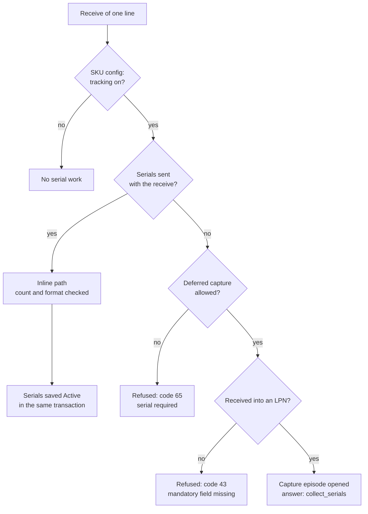
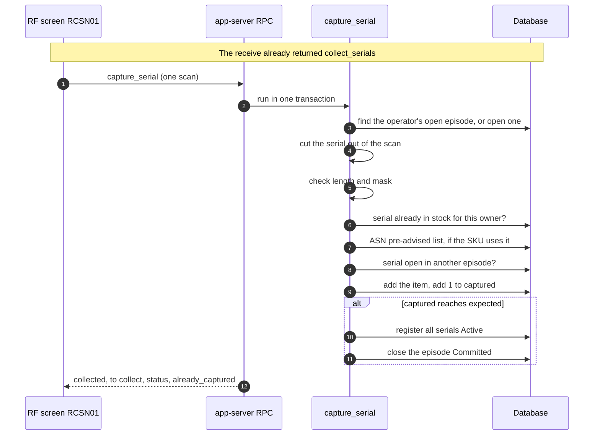
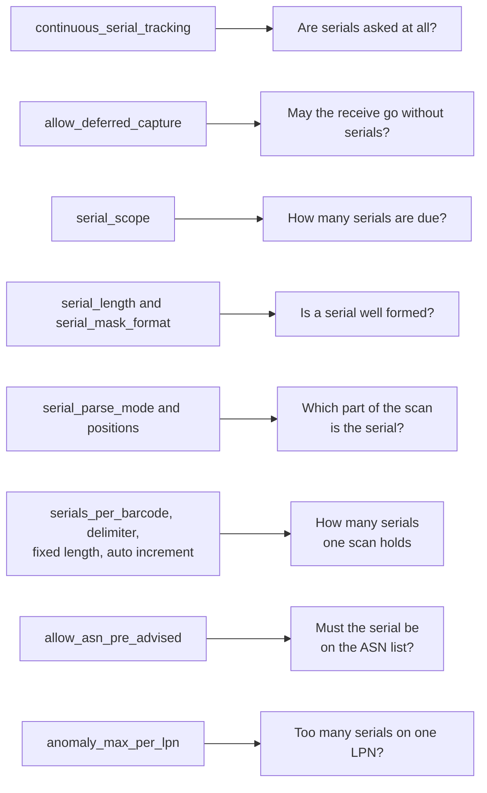
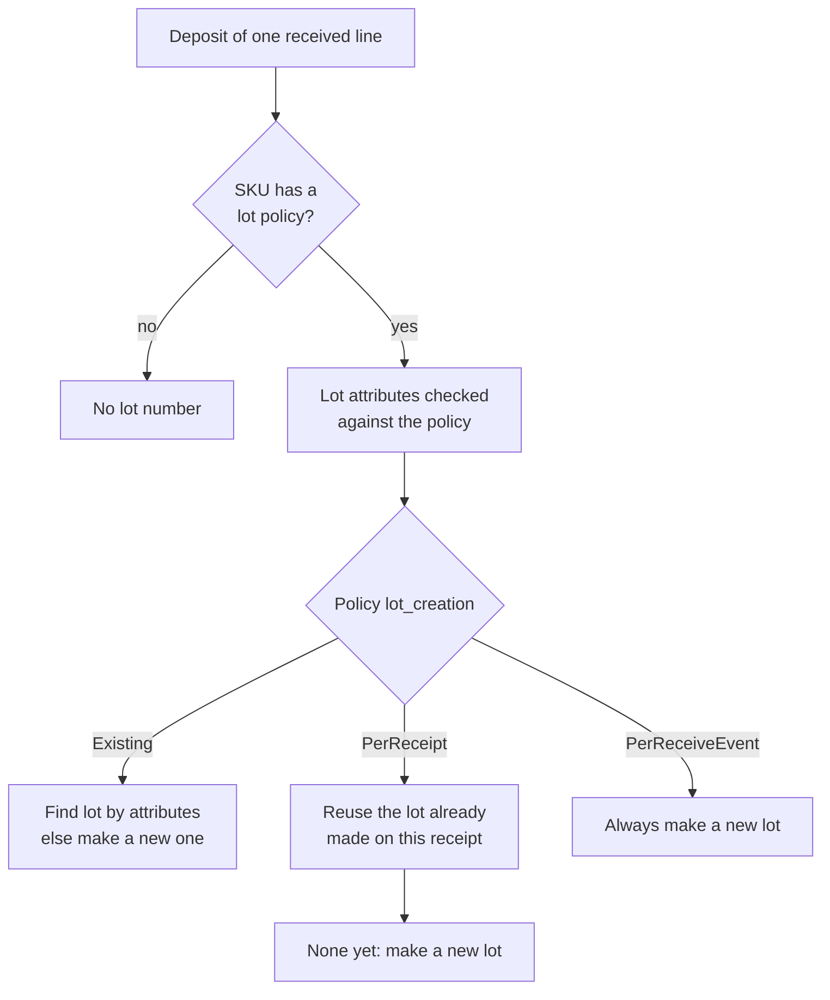
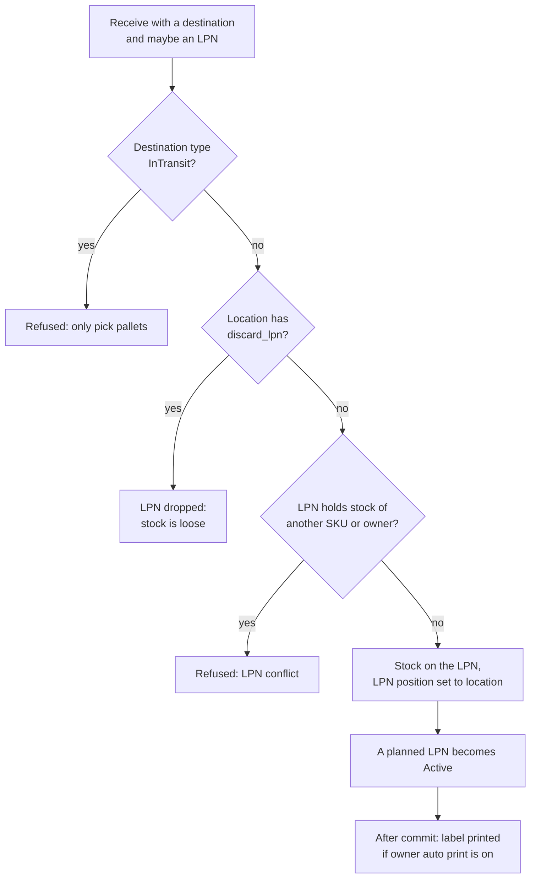

# Receiving: serial numbers, lots and LPNs

This page shows what a receive does with serial numbers, with the lot, and with the LPN (the pallet or box code), and which SKU and owner settings change each step.

## Diagram 1. Which serial path does a receive take?

**What this shows:** the questions the server asks about serials on one receive, and the three possible outcomes.

Reading notes:

- "Tracking on" is `sku_serial_config.continuous_serial_tracking`. A SKU with no config row counts as tracking off.
- The inline path compares the number of serials with the expected count (Diagram 3). A wrong count is refused with code 65. The mask is checked as a regex. A serial already active for the owner is refused with code 67.
- Code 43 comes after the stock was written. The whole transaction rolls back, so nothing is kept.
- With the deferred path, the receive succeeds and the quantity counts as received. The line completion is `Partial` until the serials are captured, because the completion check compares the serial count with the expected count.
- A customer return line does not open an episode (page 12).

### Where it comes from

| Item | Source |
|---|---|
| Tracking on, deferred allowed | `crates/libs/wms-serial/src/service/serial_policy.rs:225-240` |
| Inline checks: tracking, deferred, count, mask, duplicate | `crates/libs/wms-inbound/src/service/receipt/validation/validation_serial.rs:44-165` |
| Deferred path: policy, LPN needed, episode | `crates/libs/wms-inbound/src/service/receipt/receive/deferred_serial_capture.rs:105-179` |
| Callers of the deferred step | `crates/libs/wms-inbound/src/service/receipt/receive/receive_against_asn.rs:545-565`, `crates/libs/wms-inbound/src/service/receipt/receive/receive_blind.rs:383-405`, `crates/libs/wms-inbound/src/service/receipt/receive/receive_blind_line.rs:322-344` |
| Inline serials saved after the deposit | `crates/libs/wms-inbound/src/service/receipt/receive/receive_line_finalizer.rs:208`, `crates/libs/wms-inbound/src/service/receipt/receive/serial_registration.rs:32-75` |
| Serial coverage lowers completion to `Partial` | `crates/libs/wms-inbound/src/repo/completion.rs:270-287` |
| Return codes (names and numbers) | `crates/libs/wms-shared/src/validation_codes.rs` |

## Diagram 2. Capturing the serials one by one

**What this shows:** the deferred capture, from the receive that opens the episode to the last scan that commits it.

Reading notes:

- Every scan is its own transaction. Scanning the same serial twice in one episode adds nothing and returns `already_captured = true`.
- A scan that holds several serials (`serials_per_barcode` above 1) is cut into parts first. If the batch would pass the expected count, the whole scan is refused.
- When the last serial arrives, the server commits by itself. The operator never sends a "commit".
- If the operator leaves `RCSN01`, the episode stays open. It blocks `receipt_close` (page 16). It can be resumed from the menu entry "Resume Serial Capture". A supervisor can close it from "Force-Close Episode".
- If nobody touches an episode for 8 hours, a background job marks it `Abandoned`. The job runs every 5 minutes. An abandoned episode still blocks `receipt_close` until a supervisor force-closes it.
- A new receive on the same line by the same operator adds to the same episode. The LPN and the location must be the same, otherwise the receive is refused.
- The registered serials take the lot and the LPN stored on the episode.

### Where it comes from

| Step | Source |
|---|---|
| RF screen and payload | `crates/libs/wms-lib-sql/sql/rf-screens/020_uc_asn_declarative.sql:682-799` |
| Whole command | `crates/libs/wms-serial/src/service/serial/commands/capture_serial.rs:156-464` |
| Find or open the episode (step 3) | `crates/libs/wms-serial/src/service/serial/commands/capture_serial.rs:174-210` |
| Cut and format (steps 4 and 5) | `crates/libs/wms-serial/src/service/serial/commands/capture_serial.rs:231-304` |
| Duplicate and list checks (steps 6 to 8) | `crates/libs/wms-serial/src/service/serial/commands/capture_serial.rs:312-396` |
| Add item, count, commit (steps 9 to 11) | `crates/libs/wms-serial/src/service/serial/commands/capture_serial.rs:404-464`, `:583-697` |
| Batch refused over the expected count | `crates/libs/wms-serial/src/service/serial/commands/capture_serial.rs:272-292` |
| Episode folding and the 8 hour TTL | `crates/libs/wms-serial/src/service/serial/episode_lifecycle.rs:57`, `:125-204` |
| TTL sweep every 5 minutes | `crates/services/app-server/src/services/cleanup_tasks.rs:125-131`, `:1026`, `crates/libs/wms-lib-core/src/model/serial_capture/episode.rs:1123-1150` |
| Force close (supervisor), status `Cancelled` | `crates/libs/wms-serial/src/service/serial/commands/force_close_episode.rs:101-183` |
| RF recovery and force-close screens | `crates/libs/wms-lib-sql/sql/rf-screens/020_uc_asn_declarative.sql:954-1022`, `crates/libs/wms-lib-sql/sql/rf-screens/030_uc_force_close.sql:27-60` |
| Registration: rule 4 (too many per LPN), rule 5 (disposed serial) | `crates/libs/wms-serial/src/service/serial_service.rs:244-340` |

## Diagram 3. What the SKU serial config changes

**What this shows:** for each serial setting that code reads at receive time, the decision it changes.

| Setting | What it changes | What the operator sees | Source |
|---|---|---|---|
| `continuous_serial_tracking` | Turns the whole serial path on. | Serial prompts and codes 65 and 67. | `crates/libs/wms-serial/src/service/serial_policy.rs:225-230` |
| `allow_deferred_capture` | Off: serials must come with the receive (code 65). On: the receive can finish and the operator scans later. | `collect_serials = true`, screen `RCSN01`. | `crates/libs/wms-serial/src/service/serial_policy.rs:235-240`, `crates/libs/wms-inbound/src/service/receipt/validation/validation_serial.rs:67-81` |
| `serial_scope` | The count due: `PerUnit` = base units. `PerCase` = the quantity typed. `PerPallet` and `PerInnerPack` = base units divided by the size of the `PL` or `IP` level of the pack hierarchy. A missing level falls back to the `PerUnit` count. | "Progress 1 of N" on `RCSN01`; the refusal text "expected N serials". | `crates/libs/wms-serial/src/service/serial_policy.rs:611-646` |
| `serial_length`, `serial_mask_format` | Checked on every serial in the deferred path. In the inline path only the mask is checked (see the findings file). | Code 66 (format invalid). | `crates/libs/wms-serial/src/service/serial_policy.rs:561-592`, `crates/libs/wms-inbound/src/service/receipt/validation/validation_serial.rs:112-138` |
| `serial_parse_mode` (`None`, `Fixed`, `Bounded`), `serial_parse_start_position`, `serial_parse_start_after` | Cuts the serial out of a longer barcode. Deferred path only. | Code 66 when the scan is too short or the config is incomplete. | `crates/libs/wms-serial/src/service/serial_policy.rs:290-329` |
| `serials_per_barcode`, `multi_serial_delimiter`, `multi_serial_fixed_length` | One scan holds several serials. The count must match exactly. | Code 66 with both numbers. | `crates/libs/wms-serial/src/service/serial_policy.rs:358-431` |
| `serial_auto_increment`, `serial_increment_source_position`, `serial_increment_length` | The scan is a starter. The server makes the other serials by adding 1 in a numeric window. | Code 66 if the window is not numeric or overflows. | `crates/libs/wms-serial/src/service/serial_policy.rs:375-382`, `:448-525` |
| `allow_asn_pre_advised` | If on, and the line has pre-advised serials, a scan outside the list is refused. | Code 95 (`SerialAsnNotAdvised`). | `crates/libs/wms-serial/src/service/serial/commands/capture_serial.rs:343-370` |
| `anomaly_max_per_lpn` | A save that would put more active serials on the LPN than this number is refused. The refusal is marked overridable, but the save code reads no acknowledged codes, so an approval does not help (see the findings file). | Code 91 (`SerialMassAnomaly`). | `crates/libs/wms-serial/src/service/serial_service.rs:257-276`, `:606-616` |

### Stored only. It has no effect today.

These `sku_serial_config` columns are not read by any receiving code. The rest of the code base reads only what is noted.

| Column | Note |
|---|---|
| `allow_receive_capture` | Only test code and seed code mention it. |
| `require_unique_global` | Nothing reads it. |
| `check_digit_algorithm`, `warranty_period_days`, `industry_profile`, `serial_parse_frequency`, `anomaly_block_severity`, `serial_format` | Nothing reads them. Registration always saves `serial_format = None`. |
| `anomaly_vendor_surge_factor` | Not read at receive. A background scan reads it. |
| `anomaly_velocity_threshold_min` | Not read at receive. The ship check reads it. |
| `profile_mode`, `pick_episode_reassignment_mode` | Not read at receive. Move and pick read them. |

Source: search of `crates/` (non-test code) for each name. The readers are `crates/libs/wms-serial/src/service/serial_service.rs:558-600`, `crates/services/app-server/src/services/cleanup_tasks.rs:1240-1253` and `crates/libs/wms-inventory/src/movement/serial_episode_policy.rs:17-20`.

## Diagram 4. Which lot does the stock get?

**What this shows:** how the lot number of a received line is chosen, and which setting decides.

Reading notes:

- A new lot number comes from the warehouse counter `Lot`.
- `PerReceipt` asks the receive events of this receipt for the lot of this SKU and owner. It does not compare the attributes. Attributes are still validated on every receive.
- `PerReceiveEvent` skips the search on purpose. Looking up attributes later would find two lots with the same attributes and fail.
- The lot is saved with the dates taken from the attributes: manufactured, expiration, delivery-by, best-by.
- The lot made here is also the lot of the capture episode and of every serial it registers.

### Where it comes from

| Item | Source |
|---|---|
| Lot policy present, attributes validated, `lot_creation` match | `crates/libs/wms-inventory/src/deposit/deposit.rs:710-797` |
| New lot rows and dates | `crates/libs/wms-inventory/src/deposit/deposit.rs:578-628` |
| Lot number counter | `crates/libs/wms-inventory/src/deposit/deposit.rs:704-708` |
| Lot passed to the episode | `crates/libs/wms-inbound/src/service/receipt/receive/deferred_serial_capture.rs:35-47` |

## Diagram 5. What happens to the LPN

**What this shows:** the checks and the effects on the LPN code when a line is received.

Reading notes:

- If the operator chooses "generate a new LPN", the server makes the code before the deposit, with the same generator that makes new pallet codes.
- A location with `discard_lpn` (Lose ID) turns a serial deferred capture into a refusal, because that path needs an LPN. This follows from the two code paths. It was not run.
- The LPN check refuses an LPN that already holds stock of another SKU or another owner. An LPN holding only the same SKU and owner is accepted.
- The label print is best effort and happens after the commit.

### Where it comes from

| Item | Source |
|---|---|
| InTransit refused, `discard_lpn`, LPN validation, activate planned LPN | `crates/libs/wms-inventory/src/deposit/deposit.rs:150-191`, `:251-269` |
| LPN conflict rules | `crates/libs/wms-inventory/src/inventory_service.rs:1750-1830` |
| Generate code for a new pallet | `crates/libs/wms-inbound/src/service/receipt/receive/sku_lpn_resolution.rs:122-146` |
| Which target means which code | `crates/libs/wms-inbound/src/service/receipt/receive/sku_lpn_resolution.rs:154-171` |
| Auto print after commit | `crates/libs/wms-inbound/src/service/receipt/shared/auto_print.rs:42-91` |

## Not confirmed by code

- What the web receive dialog shows for serials. Only the RF screens and the API were read. To verify: open the receive dialog for a serial SKU in the web UI.
- The `Lose ID` effect on deferred capture was derived from `serial_registration.rs:42-45` and `deferred_serial_capture.rs:126-136`. To verify: receive a serial SKU with deferred capture into a `discard_lpn` location.
- The exact text and number of the codes 43, 65, 66, 67, 91 and 95 on the screen. The names are in `validation_codes.rs`. To verify: read the return code reference.

## Related pages

- [Operator guide: receiving against an ASN](../../operator/02-receiving-against-asn.md)
- [Policy reference: serial configuration](../../admin/policies/33-serial-configuration.md)
- [Policy reference: lot policy and attributes](../../admin/policies/32-lot-policy-and-attributes.md)
- [Reference: capturing serial numbers](../../reference/inbound/37-capturing-serial-numbers.md)
- [Receive against an ASN](11-receive-against-asn.md)
- [Receive checks and receipt policy](13-receive-checks-and-policy.md)
- [Hold, adjust, close and cancel](16-hold-adjust-close-cancel.md)
