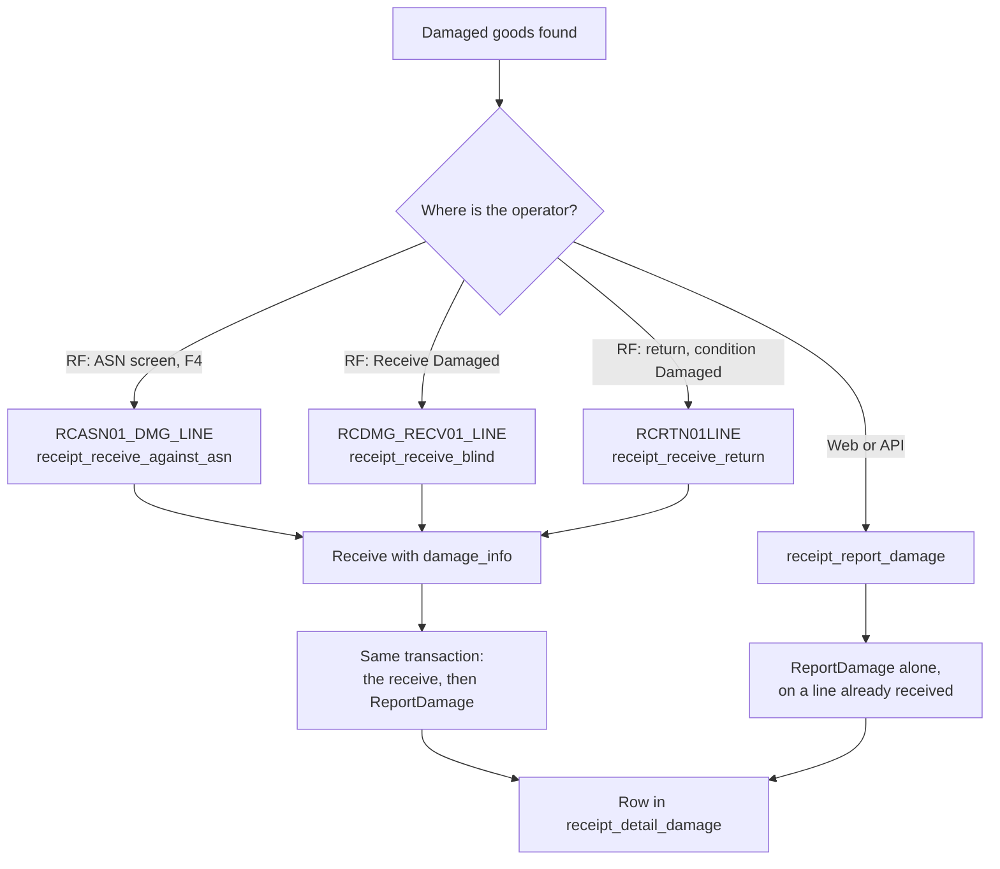
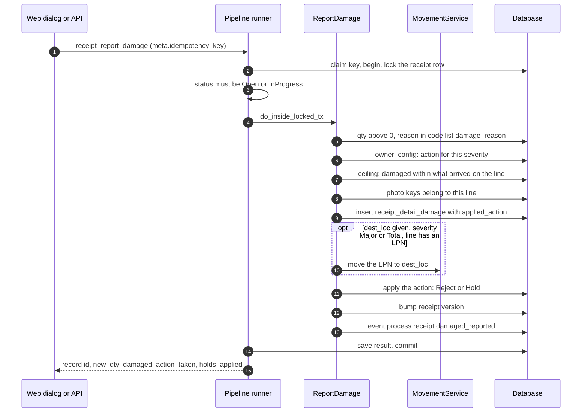
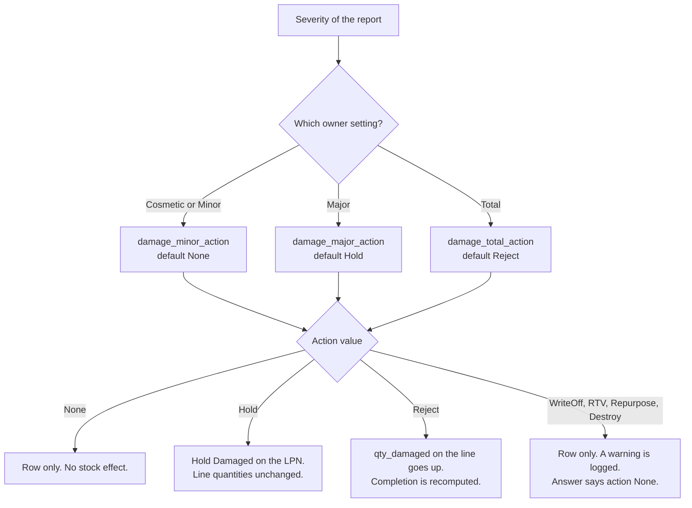
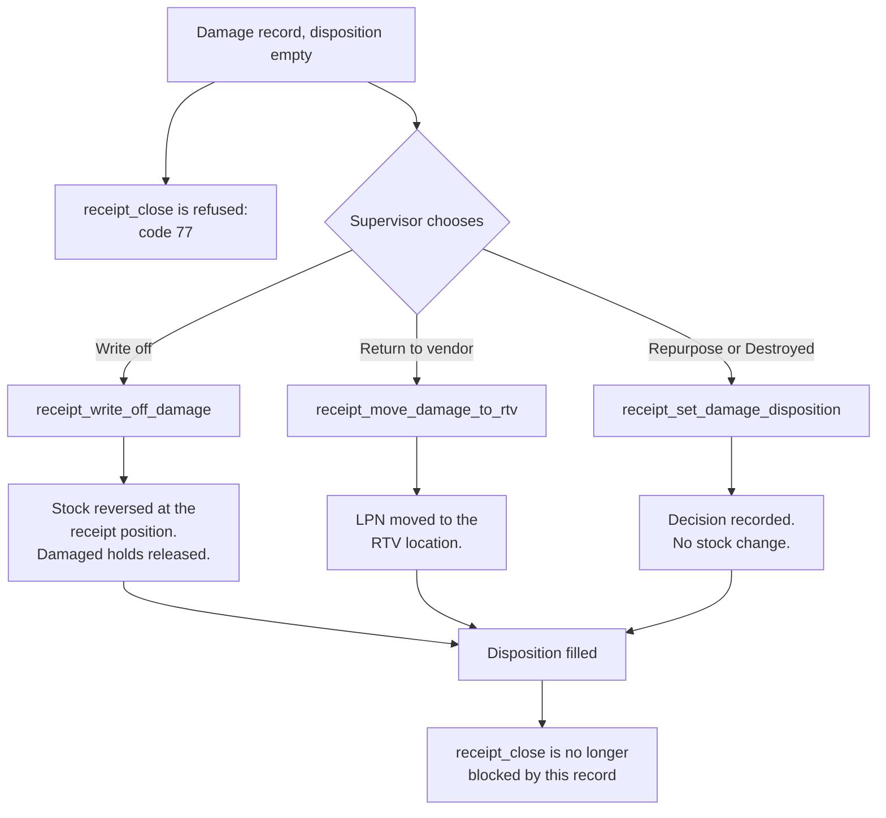

# Receiving: damaged goods

This page shows how damaged goods are recorded on a receipt, what the owner settings change, and how a damage record is closed out.

## Diagram 1. Four ways a damage record is made

**What this shows:** the places where damage enters the system and what each one calls.

Reading notes:

- The three RF screens send the receive and the damage together (`damage_info`: severity, reason, text, vendor responsibility). The server runs `ReportDamage` inside the receive transaction, after the receive is finished. The damaged quantity is the quantity of that receive.
- `receipt_report_damage` is not used by an RF screen. It is for the web damage dialog and for the API.
- The RF screens do not send a destination for a move. The stock stays where the operator put it (`dest_loc` is empty in the receive path).
- On the return path the report runs before the stock is deposited. A hold on the LPN would need the LPN to exist, so this ordering may skip the hold (see "Not confirmed").
- Only `Admin` and `Manager` may call `receipt_report_damage`, `receipt_write_off_damage`, `receipt_move_damage_to_rtv` and `receipt_set_damage_disposition`. The receives that carry `damage_info` are open to the floor roles for blind and return, and to `Admin` and `Manager` for the ASN receive.

### Where it comes from

| Item | Source |
|---|---|
| RF screens | `crates/libs/wms-lib-sql/sql/rf-screens/070_uc_asn_damage_hotkey.sql`, `crates/libs/wms-lib-sql/sql/rf-screens/060_uc_dmg_receive.sql:40-117`, `crates/libs/wms-lib-sql/sql/rf-screens/050_uc_rtn_declarative.sql:122-261` |
| The cascade into `ReportDamage` | `crates/libs/wms-inbound/src/service/receipt/damage/damage_info.rs:69-96` |
| ASN, blind, blind line callers | `crates/libs/wms-inbound/src/service/receipt/receive/receive_against_asn.rs:508-522`, `crates/libs/wms-inbound/src/service/receipt/receive/receive_blind.rs:361`, `crates/libs/wms-inbound/src/service/receipt/receive/receive_blind_line.rs:307` |
| Return caller (before the deposit) | `crates/libs/wms-inbound/src/service/receipt/receive/return_line_finalizer.rs:268-296` |
| Method classes and roles | `crates/services/app-server/src/web/rpcs/receipt_commands_rpc.rs:36-55`, `:263-345` |

## Diagram 2. Inside `receipt_report_damage`

**What this shows:** what one damage report does, in order, and which table each step writes.

Reading notes:

- The report has no version. Two reports on one receipt wait for each other on the receipt lock.
- The move (step 10) runs before the action (step 11). If the hold came first, the `Damaged` hold on the LPN would block the move that the same command asked for.
- `Major` moves to a location of type `QC`. `Total` moves to a location of type `Damage`. `Minor` and `Cosmetic` never move.
- The ceiling is "arrived on the line" minus "already reported". Arrived is `qty_received + qty_rejected + qty_damaged`, where the damaged part counts only reports that did not add themselves to the line.
- The action is stored on the row (`applied_action`) so that later reports still count correctly when the owner changes the setting.
- `vendor_responsibility` is only stored and sent in the data. No code branches on it.

### Where it comes from

| Step | Source |
|---|---|
| Whole command | `crates/libs/wms-inbound/src/service/receipt/damage/report_damage.rs:167-387` |
| Checks, reason list (step 5) | `crates/libs/wms-inbound/src/service/receipt/damage/report_damage.rs:173-200` |
| Owner action (step 6) | `crates/libs/wms-inbound/src/service/receipt/damage/report_damage.rs:222`, `:966-998` |
| Ceiling (step 7) | `crates/libs/wms-inbound/src/service/receipt/damage/report_damage.rs:241-261`, `:393-517` |
| Photos and the insert (steps 8 and 9) | `crates/libs/wms-inbound/src/service/receipt/damage/report_damage.rs:267-295` |
| The move (step 10) | `crates/libs/wms-inbound/src/service/receipt/damage/report_damage.rs:313`, `:929-964`, `crates/libs/wms-inbound/src/service/receipt/adapters/movement_damage_dispatcher.rs:30-80` |
| The action (step 11) | `crates/libs/wms-inbound/src/service/receipt/damage/report_damage.rs:319-332`, `:789-875` |
| Version bump and event (steps 12 and 13) | `crates/libs/wms-inbound/src/service/receipt/damage/report_damage.rs:345-377` |
| Destination type per severity | `crates/libs/wms-lib-core/src/model/receipt_detail_damage.rs:113-120` |
| Status allowed (`Open`, `InProgress`) | `crates/libs/wms-inbound/src/service/receipt/state_machine.rs:75-95` |

## Diagram 3. What the owner settings change

**What this shows:** how severity and the owner damage settings decide what happens to the stock.

| Setting | What it changes | What the operator or supervisor sees | Source |
|---|---|---|---|
| `owner_config.damage_minor_action`, `damage_major_action`, `damage_total_action` | The action for the severity. Without an `owner_config` row the defaults of the code apply: Minor and Cosmetic `None`, Major `Hold`, Total `Reject`. The database defaults are the same. | `action_taken` and `holds_applied` in the answer. | `crates/libs/wms-inbound/src/service/receipt/damage/report_damage.rs:966-998`, `crates/libs/wms-lib-sql/sql/wms-app/migrations/001_baseline.sql:3450-3452` |
| Action `Hold` | Puts a hold with code `Damaged` on the LPN of the line. No LPN on the line: no hold, no error. | `holds_applied` has one entry, or none. | `crates/libs/wms-inbound/src/service/receipt/damage/report_damage.rs:821-846`, `crates/libs/wms-inbound/src/service/receipt/lifecycle/auto_holds.rs:81-114` |
| Action `Reject` | Adds the quantity to the line `qty_damaged` and recomputes completion. | `new_qty_damaged` goes up. | `crates/libs/wms-inbound/src/service/receipt/damage/report_damage.rs:807-820` |
| Actions `WriteOff`, `RTV`, `Repurpose`, `Destroy` | Allowed in the setting, but not carried out. The damage is recorded and the answer says `None`. | `action_taken = None`. | `crates/libs/wms-inbound/src/service/receipt/damage/report_damage.rs:847-868`, `:882-890` |
| `dest_loc` in the request (not an owner setting) | Moves the whole LPN for Major (to type `QC`) and Total (to type `Damage`). | The LPN is at the new location. | `crates/libs/wms-inbound/src/service/receipt/damage/report_damage.rs:929-964` |

Reading notes:

- A `Hold` action holds the whole LPN, not only the damaged quantity. The hold code `Damaged` is seeded as blocking and not overridable, so the LPN cannot be put away or moved until the hold is released (the write-off releases it).
- The `Reject` action adds the quantity to `qty_damaged`. For an ASN receive with `damage_info`, the same quantity is already in `qty_received`. The two writers disagree (see the findings file).

## Diagram 4. How a damage record is closed out

**What this shows:** the three ways to give a damage record its final disposition, and how an open record blocks the close of the receipt.

Reading notes:

- Every damage record starts with an empty disposition. This includes `Minor` ones with action `None`. The close check counts every record with an empty disposition for the receipt.
- A disposition can be set once. A second try is refused.
- Write-off and RTV lock the damage record first. Set-disposition checks the record version (`expected_damage_version`, a `stateful_command`). The other two are `stateless_command`.
- The RTV destination is the typed location, or `owner_config.default_rtv_loc`, or `owner_config.default_returns_loc`. If none is set, the command is refused.
- The write-off sends the GL hint from the request, or `owner_config.write_off_gl_account_hint`. The RTV sends `owner_config.rtv_gl_account_hint`. They go into the event only.
- All three work after the receipt is closed. They do not use the receipt lock.

### Where it comes from

| Item | Source |
|---|---|
| Close check counts empty dispositions | `crates/libs/wms-inbound/src/queries/receipt/blockers.rs:35-55`, `crates/libs/wms-inbound/src/service/receipt/lifecycle/close_receipt.rs:164-181` |
| Write-off | `crates/libs/wms-inbound/src/service/receipt/damage/write_off_damage.rs:72-231` |
| RTV | `crates/libs/wms-inbound/src/service/receipt/damage/move_damage_to_rtv.rs:1-285` |
| Repurpose and Destroyed | `crates/libs/wms-inbound/src/service/receipt/damage/set_damage_disposition.rs:30-193` |
| Classes and versioned entity | `crates/services/app-server/src/web/rpcs/receipt_commands_rpc.rs:283-345` |
| Return code 77 name and number (`CannotCloseWithPendingDamage`) | `crates/libs/wms-shared/src/validation_codes.rs` |

## Not confirmed by code

- Whether the `Hold` action applies on the return path. `ReportDamage` runs before `deposit_return_line_and_echo`. The hold needs the LPN of the line, which exists only after the deposit. To verify: receive a return with condition `Damaged` and `damage_info`, with an LPN, and read `holds_applied`.
- What the web damage dialog sends for `dest_loc`. Only the API method and the helper query `receipt_damage_destination` were read.
- The effect of the damage `Hold` on a later putaway of the LPN. The generic hold gate of the move is on page 25.

## Related pages

- [Operator guide: damage and receipt close](../../operator/04-damage-and-receipt-close.md)
- [Reference: reporting damage](../../reference/inbound/39-reporting-damage.md)
- [Reference: damage records tab](../../reference/inbound/15-damage-records-tab.md)
- [Policy reference: owner settings](../../admin/policies/41-owner-settings-and-policy-resolution.md)
- [Blind receiving and returns](12-receive-blind-and-return.md)
- [Hold, adjust, close and cancel](16-hold-adjust-close-cancel.md)
- [The move](25-move-execute.md)
