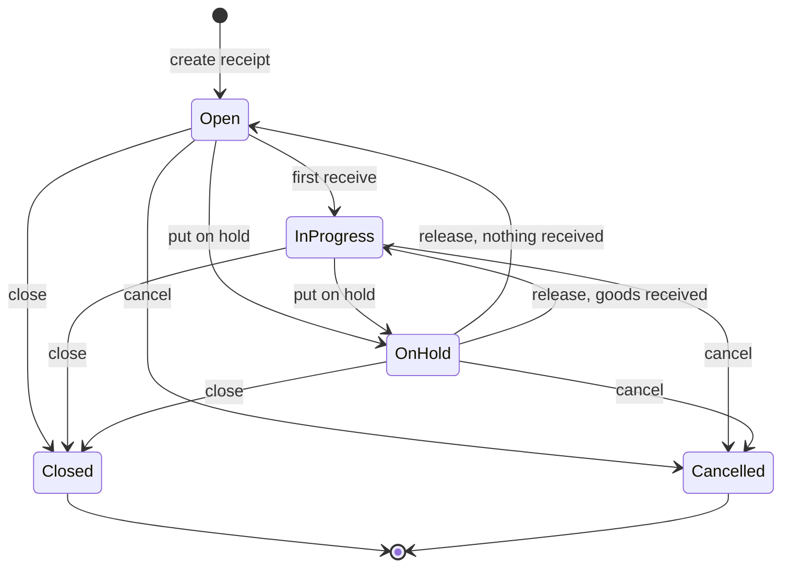
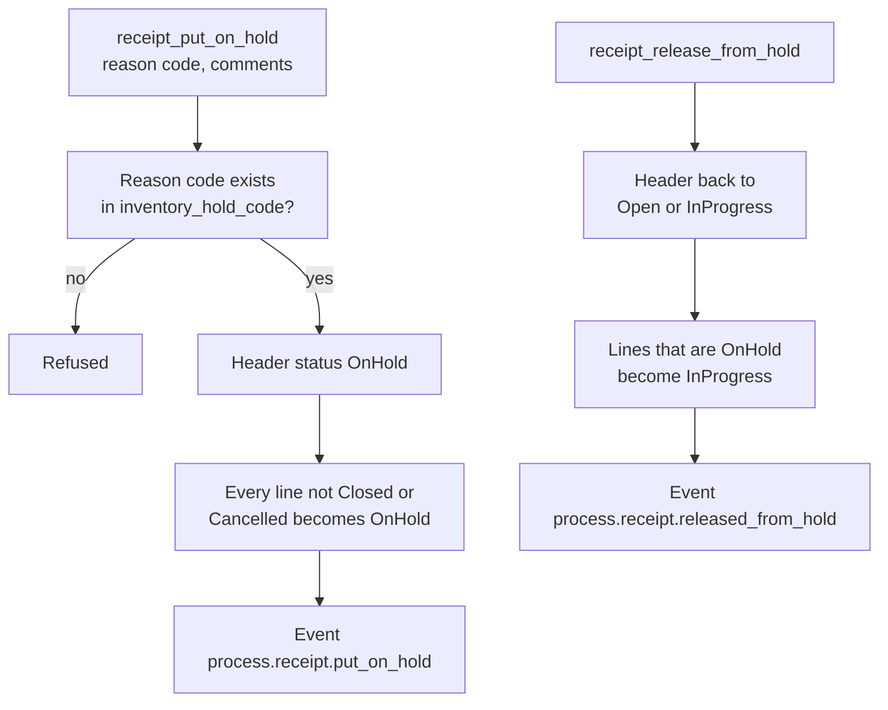
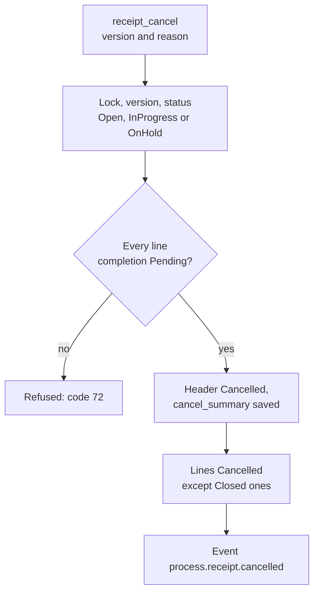
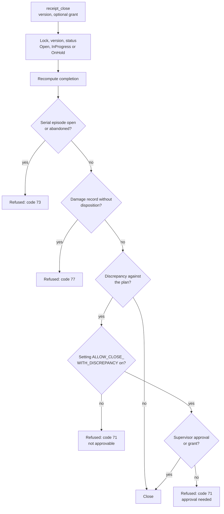
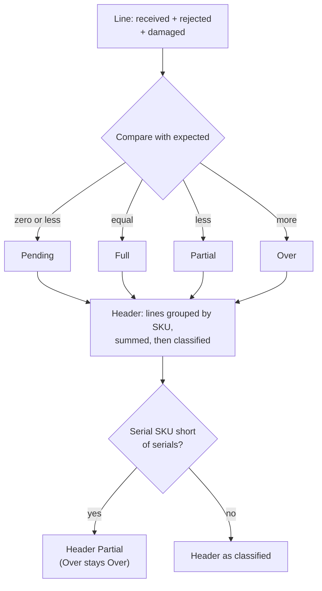
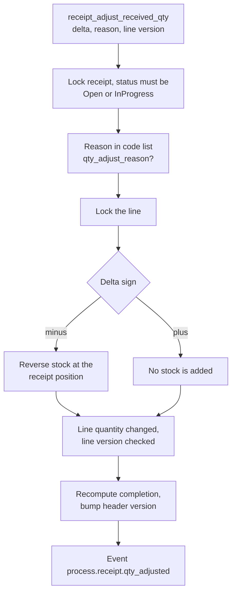

# Receipt life: hold, release, adjust, close and cancel

This page shows the statuses of a receipt, which command moves it from one to another, and what each command checks and writes.

## Diagram 1. Receipt statuses

**What this shows:** every status change a receipt can make, and the command that makes it.

Reading notes:

- Every change is proven by code: the aggregate methods `begin_receiving`, `put_on_hold`, `release_from_hold`, `close` and `cancel`. No other command changes the header status.
- A blind receipt and a return are made `Open` and move to `InProgress` in the same transaction as the first receive (page 10).
- `Closed` and `Cancelled` end the life of a receipt. All commands on this page refuse them. The damage dispositions (page 15) are the exception: they work on closed receipts.
- Receive is refused while `OnHold`. Adjust and damage reports are refused while `OnHold` too. Only release, cancel and close are allowed there.
- Release returns to `Open` when the header completion is `Pending` (nothing received), and to `InProgress` otherwise.
- The command checks happen in this order: lock the receipt row, compare the version (only for the commands that carry one), then check that the status allows the command.
- Releasing a receipt that is `Open` or `InProgress` is refused with an "invalid state" error. It is not a silent no-op (see the findings file).
- Putting a receipt on hold does not hold any stock. It changes the receipt and its lines only.

### Where it comes from

| Item | Source |
|---|---|
| Aggregate transitions | `crates/libs/wms-inbound/src/domain/receipt/aggregate.rs:139-184` (cancel), `:200-224` (close), `:237-252` (hold), `:281-299` (release), `:364-382` (first receive) |
| Which commands each status allows | `crates/libs/wms-inbound/src/service/receipt/state_machine.rs:71-99` |
| Lock, version, status order | `crates/libs/wms-inbound/src/service/receipt/shared/receipt_locking.rs:70-103` |
| Status list | `crates/libs/wms-lib-core/src/model/receipt/receipt.rs:43` |

## Diagram 2. What hold and release change

**What this shows:** the writes of `receipt_put_on_hold` and `receipt_release_from_hold`.

Reading notes:

- Both commands are `stateless_command`. They send no version.
- The reason code and the comments are checked and sent in the event. No column of the receipt keeps them.
- After a release of an untouched receipt the header is `Open`, but its lines are `InProgress` (see the findings file).
- There is no inventory hold in this flow. To hold stock, use the inventory hold function.
- On the web, the receipt list calls these commands for each selected receipt with a new key each time. A failure on one receipt does not stop the others.

### Where it comes from

| Item | Source |
|---|---|
| Put on hold | `crates/libs/wms-inbound/src/service/receipt/lifecycle/put_on_hold.rs:74-153` |
| Release | `crates/libs/wms-inbound/src/service/receipt/lifecycle/release_from_hold.rs:69-132` |
| Class `stateless_command` | `crates/services/app-server/src/web/rpcs/receipt_commands_rpc.rs:227-262` |
| Web batch release | `crates/services/web-ui-server/src/extensions/customization/receipt/lifecycle_action.rs:96-158` |
| Web list actions for hold, cancel, close | `crates/libs/wms-lib-sql/sql/wms-meta-ui/migrations/001_baseline.sql:5679-5684` |

## Diagram 3. When a receipt can be cancelled

**What this shows:** the one rule for `receipt_cancel` and what it writes.

Reading notes:

- "Pending" means nothing was received, rejected or damaged on the line. One received unit on one line is enough to refuse the cancel.
- `receipt_cancel` is a `stateful_command` on the receipt header. A stale version is refused with a version conflict (code 40) and the answer carries the current state.
- `cancel_summary` holds the time, the reason, the user and the number of lines.
- A receipt with received goods cannot be cancelled. The way out is to close it.

### Where it comes from

| Item | Source |
|---|---|
| Command | `crates/libs/wms-inbound/src/service/receipt/lifecycle/cancel_receipt.rs:77-158` |
| The all-Pending rule | `crates/libs/wms-inbound/src/domain/receipt/aggregate.rs:154-170` |
| Code 72 mapping | `crates/libs/wms-inbound/src/service/receipt/lifecycle/cancel_receipt.rs:164-187` |
| Class and versioned entity | `crates/services/app-server/src/web/rpcs/receipt_commands_rpc.rs:181-195` |

## Diagram 4. The gates of `receipt_close`

**What this shows:** the checks of one close, in order. The first one that fails stops the close.

Reading notes:

- The discrepancy question: completion `Partial` is always a discrepancy. `Over` and `Pending` are a discrepancy only when something was expected in total. A blind receipt or a return expects 0, so it closes without approval.
- The approval is the code 71 sent in `acknowledged_overrides` by a user with the capability `receipt.override_close_discrepancy` (supervisor only), or a supervisor grant for this receipt. A user without the capability who sends 71 is told to ask a supervisor.
- The RF close screen (`RCCLOSE`) sends only the grant. It has no field for acknowledged codes.
- A successful close writes: header `Closed` with `close_summary` and `close_date`, lines `Closed` (not the `Cancelled` ones), the events `process.receipt.closed` and `process.receipt.ready_for_putaway`.
- `close_summary` records who authorised the discrepancy (`discrepancy_override`: code, user, grant id).
- Nothing in the code reacts to `ready_for_putaway` except the dock-to-stock KPI. Closing a receipt does not create putaway work. Putaway starts when an operator scans the LPN (page 20).
- A line with fewer serials than due makes the line and the header `Partial` (page 14), so it needs the same approval.

### Where it comes from

| Item | Source |
|---|---|
| Whole command | `crates/libs/wms-inbound/src/service/receipt/lifecycle/close_receipt.rs:99-355` |
| Serial gate (`Open`, `InProgress`, `AwaitingConfirmation`, `Abandoned`) | `crates/libs/wms-inbound/src/service/receipt/lifecycle/close_receipt.rs:124-162`, `crates/libs/wms-lib-core/src/model/serial_capture/episode.rs:844-859` |
| Damage gate | `crates/libs/wms-inbound/src/service/receipt/lifecycle/close_receipt.rs:164-181`, `crates/libs/wms-inbound/src/queries/receipt/blockers.rs:35-55` |
| Discrepancy rule | `crates/libs/wms-inbound/src/repo/completion_compute.rs:236-245` |
| Setting and approval | `crates/libs/wms-inbound/src/service/receipt/lifecycle/close_receipt.rs:183-266` |
| Writes and events | `crates/libs/wms-inbound/src/service/receipt/lifecycle/close_receipt.rs:268-346` |
| RF close screens | `crates/libs/wms-lib-sql/sql/rf-screens/025_uc_receipt_close.sql:41-230` |
| Class and versioned entity | `crates/services/app-server/src/web/rpcs/receipt_commands_rpc.rs:198-218` |
| Only reader of `ready_for_putaway` | `crates/libs/wms-inbound/src/service/receipt/kpi.rs:91`, `crates/libs/wms-lib-core/src/model/integration/integration_event.rs:181-204` |

## Diagram 5. How completion is decided

**What this shows:** how the numbers on a line become `Pending`, `Partial`, `Full` or `Over`, and how lines become the header status.

Reading notes:

- Rejected and damaged units count as arrived. A line with 8 received and 2 damaged of 10 expected is `Full`.
- The header is grouped by SKU. A line received into two LPNs (a second synthetic line with expected 0) does not make the header `Over` when the sum matches.
- For a serial SKU, a line is lowered from `Full` to `Partial` when the registered serials are fewer than due.
- The values are stored on the line and on the header. The close recomputes them first.

### Where it comes from

| Item | Source |
|---|---|
| Classification and header rule | `crates/libs/wms-inbound/src/repo/completion_compute.rs:28-121`, `:159-200` |
| Serial coverage downgrade | `crates/libs/wms-inbound/src/repo/completion.rs:48-125`, `:257-287` |

## Diagram 6. Adjusting a received quantity

**What this shows:** what `receipt_adjust_received_qty` does for a plus or a minus.

Reading notes:

- The line carries its own version (`expected_line_version`). Two operators adjusting different lines do not collide. The receipt version is not checked.
- The minus reverses only stock that is still free at the place where the goods were received. If the pallet has been put away or moved, the correction is still allowed. It takes what is left there. The preview warns about this.
- A minus is refused when the stock is reserved or picked, or when it is more than the first deposit.
- The plus changes `qty_received` only. No stock is made (see the findings file).
- The result holds the new line version and the new header version. A later close must use the new header version.
- Operators with the floor roles may adjust. The reason, and the quantity left off the plan, meet the supervisor at close.

### Where it comes from

| Item | Source |
|---|---|
| Command | `crates/libs/wms-inbound/src/service/receipt/receive/adjust_received_qty.rs:164-349` |
| Preview and warning | `crates/libs/wms-inbound/src/service/receipt/receive/adjust_received_qty.rs:57-109` |
| Reverse of stock and its blockers | `crates/libs/wms-inventory/src/inventory_service.rs:79-138`, `:2173-2260` |
| Class, versioned entity and roles | `crates/services/app-server/src/web/rpcs/receipt_commands_rpc.rs:46-55`, `:151-180` |
| RF screens `RCADJ01`, `RCADJ02` | `crates/libs/wms-lib-sql/sql/rf-screens/027_uc_receipt_adjust.sql:1-198` |

## Not confirmed by code

- What a web user sees when they release a receipt that is not on hold. The command refuses; the web action collects the message with `operator_message`. To verify: select an open receipt and press Release.
- Whether a form in the web UI lets a user cancel a receipt with a typed reason. The list action exists in the metadata (`receipt_cancel`); its dialog was not read.
- The exact texts of codes 40, 71, 72, 73 and 77 on screen. To verify: the return code reference.

## Related pages

- [Reference: receipt statuses and transitions](../../reference/inbound/90-receipt-statuses-and-transitions.md)
- [Reference: closing a receipt](../../reference/inbound/42-closing-a-receipt.md)
- [Reference: cancelling a receipt](../../reference/inbound/43-cancelling-a-receipt.md)
- [Reference: putting a receipt on hold](../../reference/inbound/40-putting-a-receipt-on-hold.md)
- [Reference: adjusting received quantity](../../reference/inbound/38-adjusting-received-quantity.md)
- [Operator guide: damage and receipt close](../../operator/04-damage-and-receipt-close.md)
- [Damage](15-damage.md)
- [Serial numbers, lots and LPNs](14-serials-lots-lpn.md)
- [Putaway journey](20-putaway-journey.md)
