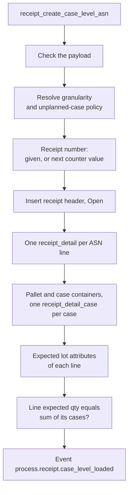
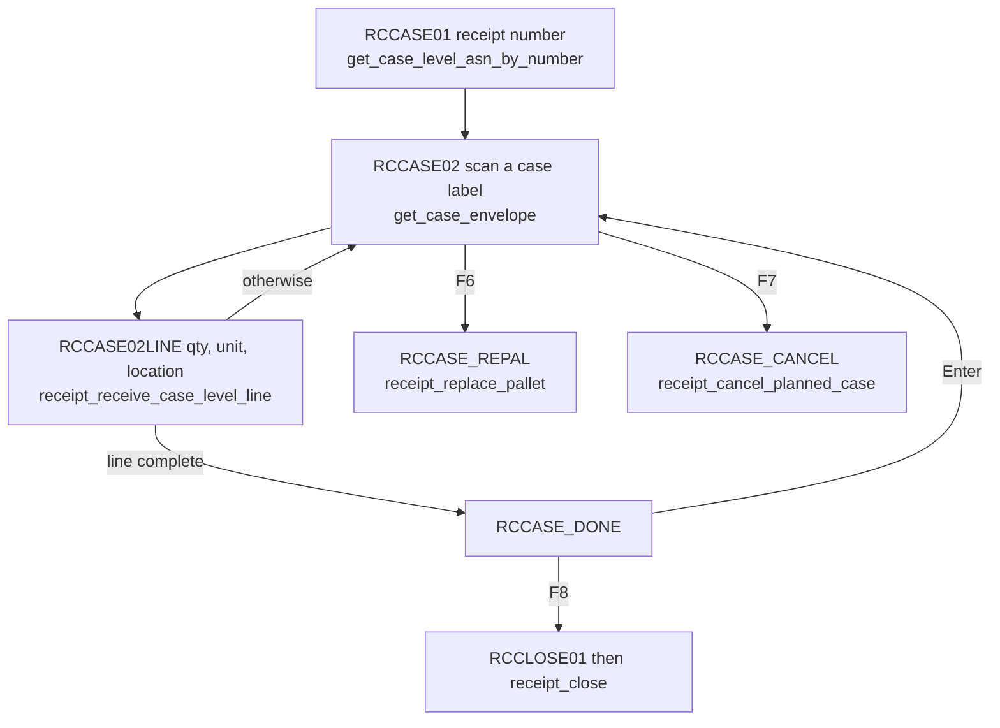
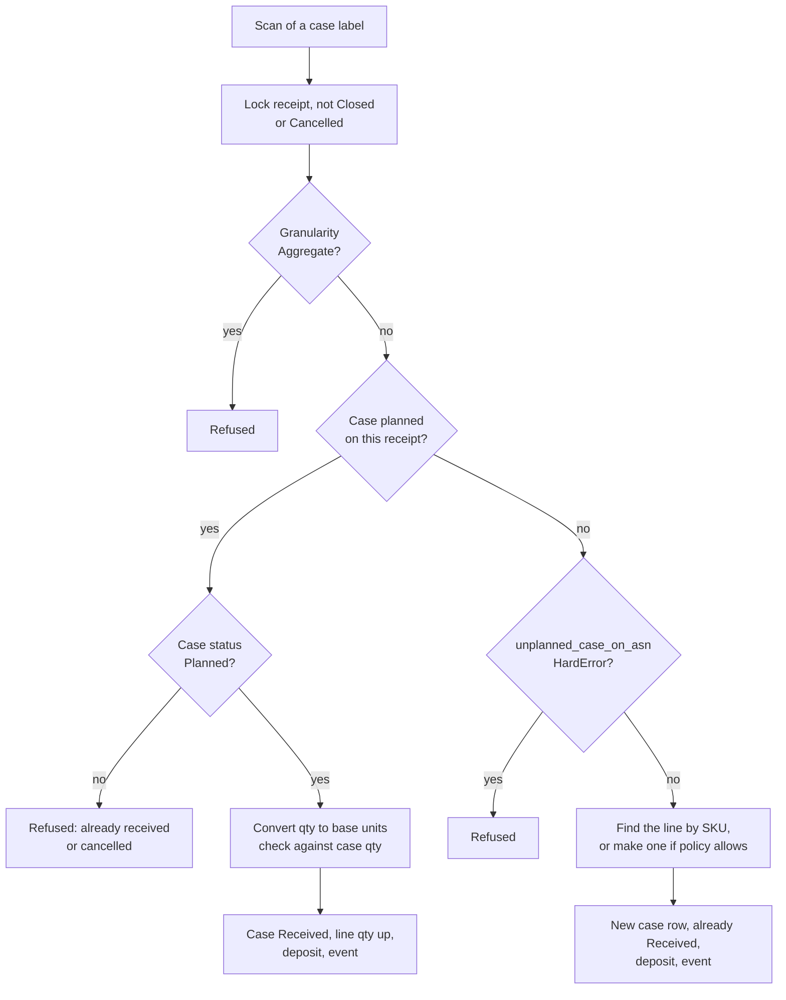
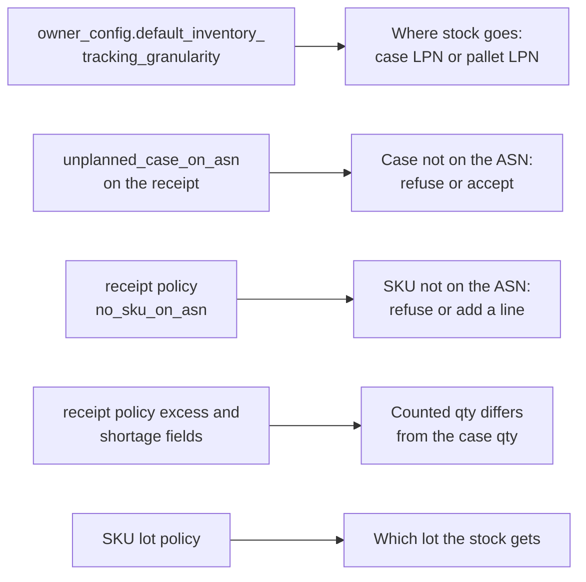
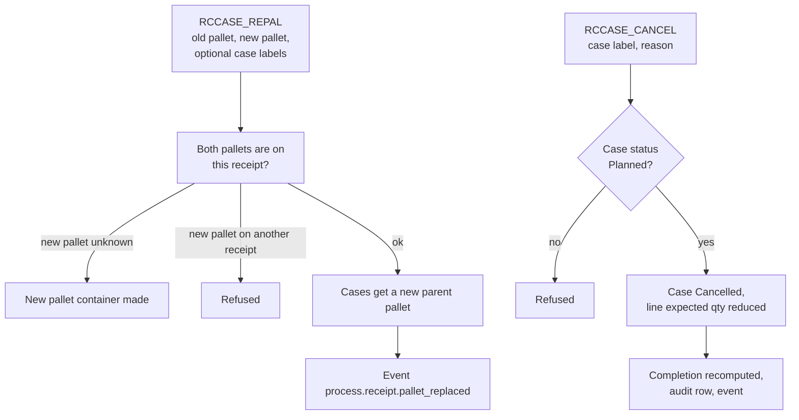

# Receiving case by case

In case-level receiving the supplier announces every pallet and every case on the ASN. The operator scans one case label at a time. This page shows how such a receipt is made, how one scan is handled, and which settings change the result.

## Diagram 1. Loading a case-level ASN

**What this shows:** what `receipt_create_case_level_asn` checks and writes. It is one transaction. No RF screen calls it; it is an API method for the ERP.

Reading notes:

- The payload check refuses: an owner that does not exist or is not of type `Own`; no lines; a line with no pallets; a pallet with no cases; a blank SKU, pallet code or case label; a pallet code or case label used twice in the payload; a case with expected quantity of 0 or less; a SKU that does not exist for the owner.
- Granularity is the first value found of: the payload, `owner_config.default_inventory_tracking_granularity`, and at last `Aggregate`. The code has a slot for an operator choice, but it always passes none.
- The unplanned-case policy (what to do with a scanned case that is not on the ASN) is the first value found of: the payload and `owner_config.default_unplanned_case_on_asn`. If the granularity is `Pallet` or `Case` and none is found, the load is refused. With `Aggregate` the policy is ignored.
- Both values are saved on the receipt header and do not change later.
- The method is a `stateless_command`, open to `Admin` and `Manager`.

### Where it comes from

| Item | Source |
|---|---|
| Steps | `crates/libs/wms-inbound/src/service/receipt/case_level/commands/create_case_level_asn.rs:230-315` |
| Payload check | `crates/libs/wms-inbound/src/service/receipt/case_level/commands/create_case_level_asn.rs:650-752` |
| The two cascades | `crates/libs/wms-inbound/src/service/receipt/case_level/commands/create_case_level_asn.rs:173-214`, `:341-370` |
| Containers and case rows | `crates/libs/wms-inbound/src/service/receipt/case_level/commands/create_case_level_asn.rs:484-620` |
| Roles and class | `crates/services/app-server/src/web/rpcs/case_level_commands_rpc.rs:17-45` |

## Diagram 2. The RF screens

**What this shows:** the RF screens of case-level receiving and the method each one calls.

Reading notes:

- `RCCASE01` refuses a receipt whose granularity is not exactly `Case`. A `Pallet` receipt is told to use "Receive Against ASN".
- After each scan the screen goes back to `RCCASE02`. When the response says `line_complete`, it goes to `RCCASE_DONE` first.
- On `RCCASE02`, `F2` on the Case field lists the receipt's unreceived cases (`find_unreceived_cases`). The picker `RCCASE_LIST`, which nothing opened, was removed (F-31, rf-screens 121).
- Closing uses the normal close screens (page 16).

### Where it comes from

| Item | Source |
|---|---|
| Screens `RCCASE01`, `RCCASE02`, `RCCASE02LINE`, `RCCASE_DONE` | `crates/libs/wms-lib-sql/sql/rf-screens/080_uc_case_level_declarative.sql:41`, `:128`, `:268`, `:419`, `:487` |
| Screens `RCCASE_REPAL`, `RCCASE_CANCEL` | `crates/libs/wms-lib-sql/sql/rf-screens/085_uc_case_level_exceptions.sql:34`, `:107` |
| Granularity gate of the entry screen | `crates/services/app-server/src/web/rpcs/case_level_rpc.rs:443-473` |

## Diagram 3. What one scan does

**What this shows:** how `receipt_receive_case_level_line` treats a scanned case label.

Reading notes:

- The planned path: `qty` in unit `CS` is multiplied by the planned quantity of that case. Any other unit is taken as base units. If the result differs from the planned case quantity, the policy check of Diagram 4 runs.
- The unplanned path needs the SKU in the request. It does not convert units: the typed `qty` is used as it is, even when the unit is `CS` (see the findings file).
- Both paths deposit through `DepositService`. With granularity `Case`, the stock goes on the case container. With `Pallet`, it goes on the parent pallet.
- The lot attributes typed by the operator are merged over the expected ones of the line. The operator value wins.
- A case in the unplanned path gets no parent pallet. `RCCASE_REPAL` can place it later.
- After a planned scan the case and its pallet become `Active`, the line copies the location, pallet and unit, and the event `process.receipt.case_received` is published.
- `line_complete` is true when the line `qty_received` is at least `qty_expected`.
- The 12 rules of page 13, serial capture, auto holds and damage information are not part of this command.
- The scan does not change the receipt status, the line status or the completion. They are recomputed by `receipt_close` (see the findings file).

### Where it comes from

| Item | Source |
|---|---|
| Body of the command | `crates/libs/wms-inbound/src/service/receipt/case_level/commands/receive_case_level_line.rs:193-292` |
| Header lock (not terminal only) | `crates/libs/wms-inbound/src/service/receipt/shared/receipt_locking.rs:42-60`, `crates/libs/wms-inbound/src/service/receipt/case_level/commands/receive_case_level_line.rs:651-666` |
| Planned case commit | `crates/libs/wms-inbound/src/service/receipt/case_level/commands/receive_case_level_line.rs:313-449` |
| Unit conversion | `crates/libs/wms-inbound/src/service/receipt/case_level/commands/receive_case_level_line.rs:555-564` |
| Quantity check and grant | `crates/libs/wms-inbound/src/service/receipt/case_level/commands/receive_case_level_line.rs:580-641` |
| Deposit and LPN choice | `crates/libs/wms-inbound/src/service/receipt/case_level/commands/receive_case_level_line.rs:758-783`, `:817-960` |
| Line quantity update | `crates/libs/wms-inbound/src/service/receipt/case_level/commands/receive_case_level_line.rs:969-983`, `crates/libs/wms-lib-core/src/model/receipt/receipt_detail.rs:673-691` |
| Unplanned path | `crates/libs/wms-inbound/src/service/receipt/case_level/commands/receive_case_level_line.rs:1011-1244` |
| Roles and class | `crates/services/app-server/src/web/rpcs/case_level_commands_rpc.rs:17-62` |

## Diagram 4. What the settings change

**What this shows:** which setting decides each outcome of a scan, and what the operator sees.

| Setting | What it changes | What the operator sees | Source |
|---|---|---|---|
| Receipt granularity `Aggregate`, `Pallet`, `Case` | `Aggregate`: case scans are refused. `Case`: stock on the case container. `Pallet`: stock on the parent pallet. The RF entry screen accepts only `Case`. | A refusal text on `RCCASE01` or `RCCASE02LINE`. | `crates/libs/wms-inbound/src/service/receipt/case_level/commands/receive_case_level_line.rs:211-219`, `:758-783`, `crates/services/app-server/src/web/rpcs/case_level_rpc.rs:457-473` |
| `unplanned_case_on_asn` (`Allow`, `Warning`, `HardError`) | `HardError` refuses a case that is not on the ASN. `Allow` and `Warning` both accept it. `Warning` asks nothing. | A refusal, or a received case that is marked unplanned. | `crates/libs/wms-inbound/src/service/receipt/case_level/commands/receive_case_level_line.rs:1011-1035` |
| `receipt_policy.no_sku_on_asn` | For an unplanned case whose SKU has no line: `HardError` refuses. Other values make a new line. | A refusal naming the policy. | `crates/libs/wms-inbound/src/service/receipt/case_level/commands/receive_case_level_line.rs:1112-1138` |
| `excess_error` and `excess_error_percent` | A planned case counted above the plan by more than the percent is refused. Not approvable. | Code 27, no approval. | `crates/libs/wms-inbound/src/service/receipt/validation/rules/case_qty.rs:40-62` |
| `excess_override` and `excess_override_percent` | Above this percent the scan needs an approval. | Code 27, "Receive Anyway?". | `crates/libs/wms-inbound/src/service/receipt/validation/rules/case_qty.rs:63-75` |
| `shortage_override` and `shortage_override_percent` | A case counted short by more than the percent needs an approval. | Code 28, "Receive Anyway?". | `crates/libs/wms-inbound/src/service/receipt/validation/rules/case_qty.rs:77-89` |
| SKU lot policy `lot_creation` and attributes | As on page 14. Attributes typed at the scan are merged over the expected ones. | Lot attribute prompts on `RCCASE02LINE`. | `crates/libs/wms-inventory/src/deposit/deposit.rs:710-797` |

Reading notes:

- The quantity check is skipped when the counted quantity equals the planned case quantity, or when the planned case quantity is 0 or less.
- Codes 27 and 28 need the capability for the code (supervisor), or a supervisor grant for the line of the case. The grant must name `receipt:<id>/line:<detail id>`.
- There is no shortage error percent. A case that is short is refused only through `shortage_override`.
- `receipt_without_asn`, `receipt_without_po` and the PO fields are not read here either (page 13).

### Where it comes from

| Item | Source |
|---|---|
| Check of the quantity | `crates/libs/wms-inbound/src/service/receipt/validation/validation_qty.rs:463-483`, `crates/libs/wms-inbound/src/service/receipt/validation/rules/case_qty.rs:40-91` |
| Grant subject for a case | `crates/libs/wms-inbound/src/service/receipt/case_level/commands/receive_case_level_line.rs:123-142`, `:598-608` |
| Code numbers | `crates/libs/wms-shared/src/validation_codes.rs` (`QtyExcess` = 27, `QtyShortage` = 28) |

## Diagram 5. Exceptions: move cases, cancel a case

**What this shows:** the two exception commands and what each one changes.

Reading notes:

- `receipt_replace_pallet` changes only the link between the case and its pallet. It does not look at the case status. It does not move stock and it does not change the location of the containers.
- With a list of case labels, every label must be on the old pallet. If one is not, the whole call fails.
- `receipt_cancel_planned_case` needs a reason. The reason is saved in `receipt_audit` and in the event. The case container is kept.
- The cancelled case no longer counts in the parent line's expected quantity. The command bumps the line version and recomputes line/header completion in the same transaction.
- Closing a receipt marks case rows still in `Planned` as `NotReceived`. Their planned container rows are retained for audit and later disposal hygiene.
- Roles: move cases is open to the floor roles. Cancel a case is for `Supervisor`, `Manager` and `Admin`.

### Where it comes from

| Item | Source |
|---|---|
| Move cases | `crates/libs/wms-inbound/src/service/receipt/case_level/commands/replace_pallet.rs:101-266`, `crates/libs/wms-lib-core/src/model/container/container.rs:1365-1380`, `:1897-1918` |
| Cancel a case | `crates/libs/wms-inbound/src/service/receipt/case_level/commands/cancel_planned_case.rs:60-185` |
| Roles | `crates/services/app-server/src/web/rpcs/case_level_commands_rpc.rs:17-25` |

## Not confirmed by code

- How the web UI shows case-level receipts. Only the API and the RF screens were read. To verify: open a case-level receipt in the receipt screen.
- `Pallet`-granularity receipts use the same RF case-scan flow as `Case`: both modes keep the per-case audit trail. Their inventory deposit differs after the scan (`Pallet` consolidates stock under the pallet; `Case` keeps case-level balances). `Aggregate` remains in Receive Against ASN.
- Whether the `Warning` value of `unplanned_case_on_asn` is meant to prompt the operator. The code treats it like `Allow`.

## Related pages

- [Reference: expected boxes tab](../../reference/inbound/16-expected-boxes-tab.md)
- [Reference: moving and cancelling expected boxes](../../reference/inbound/44-moving-and-cancelling-expected-boxes.md)
- [Policy reference: receipt policy settings](../../admin/policies/40-receipt-policy-settings.md)
- [Ways a receipt starts](10-receiving-ways-to-start.md)
- [Receive checks and receipt policy](13-receive-checks-and-policy.md)
- [Serial numbers, lots and LPNs](14-serials-lots-lpn.md)
- [Hold, adjust, close and cancel](16-hold-adjust-close-cancel.md)
