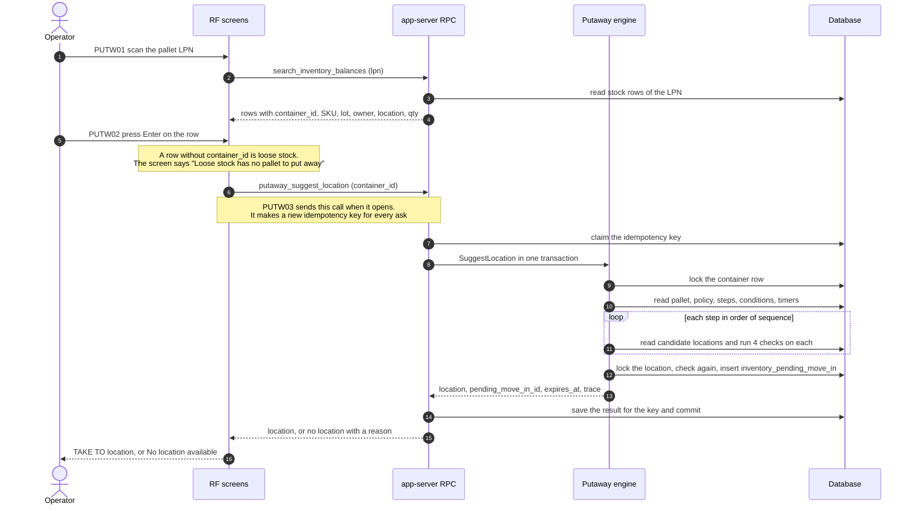
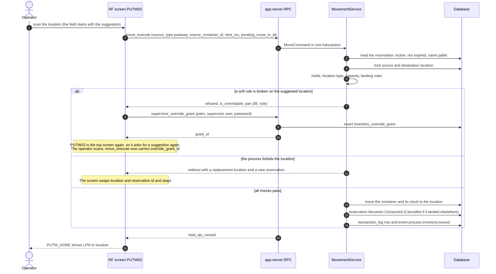

# Putaway: from the scanned pallet to the new location

Putaway on the RF terminal has two calls: ask where the pallet goes, then move it there.
Both diagrams below use the screens `PUTW01`, `PUTW02`, `PUTW03`, `PUTW_OVR` and `PUTW_DONE`.
Where the code says nothing, this page says nothing. The sections "Not confirmed by code" list what is left out.

## Diagram 1. Ask where the pallet goes

**What this shows:** which screen calls which API method, what the engine reads and writes, and what the operator sees when the answer comes back.

Reading notes:

- The loop stops at the first step that returns a location. If no step returns one, the answer is "no location" with the reason `no_eligible_location`, or `pallet_already_reserved` when another request holds the pallet's reservation right now.
- The reason is shown on `PUTW03` as `No location available: <reason> - Esc to give up`. The text is the raw code.
- The screen keeps `pending_move_in_id` and sends it in the next call (Diagram 2).
- If the operator presses Esc while a reservation exists, the screen asks "Give up this putaway?" and then calls `putaway_release_reservation`.

### Where it comes from

| Step | Source |
|---|---|
| Screens, fields, next screen | `crates/libs/wms-lib-sql/sql/rf-screens/093_uc_putaway.sql:100-149` (PUTW01), `:164-228` (PUTW02), `:253-385` (PUTW03) |
| PUTW02 picker calls `search_inventory_balances`; loose stock refusal | `crates/libs/wms-lib-sql/sql/rf-screens/093_uc_putaway.sql:172-205` |
| PUTW03 calls `putaway_suggest_location` when it opens (prefetch) | `crates/libs/wms-lib-sql/sql/rf-screens/093_uc_putaway.sql:262-270` |
| Esc: confirm, then `putaway_release_reservation` | `crates/libs/wms-lib-sql/sql/rf-screens/093_uc_putaway.sql:329-347` |
| API method and class (`stateless_command`, needs a key) | `crates/services/app-server/src/web/rpcs/putaway_rpc.rs:73` |
| Release method | `crates/services/app-server/src/web/rpcs/putaway_rpc.rs:166` |
| Search method used by the picker | `crates/services/app-server/src/web/rpcs/inventory_search_rpc.rs:41` |
| Key claim, one transaction, save result, commit | `crates/libs/wms-shared/src/pipeline_runner.rs:267-323`, `:326-415` |
| Command wrapper and reasons | `crates/libs/wms-inventory/src/putaway/command.rs:196`, `:56-61` |
| Engine: lock container, load pallet, policy, steps | `crates/libs/wms-inventory/src/putaway/mod.rs:793-905` |
| Step loop | `crates/libs/wms-inventory/src/putaway/mod.rs:908-1290` |
| Lock location, check again, insert the reservation | `crates/libs/wms-inventory/src/putaway/reserve.rs:118-240` |

## Diagram 2. Take the pallet there

**What this shows:** what `move_execute` does when the operator scans the location, and the three ways it can end: done, "a supervisor must approve", or "go to another location".

Reading notes:

- A soft rule is one of: `capacity`, `loc_type`, `sku_mixing`, `lot_mixing`, `multi_lot_on_lpn`, `attribute_mixing`. The operator may confirm past them only for the location the engine chose. If the operator scans a different location, the ordinary rules apply in full and the move is refused.
- A redirect is raised only when the destination is the reserved location and it is blocked by an inventory hold, does not exist, or is inactive. The replacement is the nearest usable location (`NearestTo`) and it is reserved in a second transaction after the move has rolled back.
- When the pallet lands in a location other than the reserved one, the reservation is set to `Cancelled`. When it lands in the reserved one, it is set to `Consumed`.
- If the system setting `COUNT_ON_PUTAWAY_DEVIATION` is `1` and the move landed through an acknowledged deviation, the destination is queued for a count (event `process.inventory.count_requested`).
- `PUTW03` asks for a suggestion every time it becomes the top screen, also when `PUTW_OVR` returns to it. Each ask cancels the pallet's earlier live reservation and may insert a new one. The grant stays in `globals.grant_id`.
- The full order of checks inside the move is on [25-move-execute.md](25-move-execute.md).

### Where it comes from

| Step | Source |
|---|---|
| PUTW03 payload for `move_execute` | `crates/libs/wms-lib-sql/sql/rf-screens/093_uc_putaway.sql:260-285` |
| Success, redirect, override and plain error routing | `crates/libs/wms-lib-sql/sql/rf-screens/093_uc_putaway.sql:286-328` |
| PUTW_OVR calls `supervisor_override_grant` | `crates/libs/wms-lib-sql/sql/rf-screens/093_uc_putaway.sql:401-460` |
| PUTW_DONE (Enter goes to PUTW01, Esc to INVM) | `crates/libs/wms-lib-sql/sql/rf-screens/093_uc_putaway.sql:488-531` |
| `move_execute` (`stateless_command`, needs a key) | `crates/services/app-server/src/web/rpcs/move_command_rpc.rs:94` |
| `supervisor_override_grant` | `crates/services/app-server/src/web/rpcs/override_grant_rpc.rs:103` |
| Order of work in the move | `crates/libs/wms-inventory/src/movement/service.rs:198-906` |
| Reservation must be live and for this pallet | `crates/libs/wms-inventory/src/movement/directed.rs:300-346` |
| Consumed or Cancelled when the pallet lands | `crates/libs/wms-inventory/src/movement/directed.rs:400-421` |
| Soft rules and redirects | `crates/libs/wms-inventory/src/movement/directed.rs:187-261` |
| Replacement location after the rollback | `crates/libs/wms-inventory/src/movement/commands/move_command.rs:132-296` |
| Count queued after a deviation | `crates/libs/wms-inventory/src/movement/service.rs:869-891` |
| The suggestion is asked again when PUTW03 returns to the top; new key each time | `clients/rf-go/internal/app/model.go:4324-4332`, `:4356-4363`, `:4809-4813` |

## Tables written

| Table or stream | When | Source |
|---|---|---|
| `idempotency_store` | both calls | `crates/libs/wms-shared/src/pipeline_runner.rs:267-323` |
| `inventory_pending_move_in` | the suggestion inserts `Active`; the move, the release call and the sweeper change the status | `crates/libs/wms-inventory/src/putaway/reserve.rs:185-215`, `crates/libs/wms-lib-core/src/model/inventory/pending_move_in.rs:589-700` |
| `container` and `inventory_balances` (new location) | the move | `crates/libs/wms-inventory/src/adapters/postgres/for_moving_container.rs:53-150` |
| `transaction_log` | the move, one row per line | `crates/libs/wms-inventory/src/movement/side_effects.rs:290-352` |
| `enterprise.integration_event` | the move (`process.inventory.moved`) | `crates/libs/wms-inventory/src/adapters/postgres/for_publishing_domain_events.rs:29-41` |
| location holds `LocBlocked` | the move, only for oversize goods (`positions_required` above 1) | `crates/libs/wms-inventory/src/putaway/section_holds.rs:101-150` |
| `inventory_override_grant` | after a supervisor approval | `crates/libs/wms-inventory/src/movement/override_grant.rs:37` |

## Not confirmed by code

- Which roles may press these buttons on the RF. The method table in `putaway_rpc.rs:41-52` lists `Admin` and `Manager` for `putaway_suggest_location`, and the operator guide says Operator and Supervisor run putaway. Role grants are also seeded in the database. To verify: log in as an Operator on RF and run `PUTW01`.
- Whether the second suggestion after an override names the same location as the first. The engine is deterministic for the same data, but stock and reservations can change between the two asks. To verify: run an override on a test pallet and compare `suggested_loc` before and after.
- What `PUTW03` sends when Esc is pressed and the screen holds no reservation (`pending_move_in_id` empty). The screen JSON passes the empty value to `putaway_release_reservation`. To verify: press Esc on a "No location available" screen and read the server log.

## Related pages

- [Operator guide: Putaway](../../operator/05-putaway.md)
- [Putaway pipeline, step by step](21-putaway-engine-steps.md)
- [What each setting changes (policy and step)](22-putaway-influence-step-settings.md)
- [What each setting changes (master data)](23-putaway-influence-master-data.md)
- [Reservation life cycle, timers and what the operator sees](24-putaway-reservation-and-refusals.md)
- [Policy reference: putaway overview](../../admin/policies/00-putaway-overview.md)
