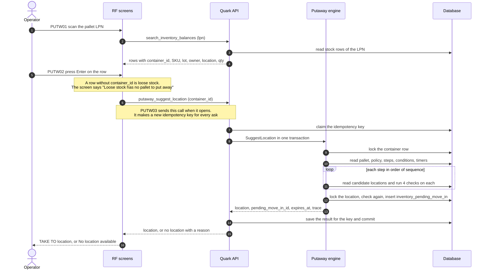
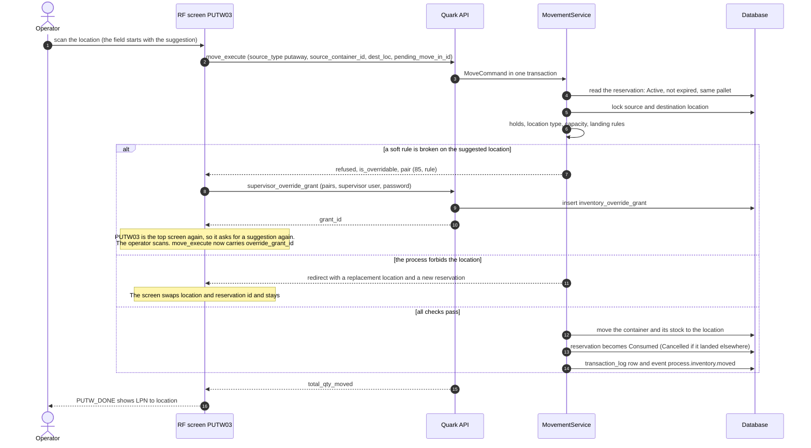

# Putaway: from the scanned pallet to the new location

Putaway on the RF terminal has two calls: ask where the pallet goes, then move it there.
Both diagrams below use the screens `PUTW01`, `PUTW02`, `PUTW03`, `PUTW_OVR` and `PUTW_DONE`.

## Diagram 1. Ask where the pallet goes

**What this shows:** which screen calls which API method, what the engine reads and writes, and what the operator sees when the answer comes back.

Reading notes:

- The loop stops at the first step that returns a location. If no step returns one, the answer is "no location" with the reason `no_eligible_location`, or `pallet_already_reserved` when another request holds the pallet's reservation right now.
- The reason is shown on `PUTW03` as `No location available: <reason> - Esc to give up`. The text is the raw code.
- The screen keeps `pending_move_in_id` and sends it in the next call (Diagram 2).
- If the operator presses Esc while a reservation exists, the screen asks "Give up this putaway?" and then calls `putaway_release_reservation`.
## Diagram 2. Take the pallet there

**What this shows:** what `move_execute` does when the operator scans the location, and the three ways it can end: done, "a supervisor must approve", or "go to another location".

Reading notes:

- A soft rule is one of: capacity, location type, SKU mixing, lot mixing,
  several lots on one LPN, or attribute mixing. The operator may confirm past
  it only for the suggested location. Scanning another location runs the
  ordinary checks in full.
- If the reserved destination becomes unavailable, Quark can redirect the
  pallet to the nearest usable location and reserve the replacement.
- When the pallet lands in a location other than the reserved one, the reservation is set to `Cancelled`. When it lands in the reserved one, it is set to `Consumed`.
- If the system setting `COUNT_ON_PUTAWAY_DEVIATION` is `1` and the move landed through an acknowledged deviation, the destination is queued for a count (event `process.inventory.count_requested`).
- `PUTW03` requests a fresh suggestion whenever the operator returns to it.
  The previous live reservation is cancelled before a replacement is made.
- See [Move execution checks](25-move-execute.md) for the order of validations.
## Related pages

- [Operator guide: Putaway](../../operator/05-putaway.md)
- [Putaway pipeline, step by step](21-putaway-engine-steps.md)
- [What each setting changes (policy and step)](22-putaway-influence-step-settings.md)
- [What each setting changes (master data)](23-putaway-influence-master-data.md)
- [Reservation life cycle, timers and what the operator sees](24-putaway-reservation-and-refusals.md)
- [Policy reference: putaway overview](../../admin/policies/00-putaway-overview.md)
