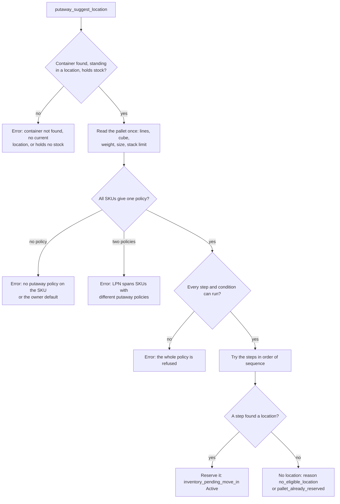
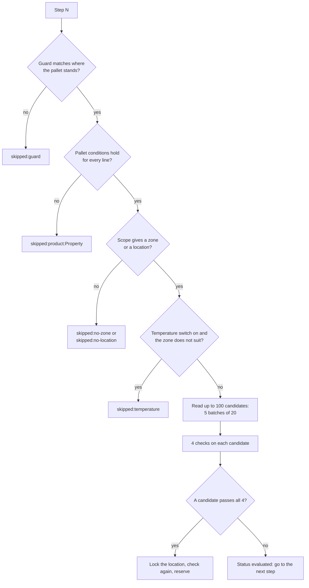
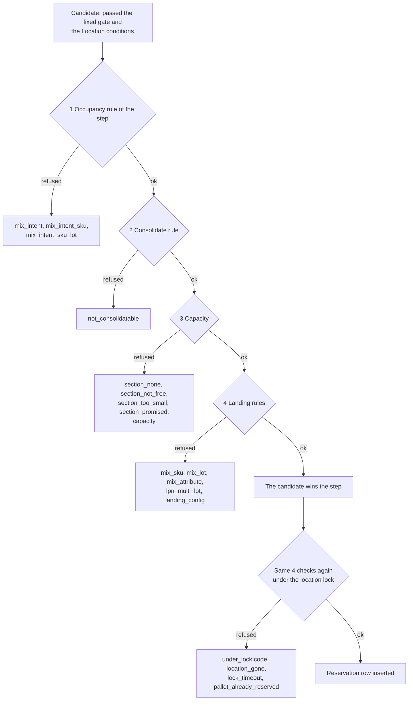

# Putaway pipeline: the decisions in order

The putaway engine answers one question: where does this pallet go? It never moves stock.
It picks a location and reserves it. These diagrams show every gate in the order the code runs it.
Each diagram answers one question.

## Diagram 1. What happens to one request

**What this shows:** the gates a request passes before any step runs, and the two ways it ends.

Reading notes:

- A policy error is an error, not "no location". The operator sees the error text.
- The check "every step can run" happens for all steps before the first step runs. One bad step refuses the whole policy. Examples: scope `AssignedSlot`, ordering `NearestToSlot`, `Must be empty` together with `Consolidate`, a condition value that does not exist, a `Location type` condition that leaves no authorized type.
- The pallet is the container and everything inside it. Lines are grouped by owner, SKU and lot. Only stock above zero counts.
- The policy is `COALESCE(sku.putaway_policy_id, owner_config.default_putaway_policy_id)` for each SKU. A SKU with neither is not counted. The pallet needs exactly one distinct policy.
## Diagram 2. What happens inside one step

**What this shows:** the gates of a single step and the status the trace records when a step is skipped.

Reading notes:

- If the scope is a named location (from the step or from the SKU), the "batch" is that one location. It still passes the fixed gate and the `Location` conditions.
- The step stops at the first candidate that passes. There is no score.
- A step that read 5 full batches and found nothing is marked as stopped at its scan budget (`batch_cap_reached`). The next step runs.
- `ZoneFromSku` and `LocationFromSku` use the first line of the pallet only.
- With `Temperature` on, the test is an overlap of the zone range and the SKU range, for every line. An empty bound means no limit on that side.
## Diagram 3. The four checks on a candidate

**What this shows:** the order of the four checks, the codes each can refuse with, and the second pass under the lock.

Reading notes:

- The first refusal ends the checks for that candidate. The trace counts one code per candidate.
- The fixed gate is applied in SQL, so a location that fails it is never a candidate and never appears in a count: status `Ok`, flag `None`, `Discard LPN` not on, type in `Case`, `Pick`, `SpeedPick`, `Pnd`, `Sort`, `Other` (a step can only narrow this list).
- `Capacity` first refuses oversize goods that need a whole free section, then the fit switches of the step. Details are on [22-putaway-influence-step-settings.md](22-putaway-influence-step-settings.md).
- `Landing` is the same function that the move runs. Details are on [23-putaway-influence-master-data.md](23-putaway-influence-master-data.md).
- `pallet_already_reserved` stops the whole scan: another request holds this pallet's single live reservation.
- A pallet that already stands in the candidate location skips the fit switches of the capacity check. The section check and the other three checks still run.
## Related pages

- [Putaway journey](20-putaway-journey.md)
- [What each setting changes (policy and step)](22-putaway-influence-step-settings.md)
- [What each setting changes (master data)](23-putaway-influence-master-data.md)
- [Reservation life cycle, timers and what the operator sees](24-putaway-reservation-and-refusals.md)
- [Policy reference: steps and conditions](../../admin/policies/01-putaway-policy-steps-and-criteria.md)
