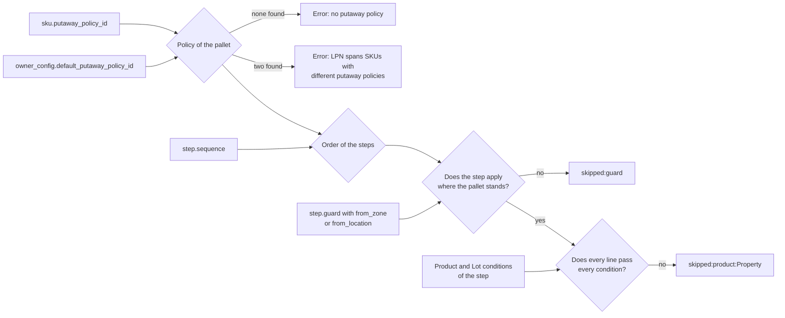
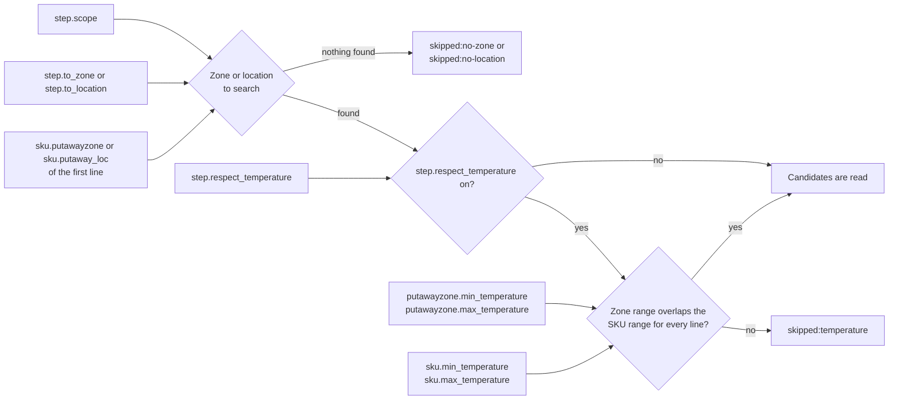
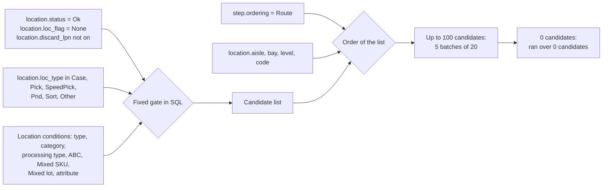
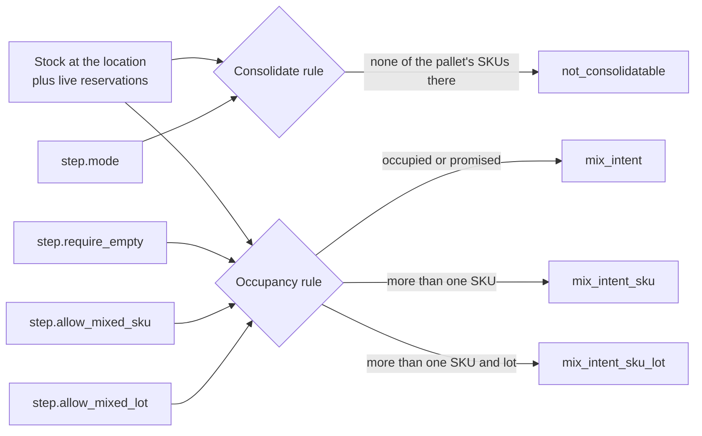

# Putaway: what the policy and step settings change

Each diagram below answers one question: "if I change this setting, which decision of the putaway engine changes, and what does the operator or the dry run show?"
Only settings that code reads are drawn. Settings that nothing reads are listed at the end of this page under "Stored only. It has no effect today."
Master data (SKU, pack, lot, zone, location) is on [23-putaway-influence-master-data.md](23-putaway-influence-master-data.md).

## Diagram 1. Which steps run for this pallet?

**What this shows:** the settings that choose the policy, the order of its steps, and whether a step applies to this pallet.

| Setting | Decision it changes | What you see |
|---|---|---|
| `sku.putaway_policy_id` | Policy of the pallet. Wins over the owner default. | Error text `no putaway policy on the SKU or the owner default` or `LPN spans SKUs with different putaway policies: ...` |
| `owner_config.default_putaway_policy_id` | Policy for SKUs that have none. | Same errors. |
| `step.sequence` | Order of the steps. The first step that finds a location wins. Steps are read by `sequence`, never by `step_num`. | Which location is suggested. |
| `step.guard` (`None`, `FromZone`, `FromLocation`) and `from_zone`, `from_location` | The step applies only if the pallet's current zone, or current location, equals the anchor. A guard with an empty anchor matches nothing. | Trace status `skipped:guard`. |
| Conditions of family `Product` and `Lot` (7 properties, table below) | The step applies only if every line of the pallet passes every condition. One failing line skips the whole step. | Trace status `skipped:product:<Property>` |

The seven pallet conditions and what each one reads:

| Property | Reads | A blank value |
|---|---|---|
| `SkuAbc` | `sku.abc` | passes |
| `SkuGroup` | `sku.sku_group` | passes |
| `SkuClass` | `sku.class` | passes |
| `PutawayClass` | `sku.putaway_class` | passes |
| `Rotation` | `sku.rotation` | passes |
| `LotAttribute` (needs a code) | `lot_attributes` for the line's lot and the code | refuses |
| `SkuAttribute` (needs a code) | `attribute_value` of the SKU for the code | refuses |
## Diagram 2. Where does the step look?

**What this shows:** how the scope, the zone or location on the step, the SKU preference and the temperature switch pick the search space.

| Setting | Decision it changes | What you see |
|---|---|---|
| `step.scope = ZoneFromStep` with `step.to_zone` | Search that zone. | Candidates come from that zone. |
| `step.scope = ZoneFromSku` | Search `sku.putawayzone` of the first line of the pallet. With two SKUs the second SKU follows the first SKU's zone. | `skipped:no-zone` when the first SKU has no zone. |
| `step.scope = LocationFromStep` with `step.to_location` | Search only that location. It still passes the fixed gate and the `Location` conditions. | `skipped:no-location` if empty; zero candidates if the location is on hold or flagged. |
| `step.scope = LocationFromSku` | Search only `sku.putaway_loc` of the first line. | `skipped:no-location` when the SKU has none. |
| `step.scope = AssignedSlot` | Not implemented. | The whole policy is refused: `step uses scope=AssignedSlot, which this build cannot execute`. |
| `step.respect_temperature` | Skip the step if the zone does not suit the pallet. For a named location the zone is the location's zone. | `skipped:temperature` |
| `putawayzone.min_temperature`, `max_temperature`; `sku.min_temperature`, `max_temperature` | Ranges overlap when `zone_min <= sku_max` and `sku_min <= zone_max`. An empty bound is open. A line whose SKU did not load counts as fitting. Read only when the switch is on. | Same status. |
## Diagram 3. Which locations are candidates, and in what order?

**What this shows:** the fixed gate, the `Location` conditions and the order that decide which locations are looked at, and how many.

| Setting | Decision it changes | What you see |
|---|---|---|
| `location.status`, `location.loc_flag`, `location.discard_lpn` | A location that is not `Ok`, not flag `None`, or has `Discard LPN` on is never a candidate. | It is not counted anywhere. |
| `location.loc_type` | Only the six types are allowed. A `Location type` condition can narrow the list, never widen it. | If the condition leaves no allowed type, the whole policy is refused. |
| Condition `Location type`, `Location category`, `Processing type`, `Location ABC`, `Mixed SKU`, `Mixed lot`, `Location attribute` | Remove locations before any check runs. | Fewer candidates. The full trace counts how many each property removed. |
| Condition `Location status`, `Location flag` | Accepted only in forms that cannot remove an allowed location (`is Ok`, `is not Hold`; `is None`, `is not CycleCountActive`). They add no new filter. Any other form refuses the whole policy. | Policy error. |
| `step.ordering = Route` | Order by `aisle`, then `bay`, then `level`, then `code`. `aisle` is text, so `A10` sorts before `A2`. It does not use `Route Sequence`. | The first location in this order that passes the checks wins. |
| `step.ordering = NearestToSlot` | Not implemented. | The whole policy is refused. |
## Diagram 4. May this candidate be used? (occupancy and consolidate)

**What this shows:** how the step's mode and occupancy switches compare the pallet with what stands in the location, and the codes they refuse with.

| Setting | Decision it changes | What you see |
|---|---|---|
| `step.mode = Consolidate` | Only a location that already holds, or has a live reservation for, one of the pallet's owner and SKU pairs. The lot does not count. | `not_consolidatable` |
| `step.require_empty = true` | The location must hold no stock and no container, and no other pallet may hold a live reservation for it. This overrides the two mixing switches. | `mix_intent` |
| `step.allow_mixed_sku = false` | After the pallet lands the location may hold one owner and SKU pair. | `mix_intent_sku` |
| `step.allow_mixed_sku = false` with `step.allow_mixed_lot = false` | One owner, SKU and lot. | `mix_intent_sku_lot` |
| `allow_mixed_lot = false` alone | The policy is refused when it is loaded. | Error text `step sets allow_mixed_lot=...` |
| `Consolidate` with `require_empty = true` | The policy is refused when it is loaded. | Error text `step sets mode=Consolidate together with require_empty=true...` |

The three columns are written by one screen choice: `Any occupancy`, `Must be empty`, or `Allow mixing, with rules`.
A pallet with two SKUs fails `mix_intent_sku` at every location, even an empty one, because the pallet alone makes two identities.
## Stored only. It has no effect today.

I searched the engine and the move for these fields. Nothing reads them to decide a location.

| Field | Note |
|---|---|
| `putaway_policy.description` | Text for people. |
| `putaway_policy.code` | Name only; the engine uses the id. |
| `putaway_policy_detail.step_num` | Label shown as `Step N (S)` and in messages. The engine orders by `sequence`. |
| `putaway_policy_detail.to_zone` and `to_location` when the scope is not `ZoneFromStep` or `LocationFromStep` | Ignored for other scopes. |
| `putaway_policy_detail.from_zone` and `from_location` when the guard is `None` | Ignored. |
| `sku.putaway_class = NoMix` | Does nothing by itself. It matters only if a step has a `Putaway class` condition. |
| Step scope `AssignedSlot` and ordering `NearestToSlot` | Can be stored through the API, but the engine refuses the policy that holds them. |
## Related pages

- [Putaway pipeline, step by step](21-putaway-engine-steps.md)
- [What each setting changes (master data)](23-putaway-influence-master-data.md)
- [Policy reference: steps and conditions](../../admin/policies/01-putaway-policy-steps-and-criteria.md)
- [Policy reference: putaway overview](../../admin/policies/00-putaway-overview.md)
