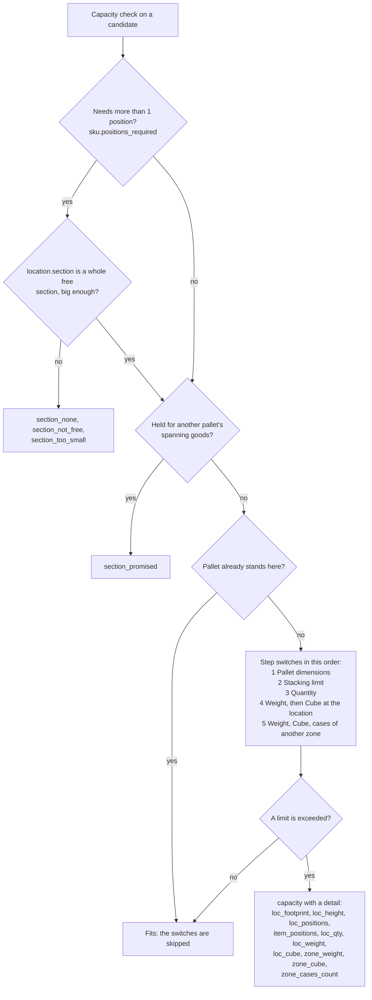
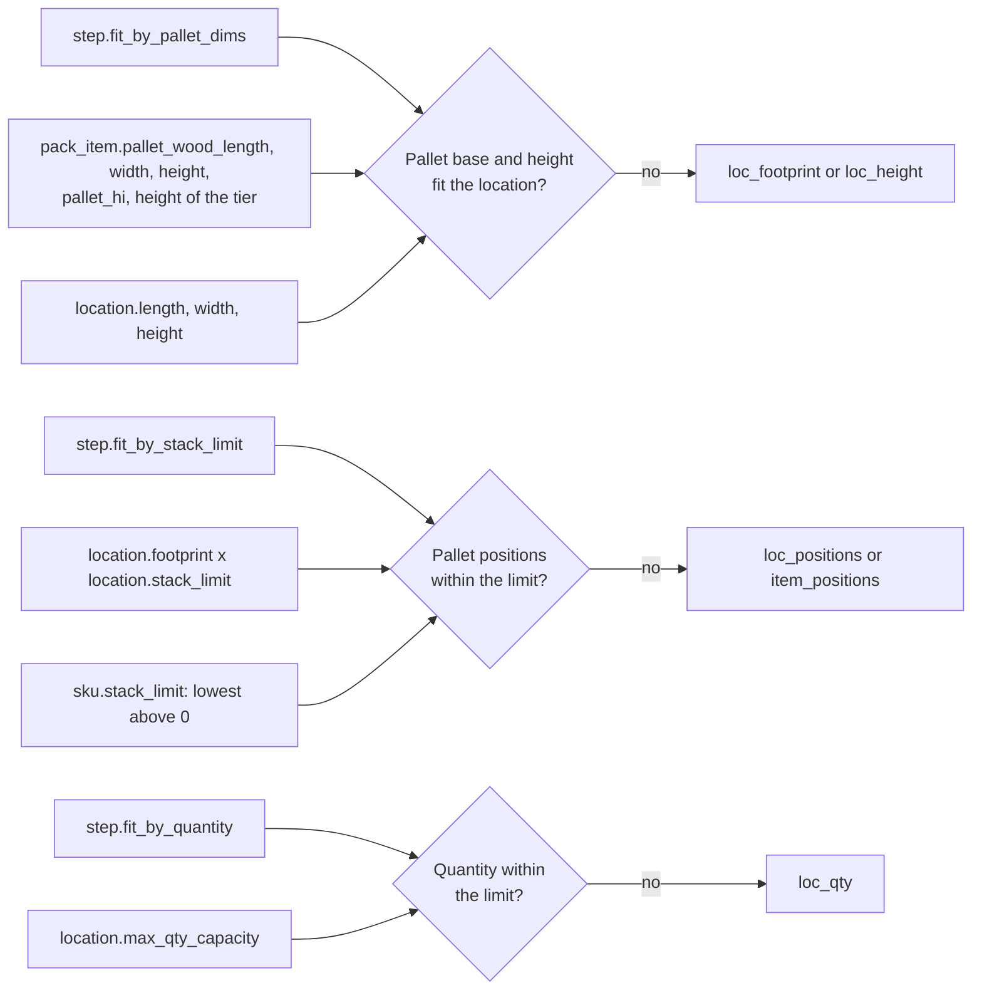
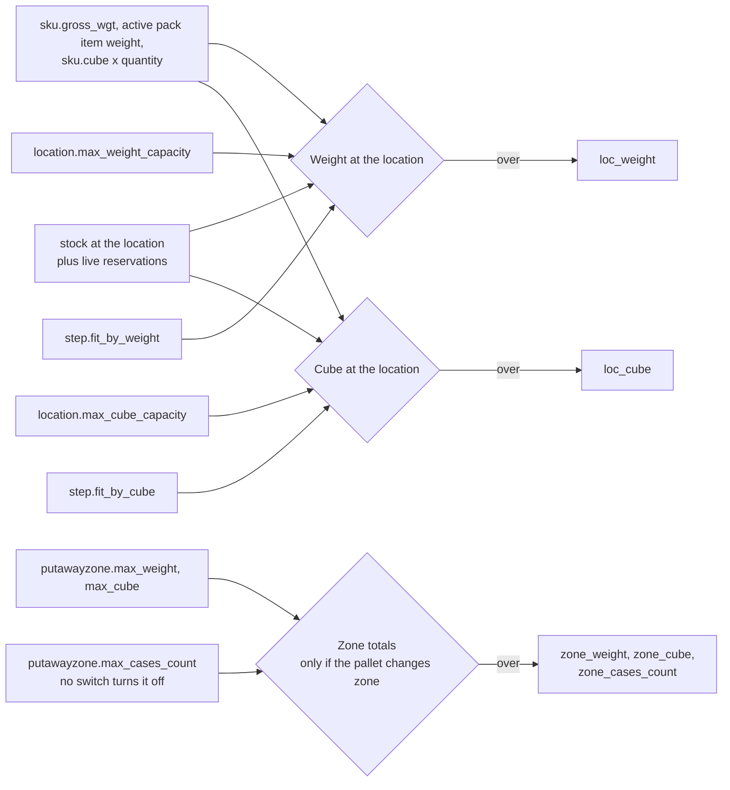
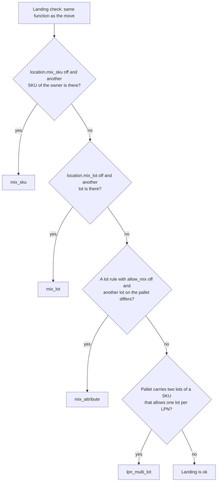

# Putaway: what SKU, pack, lot, zone and location settings change

This page covers the master data that the "Capacity" and "Landing" checks of putaway read.
Each diagram answers one question: "if I change this field, which refusal does an operator or the dry run see?"
Policy and step settings are on [22-putaway-influence-step-settings.md](22-putaway-influence-step-settings.md).
Only fields that code reads are drawn. Fields that nothing reads are listed at the end under "Stored only. It has no effect today."

## Diagram 1. The capacity check, in order

**What this shows:** the order of the capacity gates on one candidate location, and the refusal code of each.

Reading notes:

- The section test and the "held" test run whatever the step says. The five switches belong to the step (`fit_by_pallet_dims`, `fit_by_stack_limit`, `fit_by_quantity`, `fit_by_weight`, `fit_by_cube`).
- The zone part runs only when the destination zone differs from the zone where the pallet stands now.
- A limit of 0 (or empty) means "not set". The check is not run and the candidate is still offered. The trace reports it as `<limit>:no_limit`. It is not a refusal.
- Missing data also skips a check and is reported: `no_product_dims` (the pack does not describe the pallet), `no_location_dims` (the location has no length, width or height), `no_stock_weight` (no weight known for the stock).
- A free section means: every position has status `Ok`, flag `None`, no stock, no pallet standing in it and no live reservation of another pallet. Section width is the sum of the positions. Depth and height are the lowest value of the positions.
## Diagram 2. Physical fit: pallet size, stacking, quantity

**What this shows:** which fields feed the three physical switches.

| Field | Decision it changes | What you see |
|---|---|---|
| `pack_item.pallet_wood_length`, `pallet_wood_width` (largest base on the SKU's packs) | Pallet base. It must fit the location length and width, in either direction. | `loc_footprint` |
| `pack_item.pallet_wood_height`, `pallet_hi` and the height of the child pack item | Pallet height = base height + `pallet_hi` x tier height. A pallet exactly as tall as the location fits. | `loc_height` |
| `location.length`, `width`, `height` (0 means unknown) | Location size for the test above. | `no_location_dims` in the trace when unknown |
| `location.footprint` ("Pallet positions on floor") and `location.stack_limit` | Limit = footprint x stack limit. Used = pallets standing plus pallets promised, then this one. | `loc_positions` |
| `sku.stack_limit` | If it is above 0 and lower than the location's stack limit, it wins. If the location has stack limit 0, the SKU value is used. | `item_positions` |
| `location.max_qty_capacity` | Limit for the quantity already there plus the quantity arriving. It does not count quantity promised by reservations. | `loc_qty` |
## Diagram 3. Weight, cube and zone limits

**What this shows:** which fields feed the weight and cube checks, and the extra zone totals when the pallet changes zone.

| Field | Decision it changes | What you see |
|---|---|---|
| `step.fit_by_weight`, `step.fit_by_cube` | Turn the weight and cube checks on or off, for the location and for the zone. | Without the switch the check does not run. |
| `location.max_weight_capacity`, `location.max_cube_capacity` | Limits. Attempted = stock there + promised + this pallet. | `loc_weight`, `loc_cube` |
| `sku.gross_wgt` and the weights of the active pack revision | Weight of the pallet. If it is unknown the weight check is not run. | `loc_weight:no_stock_weight` in the trace |
| `sku.cube` | Cube of the pallet is the sum of cube x quantity over the lines. A cube of 0 adds nothing. | `loc_cube` |
| `putawayzone.max_weight`, `putawayzone.max_cube` | Zone totals. Used only when the destination zone differs from the zone where the pallet stands, and only with the matching switch on. | `zone_weight`, `zone_cube` |
| `putawayzone.max_cases_count` | Number of stock-bearing containers in the pallet against the zone limit. Used only for a different zone. No switch turns it off. | `zone_cases_count` |

The move itself checks location and zone weight and cube, and the zone case count, whatever the step switches say.
If a step switches `Cube` or `Weight` off, putaway can suggest a place that the move then refuses (the operator is asked for a supervisor, see [20-putaway-journey.md](20-putaway-journey.md)).
## Diagram 4. The landing rules (mixing)

**What this shows:** the order in which the landing check looks at the location's flags, the lot rules and the pallet's own lots, and which field causes each refusal.

| Field | Decision it changes | What you see |
|---|---|---|
| `location.mix_sku` (default on) | When off, the location may hold only the incoming SKU of that owner. It counts stock only, not reservations. | `mix_sku` |
| `location.mix_lot` (default on) | When off, the location may hold only the incoming lot. It counts stock only. When off, the lot attribute rules below are not asked at all. | `mix_lot` |
| `location_lot_commingle` (location, attribute code, `allow_mix`) | For each attribute of the SKU's lot policy, a rule on the location wins over the zone rule. `allow_mix` on is a deliberate exception. | `mix_attribute` |
| `putawayzone_lot_commingle` (zone, attribute code, `allow_mix`) | Used when the location has no rule for that attribute. | `mix_attribute` |
| `lot_policy_attribute` of `sku.lot_policy_id` | Names the attributes the rules above are asked about. A rule for another attribute is ignored. | none |
| `lot_attributes` value of the incoming lot | The rule compares it with the other lots standing on the same pallet. If the lot has no value for the attribute there is nothing to conflict with. | `mix_attribute` |
| `sku.allow_multi_lot_on_lpn` (column default off) | If the SKU does not allow several lots on one LPN, a pallet that carries another lot of that SKU fails everywhere. | `lpn_multi_lot` |
| `sku.force_separate_lpn_per_lot` (column default off) | Same effect for the incoming SKU. | `lpn_multi_lot` |

Reading notes:

- The `mix_attribute` rule compares lots on the same pallet. It does not compare the pallet with what stands in the location.
- `lpn_multi_lot` is a property of the pallet, not of the location. It gives the same answer at every location, so the step ends with no location.
- Putaway compares the incoming SKUs and lots with what is already in the location. It does not compare the pallet's own mix with the location flags, so a pallet with two SKUs or two lots can be offered an empty location with `Mix SKU` or `Mix Lot` off. The move does make that comparison (`validate_batch_self_consistency`). In a directed move it comes back as a supervisor approval for `sku_mixing` or `lot_mixing`.
- The step switches `Mixed SKU` and `Mixed lot` (diagram 4 of the other page) are a different check. They also see live reservations. The location flags here do not.
- The owner setting `owner_config.allow_mixed_lpn` is not read by putaway. It applies when stock enters an existing pallet (`DepositInto`), and putaway relocates the whole pallet.
## What putaway does not read

| Area | Result |
|---|---|
| Receipt policy (`receipt_policy`, `sku.receipt_policy_id`, `owner_config.default_receipt_policy_id`) | The putaway engine and the move do not read any receipt policy field. Receiving only supplies the pallet: its LPN, lots and where it stands. Receiving also publishes the event `process.receipt.ready_for_putaway`, but no code in the repository starts a putaway from it. Putaway starts when the operator scans the pallet. |
| `location.route_sequence` | Not used by putaway. The order is `aisle`, `bay`, `level`, `code`. |
| `location.processing_type`, `location.category`, `location.abc` | Read only by the matching step conditions. |
| `sku.putaway_class` | Read only by a `Putaway class` condition. |

## Stored only. It has no effect today.

These fields are stored and shown, but no code reads them to make a decision.

| Object | Fields |
|---|---|
| Putaway zone | `inbound_loc`, `outbound_loc`, `rf_pick_strategy`, `replenishment_allowed`, `replenishment_threshold`, `default_label_printer`, `default_report_printer`, `auto_print_addr_label`, `auto_print_carton_label` |
| Location | `cube` (the location's own volume; the checks read `max_cube_capacity`), `check_digit` (written once when a location is created) |
| Receipt policy | `receipt_without_po`, `receipt_without_asn`, `no_sku_on_po`, `asn_po_qty_discrepancy`, `po_qty_validation`, `excess_message`, `shortage_message` and the `po_*` fields. See [13-receive-checks-and-policy.md](13-receive-checks-and-policy.md). |
## Related pages

- [Putaway pipeline, step by step](21-putaway-engine-steps.md)
- [What each setting changes (policy and step)](22-putaway-influence-step-settings.md)
- [Policy reference: zone settings](../../admin/policies/02-putaway-zone-settings.md)
- [Policy reference: location settings](../../admin/policies/03-location-settings.md)
- [Policy reference: SKU level settings](../../admin/policies/34-sku-level-settings.md)
- [Policy reference: lot policy and attributes](../../admin/policies/32-lot-policy-and-attributes.md)
