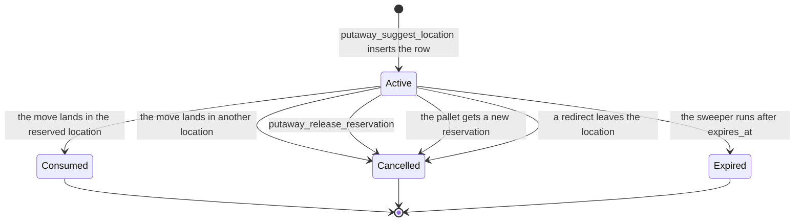
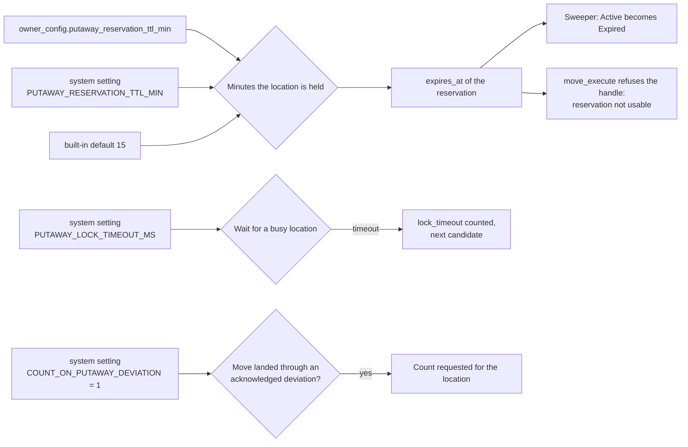

# Putaway: the reservation, the timers, and what the operator sees

When the engine finds a location it writes a reservation row in `inventory_pending_move_in`.
Other searches count its cube, weight and pallet position as taken. This page shows the life of that row, the settings that time it, and the words on the RF screen.

## Diagram 1. Life of a reservation

**What this shows:** every status change of a reservation row that the code makes.

Reading notes:

- Only `Active` rows change. Every status change in the code has `WHERE status = 'Active'`.
- A pallet has at most one live reservation. A new ask cancels the earlier one (`cancel_active_for_container`).
- An oversize load (`sku.positions_required` above 1) holds one extra row for each other position of the section. These rows point to the first row (`share_of`) and all change status together.
- The sweeper flips rows to `Expired` every 5 minutes. A row counts as promised space while its status is `Active`, even after `expires_at` has passed. So a location can stay held for up to the TTL plus one sweep. `move_execute` already refuses an expired handle.
- Settled rows (`Consumed`, `Cancelled`, `Expired`) do not count against the location.
## Diagram 2. Which settings set the timers and the follow-up work

**What this shows:** the system and owner settings that putaway and the directed move read.

| Setting | Decision it changes | What you see |
|---|---|---|
| `owner_config.putaway_reservation_ttl_min` | Minutes a reservation lives. The owner is the owner of the first line of the pallet. Empty means use the system setting. A result of 0 or less is replaced by 15. | `expires_at` in the answer. |
| `PUTAWAY_RESERVATION_TTL_MIN` (seed 15) | Same, for every owner without its own value. If the value is not a number the default 15 is used. | Same. |
| `PUTAWAY_LOCK_TIMEOUT_MS` (code default 5000) | How long the engine waits for a busy location before it counts `lock_timeout` and tries the next candidate. A value of 0 or less is ignored, because 0 would mean "wait for ever". | `lock_timeout` in the trace. |
| `COUNT_ON_PUTAWAY_DEVIATION` (seed 0) | When the move landed through an acknowledged deviation (code 85), each deviating location is queued for a count. | Event `process.inventory.count_requested` for the location. |
| `MOVE_HOLD_POLICY` (seed `warn`) | A move setting, not a putaway setting. `warn`: active holds on the pallet are judged by the hold code policy (acknowledge or block). `silent`: holds on the pallet are not asked about. Holds on the source and destination location are always judged. | Supervisor prompt, or a refusal naming the hold. |
## What the operator sees

**What this shows:** the words on the RF terminal for each outcome of the putaway screens.

| Situation | Screen text | Source |
|---|---|---|
| The engine found a location | `TAKE TO` and the location. The `Location` field starts with it. | `crates/libs/wms-lib-sql/sql/rf-screens/093_uc_putaway.sql:361-364`, `:373-376` |
| No location (all candidates refused) | `No location available: no_eligible_location - Esc to give up` | `crates/libs/wms-lib-sql/sql/rf-screens/093_uc_putaway.sql:365-368`, `crates/libs/wms-inventory/src/putaway/command.rs:56-61` |
| Another request holds the pallet's reservation right now | `No location available: pallet_already_reserved - Esc to give up` | same |
| The suggestion call fails (no policy, two policies, a step the engine cannot run, container not found, no stock, no current location) | `No location available - Esc to give up`, with no reason. The RF client logs the failure and shows no error. | `clients/rf-go/internal/app/model.go:4805-4824` |
| The scanned (suggested) location breaks a soft rule | Screen `Supervisor Override`: "The location breaks a putaway rule - a supervisor must authorize". The line `Overriding` reads `Putaway rule: <text>`: capacity "The location does not have room for this pallet", loc_type "This location is not authorized for this kind of movement", sku_mixing "The location already holds a different SKU, and may not mix", lot_mixing "The location already holds a different lot, and may not mix", multi_lot_on_lpn "The pallet already carries a different lot of this SKU", attribute_mixing "A lot attribute (e.g. colour, grade) may not mix here". | `crates/libs/wms-inventory/src/movement/directed.rs:118-130`, `crates/libs/wms-lib-sql/sql/rf-screens/093_uc_putaway.sql:444-450` |
| The reserved location is blocked by a hold, gone, or inactive | Line "That location is blocked - take it to the location shown instead". `TAKE TO` shows the replacement. Server text: `directed move must be redirected away from <loc>: <because>; put it in <new loc> instead`. | `crates/libs/wms-lib-sql/sql/rf-screens/093_uc_putaway.sql:306-318`, `:369-372`, `crates/libs/wms-inventory/src/movement/types.rs:334-339`, `:680` |
| A redirect found no replacement | `directed move must be redirected away from <loc>: <because>; no replacement location could be named - ask for a fresh suggestion` | `crates/libs/wms-inventory/src/movement/types.rs:334-339` |
| The reservation is no longer live (consumed, cancelled, expired, other pallet) | `directed move: reservation <id> is not usable (<reason>)` | `crates/libs/wms-inventory/src/movement/directed.rs:300-346`, `crates/libs/wms-inventory/src/movement/types.rs:664` |
| A different location is scanned and a limit is exceeded | `capacity exceeded (<kind>): limit=..., attempted=...`. No supervisor prompt is offered for capacity, type and mixing outside the reserved location. | `crates/libs/wms-inventory/src/movement/types.rs:645`, `crates/libs/wms-inventory/src/movement/directed.rs:435-482` |
| The move ends | `Put Away` with `<lpn> -> <location>` and `Moved` quantity. Enter goes back to the first screen. | `crates/libs/wms-lib-sql/sql/rf-screens/093_uc_putaway.sql:488-531` |
## Related pages

- [Operator guide: Putaway](../../operator/05-putaway.md)
- [Reference: Pending Move-In](../../reference/inventory/33-pending-move-in.md)
- [Reference: releasing a reservation](../../reference/inventory/59-releasing-a-reservation.md)
- [Putaway journey](20-putaway-journey.md)
- [The move: order of checks](25-move-execute.md)
- [Policy reference: putaway overview](../../admin/policies/00-putaway-overview.md)
