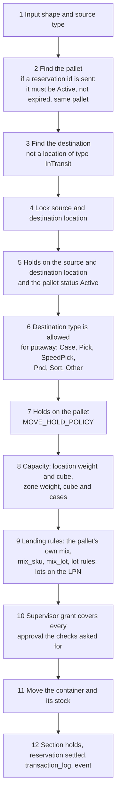
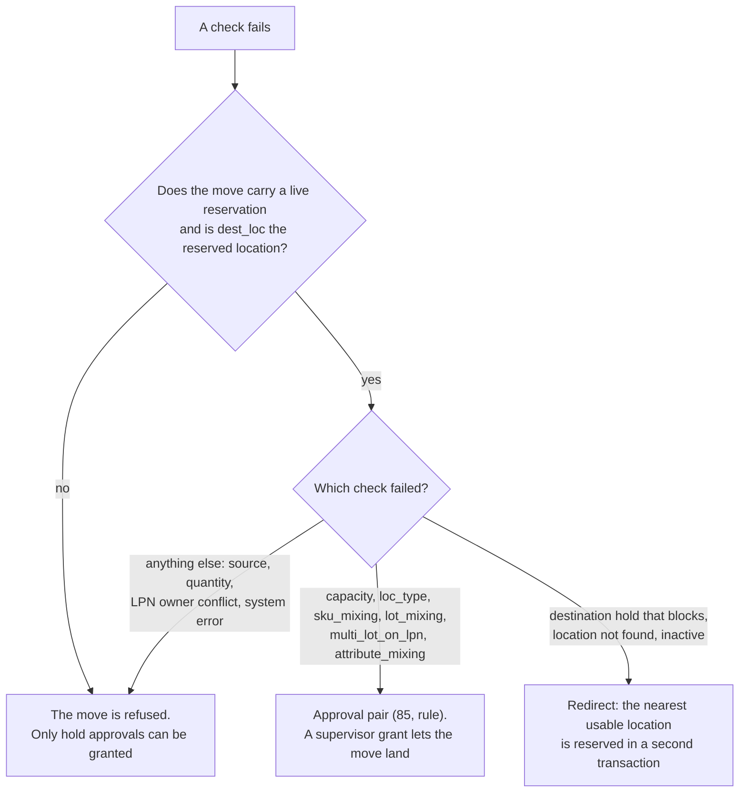

# The move (`move_execute`) used by putaway

Putaway never moves stock. The move does. Both putaway (`PUTW03`) and the manual move (`INVMOV04`) call the same API method, `move_execute`.
The difference is one field: putaway sends `pending_move_in_id` and `source_type = putaway`. The manual move sends `source_type = manual` and no reservation.

## Diagram 1. What `move_execute` does, in order

**What this shows:** the steps of `MovementService::execute` for a putaway, from the first check to the last write. The first refusal ends the move and rolls everything back.

Reading notes:

- Steps 5, 6, 8 and 9 can end in a refusal, or in a request for approval, or in a redirect. Diagram 2 shows which.
- Step 5: an inventory hold on a location is judged by its hold code (`enforce`, `overridable`). The move does not read `location.status` or `location.loc_flag`. A location with status `Hold` is kept out of putaway suggestions by the candidate query, but a scan of such a location does not fail in the move unless an inventory hold sits on it.
- Step 8 reads `location.max_weight_capacity` and `max_cube_capacity`, and the zone limits when the pallet changes zone. It does not read the step switches, `max_qty_capacity`, `stack_limit`, or pallet size.
- Step 10: approvals come from the checks (holds, and soft rules on the reserved location). The operator's `override_grant_id` is redeemed and must cover every pair. A pair the move did not ask for is refused as an unknown subject.
- Step 12: after the pallet moved, the reservation becomes `Consumed` (landed in the reserved location) or `Cancelled`. For oversize goods the other positions of the section get `LocBlocked` holds, and the previous section is released.
## Diagram 2. Refusal, approval or redirect?

**What this shows:** what happens to a failed check, depending on whether the move is directed (it carries a reservation) and whether the operator scanned the reserved location.

Reading notes:

- A hold approval pair (codes 80, 83, 84) can be granted in any move, directed or not. The pair 85 exists only in a directed move on the reserved location.
- If the operator scans another location, the reservation is not used for leniency. At the end it is set to `Cancelled`.
- The redirect picks the nearest location by straight-line distance from the refused one (`x_coord`, `y_coord`, `z_coord`), with the refused location excluded. It runs the same policy and the same checks.
- Supervisor grants are single use and expire in minutes. They are bound to the operator, the pairs and the authorizing supervisor. For a move pair the supervisor needs one of the override roles (Supervisor, Manager, Admin).
## Manual move and putaway side by side

| | Putaway (`PUTW03`) | Manual move (`INVMOV04`) |
|---|---|---|
| `source_type` | `putaway` | `manual` |
| Reservation (`pending_move_in_id`) | yes | no |
| Destination types | Case, Pick, SpeedPick, Pnd, Sort, Other | the same six |
| Capacity, mixing or type problem | approval (85) on the reserved location | refusal |
| Blocked, missing or inactive destination | redirect | error |
| Quantity | whole pallet (`qty` empty, `recursive` true) | whole position, or a partial quantity |
## Related pages

- [Putaway journey](20-putaway-journey.md)
- [Reservation life cycle and operator messages](24-putaway-reservation-and-refusals.md)
- [Operator guide: Move](../../operator/06-move.md)
- [Reference: Move Stock document](../../reference/inventory/17-move-stock-document.md)
- [Reference: moving stock](../../reference/inventory/40-moving-stock.md)
