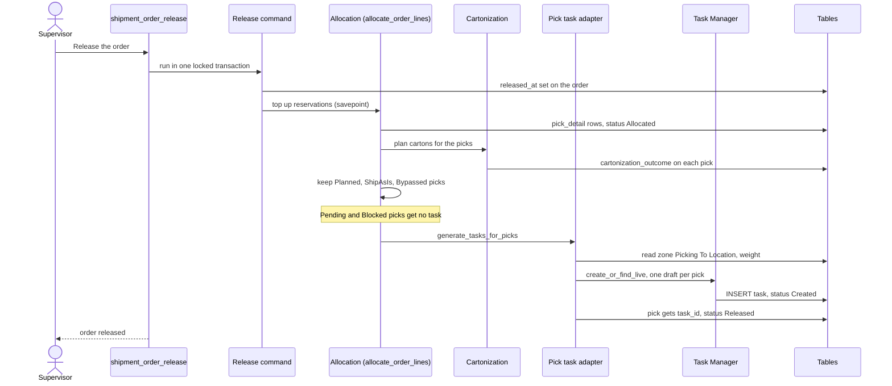

# How a pick becomes a task

**What this shows.** What happens between the press of `Release` on an order and a pick task that waits in the pool.

## Reading the diagram

- The task is created by the same transaction that releases the order. A person does not type it in.
- The gate is `shipment_order.released_at`. An `Allocate` on an order that is not released reserves stock and makes no task. When the order is released later, the same function runs again and makes the missing tasks.
- A second `Release` on a released order (`release_again`) runs the same allocation step again. The picks that still have no task get one.
- A pick that already has a task is skipped. A live task for the same source is found and reused. A task that does not match the pick refuses with `SourceTaskSnapshotConflict`.
- `ShipAsIs` only counts as ready when the factory package proof is complete. `Planned` needs a carton id. Otherwise the pick is refused with a business error and the allocation step fails as a whole. `Release` then keeps the release and reports `auto_allocation_error`.

## What the task copies from the pick

| Task field | Value | Task Board column |
|---|---|---|
| source | `pick_detail` and the pick id | none (the board shows the order only to the delete action) |
| `from_location` | the pick location | `From`; its zone is `Zone` and decides the work area |
| `to_location` | the `Picking To Location` of the zone of the pick location | `To` |
| owner, SKU, lot, unit, quantity, container | the pick | `SKU`, `Lot`, `Qty`, `UOM` |
| `weight` | stock weight of the quantity (empty when no weight is known) | none |
| `priority` | the order priority (1 to 99, default 50, smaller is sooner) | `Priority` |
| `wave_id` | the active wave claim of the order, if any | none. Stored on the task. No dispatch rule reads it |

## Where it comes from

| What | Source |
|---|---|
| Release sets `released_at`, then runs the allocation half | `crates/libs/wms-outbound/src/service/order/release.rs:173-290` |
| Release again | `crates/libs/wms-outbound/src/service/order/release.rs:292-330` |
| Allocation runs inside a savepoint | `crates/libs/wms-outbound/src/service/order/release.rs:354-380` |
| Cartonization right after reserving | `crates/libs/wms-outbound/src/service/order/allocate.rs:398-406` |
| Task generation only when the order is released | `crates/libs/wms-outbound/src/service/order/allocate.rs:408-440` |
| Which cartonization outcomes are executable | `crates/libs/wms-outbound/src/cartonization/handoff.rs:27-67` |
| The task draft, zone destination, weight | `crates/libs/wms-outbound/src/picking/infrastructure/tasks.rs:21-85` |
| Task created, pick set to `Released` | `crates/libs/wms-outbound/src/picking/infrastructure/tasks.rs:88-146` |
| One live task per source, advisory lock, reuse | `crates/libs/wms-tasks/src/service/draft.rs:185-238` |
| Wave id read from the wave claim | `crates/libs/wms-outbound/src/waves/task_grouping.rs:9-19` |
| Order priority range and default | `crates/libs/wms-lib-sql/sql/wms-app/migrations/001_baseline.sql:5785` |
| API method | `docs-obsidian/user-guide/api/openrpc.json` (`shipment_order_release`) |

## Related pages

- [Releasing an order](../../reference/outbound/35-releasing-an-order.md)
- [Allocating an order](../../reference/outbound/36-allocating-an-order.md)
- [Picking overview, section 3](../../admin/policies/20-picking-overview.md)
- [Pick and task statuses](40-statuses.md)
- [Who gets which task](52-influence-who-gets-which-task.md)
