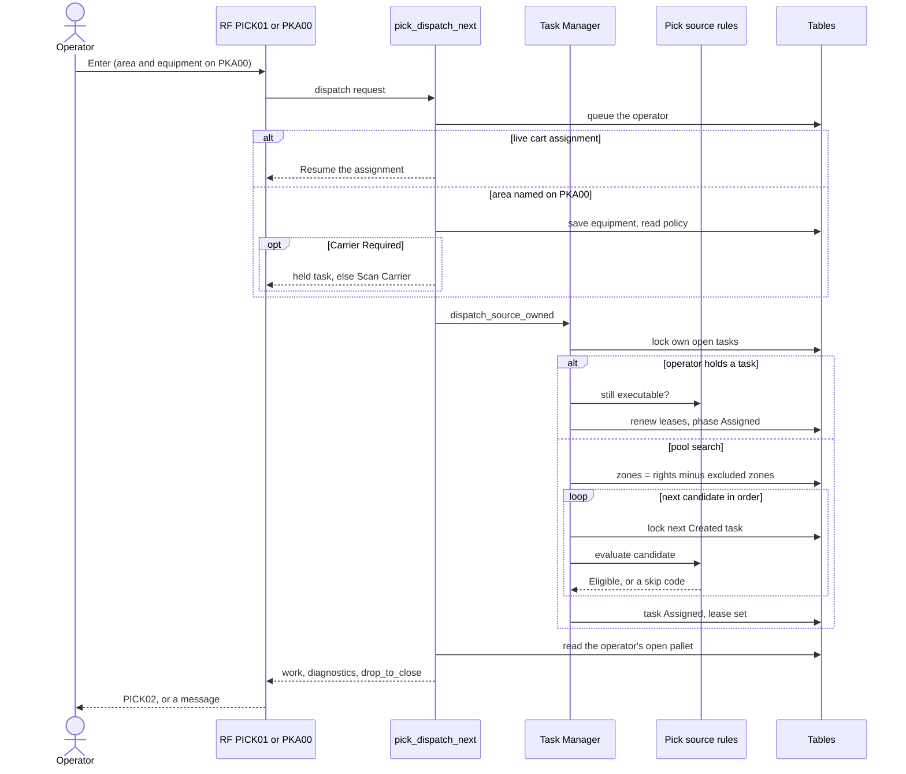

# How an operator takes a pick task

**What this shows.** What `pick_dispatch_next` does when an operator asks for work on the RF terminal, up to the moment a task becomes `Assigned`.

## Reading the diagram

- The two RF entries are `Discrete Pick` (`PICK01`, no area named) and `Pick by Area` (`PKAA`, then `PKAE` and `PKAEL`, then `PKA00`). Only `PKA00` sends `work_area_code`, `equipment_profile_code` or `on_foot`.
- Without a named area the search covers every area where the operator has a `Pick` right. With a named area it covers only that area. Both read the pool in the same order.
- The pool order is: order priority (smaller first), then the `Route Sequence` of the source location (empty last), then oldest, then id.
- The operator must be active (`OperatorNotActive` otherwise).
- The generic `task_claim` does not work for `Pick`. It refuses with `SourceOwnedDispatch`.
- A candidate that fails a source rule stays `Created`. It is skipped only in this search. The codes go to `diagnostics`: `PICK_EXECUTION_ROLLOUT_DISABLED`, `PICK_NOT_RELEASED`, `ORDER_NOT_RELEASED`, `ORDER_TERMINAL`, `LOCATION_MISSING`, `LOCATION_BLOCKED`, `INVENTORY_HOLD`, `CARTONIZATION_PENDING`, `CARTONIZATION_BLOCKED`, `CARTONIZATION_INVALID`, `IN_CONTINUATION`, `WRONG_TASK_TYPE`, `UNSUPPORTED_SOURCE`, `SOURCE_MISSING`, `SOURCE_TASK_MISMATCH`, `TASK_SNAPSHOT_MISMATCH`. The RF shows only `No eligible Pick work` (`PICK01`) or `No eligible Pick work in the area` (`PKA00`).
- `drop_to_close` names the pallet of the operator when it holds goods and the answer does not go onto it. The RF then opens `PICK13` (close pallet) first.
- A task already held is returned first, with its lease renewed. If it is no longer executable the dispatch refuses with `AssignedSourceIneligible`. If it is a task of another type it refuses with `OtherTaskActive`.
- When there is no right in any area the answer is `NoWorkArea`. When rights exist but only tasks too heavy for the equipment remain, the answer is `TooHeavyForEquipment`.
## Related pages

- [How a cart assignment starts](12-cart-assignment.md)
- [Who gets which task](52-influence-who-gets-which-task.md)
- [Picking overview, section 2](../../admin/policies/20-picking-overview.md)
- [Work areas, equipment and permissions, section 8](../../admin/policies/22-work-areas-equipment-and-permissions.md)
- [Operator guide: picking](../../operator/09-picking.md)
