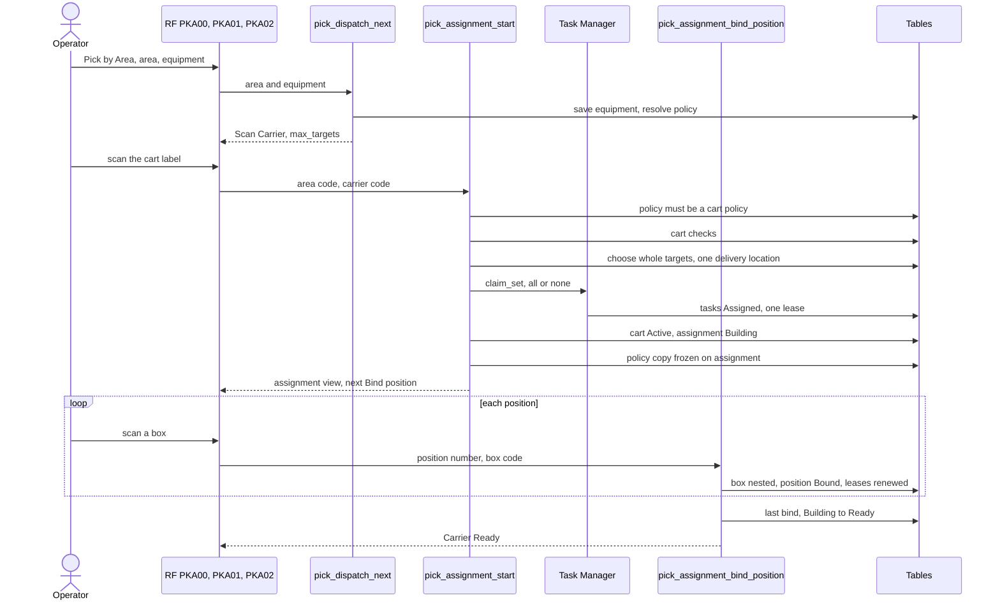

# How a cart (pick assignment) is built

**What this shows.** How an operator on a cart gets a pick assignment: choose area and equipment, scan the cart, receive several boxes' tasks at once, and bind one box to each cart position.

## Reading the diagram

- `pick_dispatch_next` does not claim a task for a carrier area. It answers `Scan Carrier` and the number `max_targets`. An operator who already holds a single task gets that task first.
- The number of targets is the smaller of `Max Targets` of the policy and the `Positions` of the cart type. A target is a whole planned carton with all its picks, or all `Bypassed` picks of one order, or the rest of a box that was closed full (a continuation, taken first).
- Candidates are ranked by: continuation first, then order priority (smaller first), requested ship date, first location on the walk. A candidate passes only if every task of it passes the same source rules as a single task.
- All targets of one cart go to one delivery location. The first target chosen fixes it. A target with no delivery location (the owner has no `Delivery location (picker carrier)` and the tasks do not agree on `To Location`) is never taken.
- With `Completion` = `ConfirmAtLocation` and a pack station on the area, the delivery location is the station. With `Complete` the router is not asked.
- `claim_set` is all or nothing. If another operator took one task in the same moment, the start refuses with `SelectionChanged` and the operator presses again.
- The assignment starts as `Building`. It becomes `Ready` in the same statement that binds the last `Open` position.
- A box is accepted only when it is an empty registered box, not on hold, of an active type that holds goods and is not a carrier, large enough for the planned carton, not on another cart, and its usage policy allows the owner of the goods. Or it is the planned carton's own label.
- `pick_assignment_start` refuses with `OperatorHasOtherWork` when the operator holds a single task, and with `UndeliveredCarrier` when a cart they dissolved still carries goods and was never delivered.
- If the operator already has a live assignment, `pick_assignment_start` continues it (`resumed`) when it is on the scanned cart, and refuses when it is on another cart.

## Where it comes from

| What | Source |
|---|---|
| Dispatch answers `Scan Carrier` | `crates/libs/wms-outbound/src/picking/commands/dispatch_next.rs:256-300` |
| Start: steps a to i | `crates/libs/wms-outbound/src/picking/commands/start.rs:1-60` and `:142-400` |
| Policy must be `PlannedTarget` with a carrier | `crates/libs/wms-outbound/src/picking/commands/start.rs:193-198` |
| Router asked only for `ConfirmAtLocation` | `crates/libs/wms-outbound/src/picking/commands/start.rs:205-218` |
| Capacity: smaller of `Max Targets` and positions | `crates/libs/wms-outbound/src/domain/pick_assignment/aggregate.rs:50-55` |
| Which targets, ranking, one delivery location | `crates/libs/wms-outbound/src/picking/grouping/planned_target.rs:1-250` |
| Delivery location chain | `crates/libs/wms-outbound/src/domain/pick_assignment/delivery.rs:13-39` |
| Cart checks | `crates/libs/wms-outbound/src/picking/carrier/select.rs:42-72` |
| Tasks claimed all or nothing | `crates/libs/wms-tasks/src/service/claim_set.rs:1-60` |
| Start status `Building` | `crates/libs/wms-lib-sql/sql/wms-app/migrations/050_pick_assignment.sql:28` |
| Box checks at bind | `crates/libs/wms-outbound/src/picking/target/bind.rs:111-196` |
| Bind, `Ready` flip | `crates/libs/wms-outbound/src/picking/commands/bind_position.rs:100-190` and `crates/libs/wms-lib-core/src/model/outbound/pick_assignment.rs:797-835` |
| RF screens `PKA00`, `PKA01`, `PKA02`, `PKA03` | `crates/libs/wms-lib-sql/sql/rf-screens/110_uc_pick_aggregated_cart.sql` |
| API methods | `docs-obsidian/user-guide/api/openrpc.json` (`pick_assignment_start`, `pick_assignment_bind_position`) |

## Related pages

- [How an operator takes a task](11-operator-takes-a-task.md)
- [The cart route and delivery](21-rf-pick-cart-route.md)
- [Picking policy: what each field changes](51-influence-picking-policy.md)
- [Pick Assignments list](../../reference/tasks/20-pick-assignments-list.md)
- [Picking overview, section 5.2](../../admin/policies/20-picking-overview.md)
