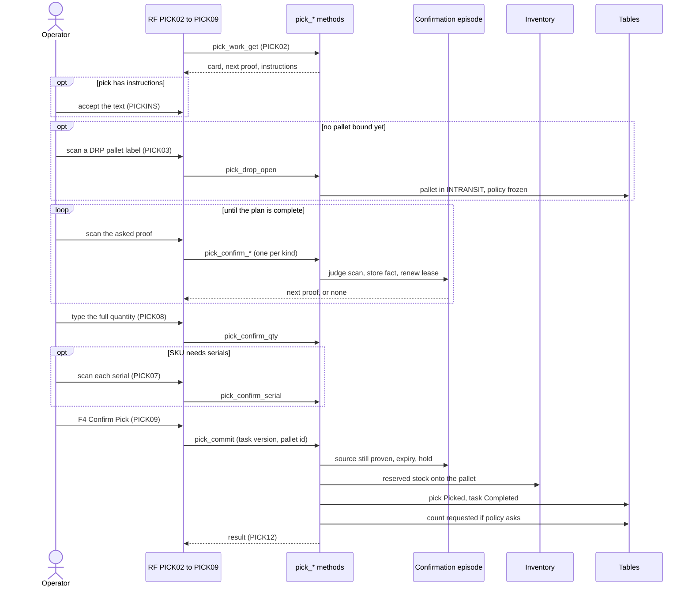

# The RF pick journey: one pick onto a pallet

**What this shows.** Every call the RF terminal makes for one discrete pick: card, pallet, scans of location, item, LPN and lot, serials, quantity and the commit.

## Reading the diagram

- The order of the screens comes from the server. `PICK02` reads `verification.next` and opens the screen for the next proof. The kinds are `Location` (`PICK04`), `Item` (`PICK05`), `Lpn` (`PICK06`), `InternalLot` (`PICK14`) and `LotAttribute` (`PICK15`). Which of them are asked depends on the five `Confirmation` fields of the policy `DISCRETE` and on the source (see [57](57-influence-source-proof.md)).
- Each scan command is a `stateless_command`. A scan that repeats a stored fact is absorbed. A scan that contradicts it is refused. A wrong value is refused with a message that names the kind of proof.
- The quantity step must equal the full quantity still to pick, or it is refused. It is stored as an audit fact. The commit does not need it.
- `pick_commit` is a `stateful_command` on the task version. A stale version answers code 40 with the current task.
- A pick with a plan that cannot tell the lots apart is blocked. Only the pallet step, a short with 0 found and a reject stay open. See [Short pick](22-short-pick.md).
- The commit re-reads the stock, the lot expiry (`Min Shelf Life on Pick` of the SKU) and holds under the lock of the source location. A task that is no longer held by the caller, a lease that ran out, a pick that is not `Released` or a pallet that is not the caller's open pallet of this order are refused.
- The first deposit onto a pallet freezes the pallet destination. See [Drop-off of a pallet](23-drop-off-pallet.md).
- After a full commit, if the policy revision frozen on the pallet has `Count an Emptied Location` and the location holds no stock, the commit publishes `process.inventory.count_requested`. The count is started later by a subscriber.
- The task goes `Assigned` to `Completed` in the commit. No pick door writes `InProgress`.

## Where it comes from

| What | Source |
|---|---|
| Screen order and the payload of each call | `crates/libs/wms-lib-sql/sql/rf-screens/105_uc_pick_source_confirmation.sql`, `crates/libs/wms-lib-sql/sql/rf-screens/101_uc_pick_drop_close.sql`, `crates/libs/wms-lib-sql/sql/rf-screens/111_uc_pick_drop_area.sql` |
| API methods and their classes | `crates/services/app-server/src/web/rpcs/pick_commands_rpc.rs:42-330` |
| Open pallet, policy frozen on it | `crates/libs/wms-outbound/src/picking/commands/drop_open.rs:1-60` and `:90-260` |
| Confirmation commands, episode, lock steps | `crates/libs/wms-outbound/src/picking/commands/confirm.rs:1-60` and `:380-440` |
| Quantity must equal the full quantity | `crates/libs/wms-outbound/src/picking/commands/confirm.rs:683-708` |
| What the plan asks | `crates/libs/wms-outbound/src/domain/pick_confirmation/plan.rs:141-300` |
| Serial scan | `crates/libs/wms-outbound/src/picking/commands/capture_serial.rs:1-110` |
| Commit steps | `crates/libs/wms-outbound/src/picking/commands/commit.rs:1-40` and `:125-380` |
| Source proof, expiry, hold at commit | `crates/libs/wms-outbound/src/picking/confirmation/at_commit.rs:62-145` |
| Instructions that must be accepted | `crates/libs/wms-outbound/src/picking/instructions.rs:18-80` |
| Count request event code | `crates/libs/wms-inventory/src/service/inventory_count/request_location.rs:1-10` |
| Count of an emptied location | `crates/libs/wms-outbound/src/picking/emptied_location.rs:37-90` |
| Task goes `Assigned` to `Completed` | `crates/libs/wms-tasks/src/service/lifecycle.rs:166-216` |

## Related pages

- [The cart route](21-rf-pick-cart-route.md)
- [Short pick](22-short-pick.md)
- [Drop-off of a pallet](23-drop-off-pallet.md)
- [Source proof fields](57-influence-source-proof.md)
- [SKU and lot settings](54-influence-sku-and-lot-settings.md)
- [Operator guide: picking](../../operator/09-picking.md)
