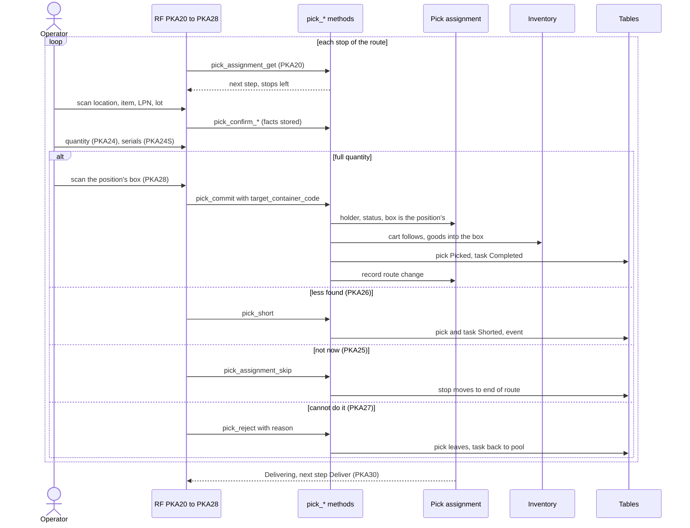

# The RF pick journey: stops on a cart route

**What this shows.** How the operator walks the route of a cart: next stop, the same proofs as a discrete pick, then the scan of the position's box, and the three ways to leave a stop (skip, short, reject).

## Reading the diagram

- The route order is: stops not skipped first, by `Route Sequence` of the location (empty last), then location code, then source (owner, SKU, source LPN, lot), then pick id. Skipped stops come after, oldest skip first.
- After every route command the assignment version goes up. The status becomes `Picking` on the first one (from `Ready`). It becomes `Delivering` as soon as no live member pick is `Released`.
- `pick_commit` on a member pick needs the box code. The code must be the box of that position, and the box must stand directly on the cart. Wrong box: `WRONG_TARGET`. No box: `TARGET_REQUIRED`. A pallet id on a cart pick: `DROP_ID_ON_ASSIGNMENT_PICK`.
- A commit moves the whole cart tree to the location of the pick (the carrier follows the operator).
- A short with 0 found deposits nothing, needs no box and does not move the cart. With some found, the box is scanned like a commit.
- `pick_assignment_skip` never touches the task: no lease change, no status. The pick's source proof is dropped. The operator proves it again when the stop comes back.
- `pick_reject` is allowed only before anything is picked. The pick first leaves the assignment, then the task returns to the pool as `Refused` with a cooldown. The refusal counter goes up, and `Allow Task Release` of the area can forbid it.
- With `Quantity` = `Aggregated`, consecutive stops of one source in one location become one summary step: `AggregatedPick`. A skip or reject there takes the whole group. A commit and a short still go one place at a time, each into its own box.
- A position whose box was closed full and whose repair failed holds its picks. Every route command and the delivery refuse with `CARTON_REPLAN_REQUIRED` until the operator hands the picks over. See [Box full](31-box-full-and-target-exceptions.md).
## Related pages

- [Short pick](22-short-pick.md)
- [Drop-off of a cart](24-drop-off-cart.md)
- [Box full and target exceptions](31-box-full-and-target-exceptions.md)
- [Pick assignment card](../../reference/tasks/21-pick-assignment-card.md)
- [Operator guide: picking](../../operator/09-picking.md)
