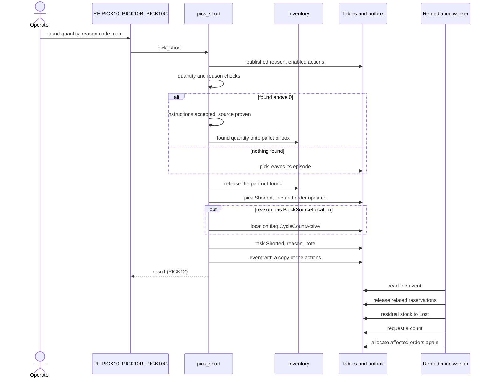

# What happens when the operator finds less stock (short pick)

**What this shows.** The two phases of a short pick: the transaction of `pick_short`, then the clean-up that a background worker runs from the event. The operator's other way out, `pick_reject`, is on [page 30](30-task-return-paths.md).

## Reading the diagram

- Everything above the event is one transaction. If any rule fails, nothing is written.
- The reason is read from the **published** revision of the code the operator typed. No published revision means the short is refused. Disabled actions are dropped at read time and are not copied to the event.
- `Allow Partial` and `Allow Zero` of the reason decide which quantities the reason accepts. The quantity must be below the remaining quantity. To pick everything, the operator commits.
- A zero short deposits nothing, needs no pallet or box, proves nothing and does not move a cart.
- The note has at most 200 characters.
- `BlockSourceLocation` blocks the whole source location, whatever the `Scope`. Dispatch gives no new work from it (`LOCATION_BLOCKED`) and allocation skips it. A task already held may still finish at the blocked location.
- The worker steps run in this fixed order, whatever `Trigger After` says: release related reservations, move the residual to Lost, count, re-allocate. Related picks are released only when the task is `Created` with nothing done, or there is no task. A pick whose task is held stays.
- The count is requested after the move. A refused count does not fail the clean-up (`Required` is off in the seeded reasons). The location then stays blocked until someone counts it.
- The delivery to the worker is retried by the integration delivery (seeded subscriber `quark_outbound_execution`). Each step is safe to repeat.
- `HoldInventory`, `HoldContainer` and `RequestSupervisorReview` can be stored on a reason but no code runs them. See [short reasons: what each setting changes](53-influence-short-reasons.md).

## Where it comes from

| What | Source |
|---|---|
| The whole `pick_short` transaction | `crates/libs/wms-outbound/src/picking/commands/short.rs:152-480` |
| Quantity and reason checks | `crates/libs/wms-outbound/src/picking/commands/short.rs:538-575` |
| Published reason and action rules | `crates/libs/wms-outbound/src/domain/pick_short_reason/aggregate.rs:30-160` |
| Location flag from `BlockSourceLocation` | `crates/libs/wms-lib-core/src/model/location.rs:1239-1257` |
| Event for the worker | `crates/libs/wms-outbound/src/picking/events.rs:12-110` |
| Worker: delivery to the internal subscriber | `crates/services/app-server/src/services/integration_delivery.rs:528-545` |
| Worker: the four steps in fixed order | `crates/libs/wms-outbound/src/picking/remediation.rs:1-30` and `:449-500` |
| Which related picks are released and which are kept | `crates/libs/wms-outbound/src/picking/remediation.rs:246-345` |
| Count request | `crates/libs/wms-outbound/src/picking/remediation.rs:499-540` |
| Re-allocation | `crates/libs/wms-outbound/src/picking/remediation.rs:460-480` and `:559-590` |
| Seeded reasons `SHORT`, `LPN_NOT_FOUND`, `WRONG_LOCATION` | `crates/libs/wms-lib-sql/sql/wms-app/migrations/036_pick_short_reason.sql`, `crates/libs/wms-lib-sql/sql/wms-app/migrations/071_count_on_scan_and_putaway_exceptions.sql` |
| RF screens | `crates/libs/wms-lib-sql/sql/rf-screens/094_uc_pick.sql`, `crates/libs/wms-lib-sql/sql/rf-screens/113_rf_inputs_fit_the_server_limits.sql` |

## Related pages

- [Short reasons: what each setting changes](53-influence-short-reasons.md)
- [Task return paths](30-task-return-paths.md)
- [Pick short reasons (policy reference)](../../admin/policies/23-pick-short-reasons.md)
- [Inventory count policy](../../admin/policies/24-inventory-count-policy.md)
