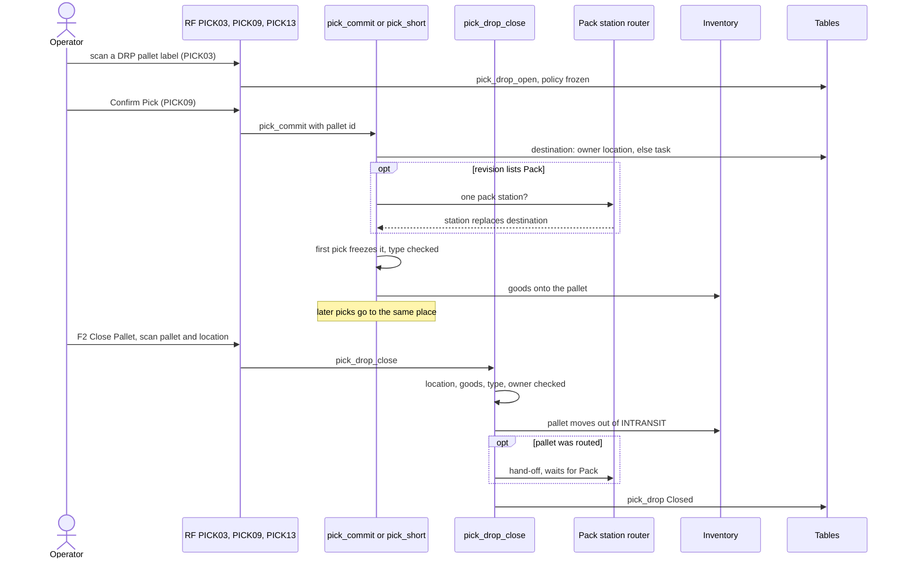

# Drop-off of a discrete pick pallet

**What this shows.** Where the goods of a discrete pick wait while the operator picks (a pallet in `INTRANSIT`), how the first pick fixes the pallet's destination, and how `Close Pallet` (key F2) moves the pallet there.

## Reading the diagram

- An operator has at most one open pallet. A pallet that holds goods must be closed before another is opened: `DROP_STILL_OPEN`. An empty open pallet is let go when a new one is opened.
- The pallet opens under a frozen policy revision. With `Pick by Area` and a pick that stands in a zone of that area, it is the revision of the area and equipment. Otherwise it is `DISCRETE`. The revision decides `Pallet Drop Cell Types` and `Count an Emptied Location`.
- The destination is the same chain as for a cart: the owner field `Delivery location (picker carrier)`, else the `To Location` of the task (the zone field `Picking To Location`). If neither exists, the pick is refused (`DROP_DESTINATION_UNRESOLVED`).
- A later pick onto the same pallet that goes to another destination is refused (`DROP_DESTINATION_DIFFERS`). The next dispatch then names the open pallet in `drop_to_close`.
- At F2 the scanned location must be exactly the frozen destination. Anything else answers `WRONG_DROP_LOCATION`. A pallet that holds nothing answers `DROP_EMPTY`.
- The operator closes their own pallet. Another operator needs the right `pick_drop.close_foreign` or a one-time supervisor grant for that pallet (screen `PICK13_OVR`, method `supervisor_override_grant`). Without both: `DROP_NOT_YOURS`.
- The location must also pass inventory's check: not blocked against outbound flow, status `Ok`, no flag.
- A closed pallet of a cancelled order still closes. Its goods must leave `INTRANSIT`.
- The router is asked only when the revision lists `Pack`. It routes only if exactly one distinct pack station answers for the destination. If areas disagree, the pallet is not routed.

## Where it comes from

| What | Source |
|---|---|
| Open pallet and the frozen revision | `crates/libs/wms-outbound/src/picking/commands/drop_open.rs:1-60` and `:113-143` |
| Deposit onto the pallet, destination chain, router, freeze | `crates/libs/wms-outbound/src/picking/deposit/onto_pallet.rs:1-120` |
| Pallet types come from the frozen revision | `crates/libs/wms-outbound/src/picking/deposit/onto_pallet.rs:178-200` |
| Refusal codes | `crates/libs/wms-outbound/src/domain/pick_drop/aggregate.rs:119-140` |
| Rules of the destination | `crates/libs/wms-outbound/src/domain/pick_drop/aggregate.rs:387-409` |
| Rules of the close | `crates/libs/wms-outbound/src/domain/pick_drop/aggregate.rs:437-484` |
| The close, with the router hand-off | `crates/libs/wms-outbound/src/picking/commands/drop_close.rs:1-60` and `:160-260` |
| Code of the right `pick_drop.close_foreign` | `crates/libs/wms-shared/src/validation_codes.rs:650-659` |
| Right to close another operator's pallet | `crates/libs/wms-outbound/src/picking/infrastructure/authority.rs:12-24` |
| Pallet statuses | `crates/libs/wms-lib-core/src/model/outbound/pick_drop.rs:39-46` |
| RF screens | `crates/libs/wms-lib-sql/sql/rf-screens/101_uc_pick_drop_close.sql`, `crates/libs/wms-lib-sql/sql/rf-screens/111_uc_pick_drop_area.sql` |

## Related pages

- [Cart delivery](24-drop-off-cart.md)
- [The RF journey for a discrete pick](20-rf-pick-discrete.md)
- [Pallet fields](56-influence-pallet-fields.md)
- [Delivery location](58-influence-delivery-destination.md)
- [Picking overview, section 5.1](../../admin/policies/20-picking-overview.md)
