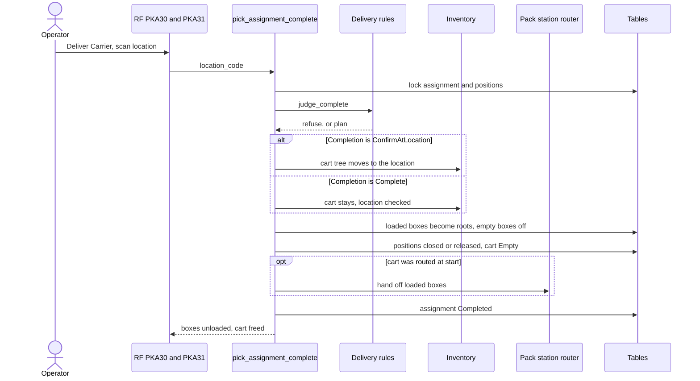

# Drop-off of a cart (deliver the carrier)

**What this shows.** What `pick_assignment_complete` does when the operator delivers a cart: the checks, the move to the delivery location (or not), the unload of the boxes and the end of the assignment.

## Reading the diagram

- A live assignment can be delivered only by its holder, only when it is past `Building`, only when no stop is left, and only when no position waits for carton recovery. The refusals are `PICK_ASSIGNMENT_NOT_YOURS`, `PICK_ASSIGNMENT_NOT_ON_ROUTE`, `ROUTE_NOT_FINISHED` and `CARTON_REPLAN_REQUIRED`.
- `Completion` is read from the policy copy frozen when the cart started. With `ConfirmAtLocation` the operator must scan exactly the delivery location of the assignment, or the answer is `DELIVERY_LOCATION_REQUIRED` or `WRONG_DELIVERY_LOCATION`. With `Complete` the scan is not read and the boxes come off where the cart stands.
- The delivery location was frozen at start. A later edit of the owner field applies to the next start.
- The location must be able to take the cart: status `Ok`, no flag, no hold against outbound flow, and the cart must stand somewhere. Otherwise `DELIVERY_LOCATION_UNUSABLE`.
- A cart that was dissolved but still carries goods can be delivered by anyone who scans its label, and also by its former holder without a scan. The assignment then stays `Dissolved`. The next `pick_dispatch_next` of the former holder returns that cart first.
- Boxes with goods keep their stock and stand as separate roots at the delivery location. Empty boxes come off. The cart becomes `Empty` and can be used again.
- The router hand-off exists only when the cart was routed at start: `Completion` = `ConfirmAtLocation` and the area has a pack station. A cart with `Complete` is never routed.
- A repeat of the call answers `PICK_ASSIGNMENT_ALREADY_DELIVERED`.
## Related pages

- [Drop-off of a pallet](23-drop-off-pallet.md)
- [The cart route](21-rf-pick-cart-route.md)
- [Pick and task statuses](40-statuses.md)
- [Pick Assignments list](../../reference/tasks/20-pick-assignments-list.md)
- [Picking overview, section 5.2](../../admin/policies/20-picking-overview.md)
