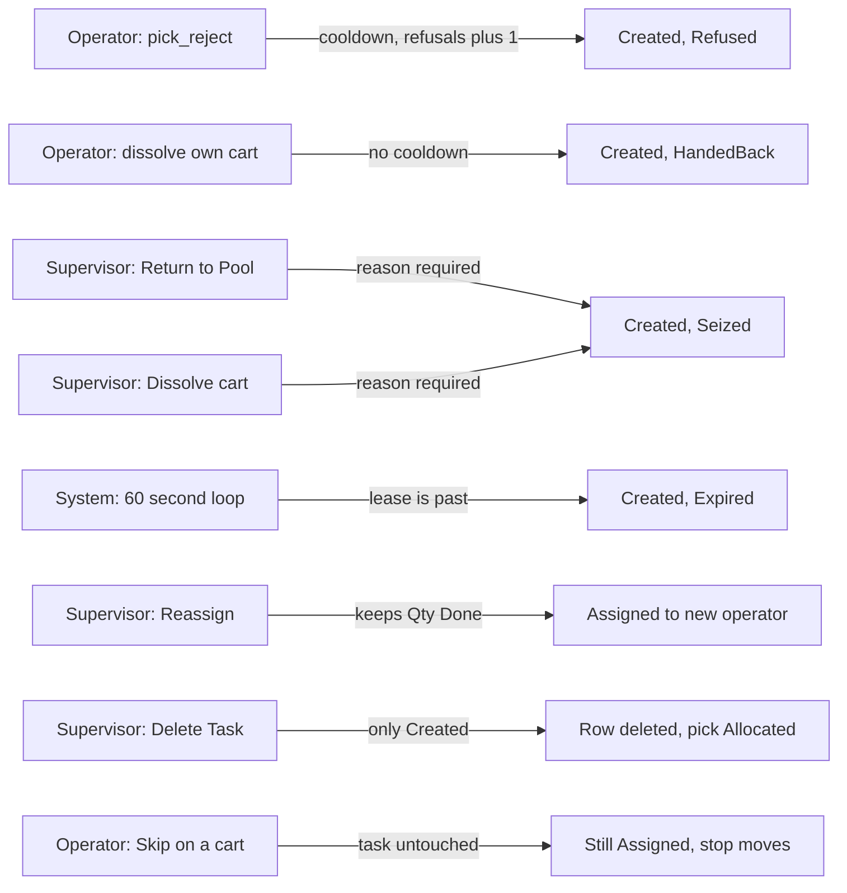

# How a held pick task leaves its operator

**What this shows.** Every door that takes a pick task away from the operator who holds it, who uses the door, and in which state the task is afterwards.

## Reading the diagram

- Every door except `Delete Task` and `Skip` asks the **source** first. For a pick the source is the Pick guard. It refuses when the SKU has an open serial scan and its `Pick Episode Reassignment` is `Block`, when a serial scan is `Abandoned`, and when the pick is in a live cart (`PICK_ASSIGNMENT_LIVE`: use the dissolve instead). With `Handover` or `CancelAndRestart` a return is allowed. A reassign hands the scan over or cancels it.
- `pick_reject` is the only way an operator gives back a single pick task. The generic `task_skip` refuses a pick (`SourceOwnedLifecycle`). `HandedBack` is therefore written by cart doors only: the holder's dissolve, a box closed full, and the hand-over to recovery.
- `pick_reject` is allowed only before anything is picked, needs a reason (at most 80 characters) and the task version. Two switches can forbid it. For a pick on a cart it is the flag `Allow Task Release` of the area of the assignment. For a discrete pick the RF screen `PICK11` sends no work area, so only the system setting `TASK_ALLOW_RELEASE_DEFAULT` applies (the area flag is read only when a caller of the API names `work_area_id`).
- After `Refused` the task is hidden for `TASK_SKIP_COOLDOWN_MIN` minutes. After `TASK_SKIP_ESCALATE_AFTER` refusals it leaves the pool until a supervisor reassigns it. See [Task settings](55-influence-task-settings.md).
- `Seized`, `HandedBack` and `Expired` set no cooldown and do not count as a refusal. A task returned by `Return to Pool` can be offered at once.
- The holder may dissolve their own cart before the first commit alone. After a commit a supervisor must confirm on the RF with a one-time grant. A supervisor can dissolve a cart in any live status except `Delivering`, and not while a position waits for carton recovery (`CARTON_REPLAN_REQUIRED`).
- `Reassign` works on `Assigned` and `InProgress` tasks and on `Created` tasks that were escalated. It resets the refusal counter, clears the escalation and sets a new lease. The code checks only that the target is an **active operator**. It does not check the target's task rights, `Pick Execution`, zones or equipment.
- The lease reaper does not take a task whose source refuses. A pick under `Block` with an open serial scan stays with its holder until the scan is finished or a supervisor closes it.
- `Skip` on a cart moves the stop to the end of the route. It does not change the task, its lease or its status.

## Where it comes from

| What | Source |
|---|---|
| Operator return, area gate, escalation counter | `crates/libs/wms-tasks/src/service/release.rs:121-190` |
| Generic skip refuses a pick | `crates/libs/wms-tasks/src/service/release.rs:66-77` and `:690-720` |
| `pick_reject` | `crates/libs/wms-outbound/src/picking/commands/reject.rs:1-60` and `:130-200` |
| Return to pool: SQL | `crates/libs/wms-lib-core/src/model/tasks/task.rs:1512-1575` |
| Reassign: rules and SQL | `crates/libs/wms-tasks/src/service/release.rs:223-300` and `crates/libs/wms-lib-core/src/model/tasks/task.rs:1617-1647` |
| Return to Pool by a supervisor | `crates/libs/wms-tasks/src/service/release.rs:304-370` and `crates/libs/wms-lib-core/src/model/tasks/task.rs:1685-1706` |
| Source may refuse (serial rule, live cart) | `crates/libs/wms-outbound/src/picking/infrastructure/holder_change.rs:1-60` and `:90-135` |
| Lease reaper | `crates/libs/wms-tasks/src/service/reap.rs:1-100` and `crates/libs/wms-lib-core/src/model/tasks/task.rs:1886-1923` |
| Reaper and cart sweeper loop (60 s) | `crates/services/app-server/src/services/cleanup_tasks.rs:142` and `:908-965` |
| Cart sweeper | `crates/libs/wms-outbound/src/picking/lease.rs:1-110` |
| Who may dissolve and when | `crates/libs/wms-outbound/src/domain/pick_assignment/aggregate.rs:520-581` |
| Dissolve: holder, supervisor, sweeper | `crates/libs/wms-outbound/src/picking/commands/dissolve.rs:1-120` and `:505-520` |
| Delete Task | `crates/libs/wms-outbound/src/service/status_manager/delete_task.rs:1-60` |
| Skip on a cart | `crates/libs/wms-outbound/src/picking/commands/skip.rs:1-30` |
| RF screens | `crates/libs/wms-lib-sql/sql/rf-screens/094_uc_pick.sql`, `crates/libs/wms-lib-sql/sql/rf-screens/096_uc_pick_route.sql` |

## Related pages

- [Task settings: lease, cooldown, escalation, release](55-influence-task-settings.md)
- [Box full and target exceptions](31-box-full-and-target-exceptions.md)
- [Pick and task statuses](40-statuses.md)
- [Returning a task to the pool](../../reference/tasks/60-returning-a-task-to-the-pool.md)
- [Reassigning a task](../../reference/tasks/61-reassigning-a-task.md)
- [Dissolving a pick assignment](../../reference/tasks/63-dissolving-a-pick-assignment.md)
