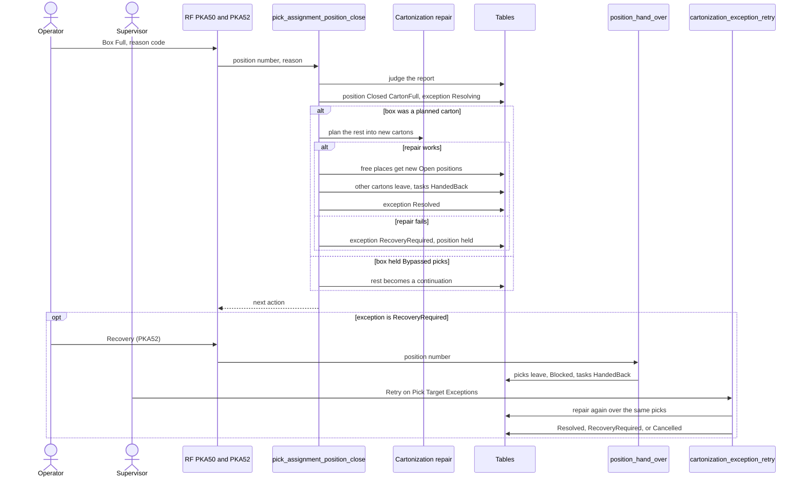

# Box full: the exception and its repair

**What this shows.** What happens when the box at a cart position is full before all its picks are done: the operator's report, the automatic repair of the rest, and the recovery by hand when the repair fails.

## Reading the diagram

- The report is refused when the box is empty, when the box is not the type or size the carton was planned for, when no pick of the position is left to replan, when some open pick is already partly picked, when the position already has an unfinished exception, or when the reason is `OTHER` without a comment.
- The reasons are `MASTER_DATA_DIMENSIONS`, `PROTECTIVE_PACKAGING`, `ORIENTATION_NOT_FEASIBLE`, `PRODUCT_OR_CARTON_DEFORMED`, `SOLVER_LAYOUT_NOT_FEASIBLE` and `OTHER`.
- The free places for new cartons are the numbers from 1 to the smaller of the cart's positions and `Max Targets` of the frozen policy that no position of the assignment uses. A new carton without a place waits whole for the next `pick_assignment_start`.
- While an exception is `RecoveryRequired`, the position is held. Every route command and the delivery refuse with `CARTON_REPLAN_REQUIRED` until the operator hands the picks over. A dissolve is refused too.
- The hand-over blocks the picks from dispatch (`cartonization_outcome` = `Blocked`, so `CARTONIZATION_BLOCKED`) until a retry repairs them.
- The supervisor's retry hands over picks that are still on a cart first (their tasks are `Seized`). When none of the picks is a live reservation any more, the exception becomes `Cancelled` with `CARTON_REPLAN_NOTHING_LEFT`.
- The exception status `Resolving` is written and left inside the transaction of the report. After it ends, the visible statuses are `Resolved` or `RecoveryRequired`. `Reported` is never written.
- The close takes the order lock, so `ORDER_LOCK_TIMEOUT_MS` (a system setting, default 5000) is the longest it waits for it.

## Where it comes from

| What | Source |
|---|---|
| Steps and lock order of the report | `crates/libs/wms-outbound/src/picking/target/close.rs:1-70` and `:104-420` |
| Rules for a box-full report | `crates/libs/wms-outbound/src/domain/pick_assignment/tare.rs:138-198` |
| Free places | `crates/libs/wms-outbound/src/domain/pick_assignment/tare.rs:200-220` and `crates/libs/wms-outbound/src/picking/target/close.rs:330-340` |
| Reasons | `crates/libs/wms-lib-core/src/model/outbound/pick_target_execution_exception.rs:55-63` |
| Exception statuses and their writers | `crates/libs/wms-lib-core/src/model/outbound/pick_target_execution_exception.rs:38-53` and `:315-410` |
| Hand-over and retry | `crates/libs/wms-outbound/src/picking/target/recovery.rs:1-60` |
| Commands | `crates/libs/wms-outbound/src/picking/commands/close_position.rs:1-115`, `crates/libs/wms-outbound/src/picking/commands/hand_over_position.rs:1-68`, `crates/libs/wms-outbound/src/picking/commands/retry_carton_exception.rs:1-85` |
| RF screens `PKA50`, `PKA52` | `crates/libs/wms-lib-sql/sql/rf-screens/098_uc_pick_carton_exceptions.sql` |
| Order lock timeout setting, default 5000 | `crates/libs/wms-outbound/src/repo/locking.rs:1-30`, `crates/libs/wms-outbound/src/repo/occ.rs:25-45`, `crates/libs/wms-lib-core/src/model/sys_settings.rs:87` and `:226-231` |
| Supervisor list and retry button | `crates/libs/wms-lib-sql/sql/wms-meta-ui/migrations/101_carton_execution_exceptions.sql` |

## Related pages

- [Box damaged: replace the box](32-box-damaged.md)
- [Pick and task statuses](40-statuses.md)
- [Pick Target Exceptions](../../reference/tasks/30-pick-target-exceptions.md)
- [Retrying a box-full exception](../../reference/tasks/64-retrying-a-box-full-exception.md)
