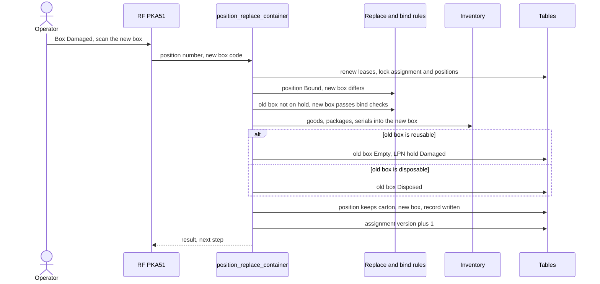

# Box damaged: replace the box on a cart position

**What this shows.** What `pick_assignment_position_replace_container` does when the box at a position is damaged and the operator scans a new box.

## Reading the diagram

- The new box must pass the same checks as a box bound at the start: empty, registered, not on hold, type and size as planned, not on another cart, usage allowed for the owner. Or it is the planned carton's own label. See [How a cart is built](12-cart-assignment.md).
- The call is refused when the scanned box is already the position's box (`SameBox`), when it was written off, or when the damaged box carries a hold of its own. A hold that lands on the new or old box after the first check is found again under the container lock, and the whole replacement rolls back.
- The picks keep their `carton_id`. Only the physical box of the position changes. The swap is written in `pick_position_container_replacement`.
- A repeat with a new key on a position that already holds the scanned box after a replacement answers `already_replaced` and writes nothing.
- The route status does not change. A replacement is not a route command.
## Related pages

- [Box full and target exceptions](31-box-full-and-target-exceptions.md)
- [How a cart is built](12-cart-assignment.md)
- [Operator guide: picking](../../operator/09-picking.md)
