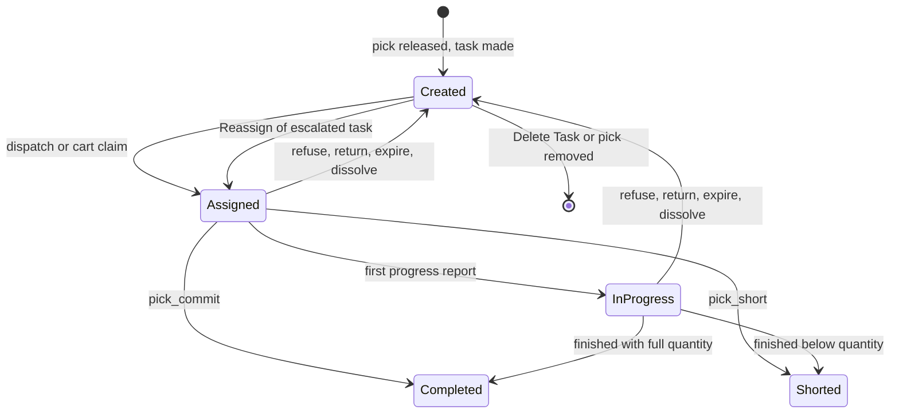
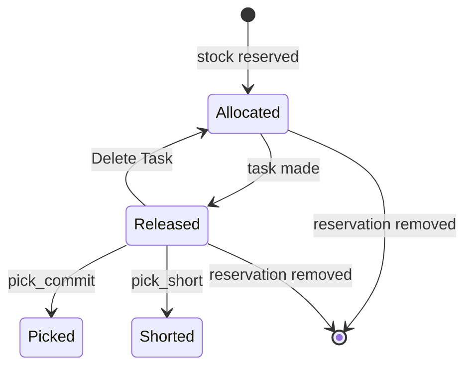
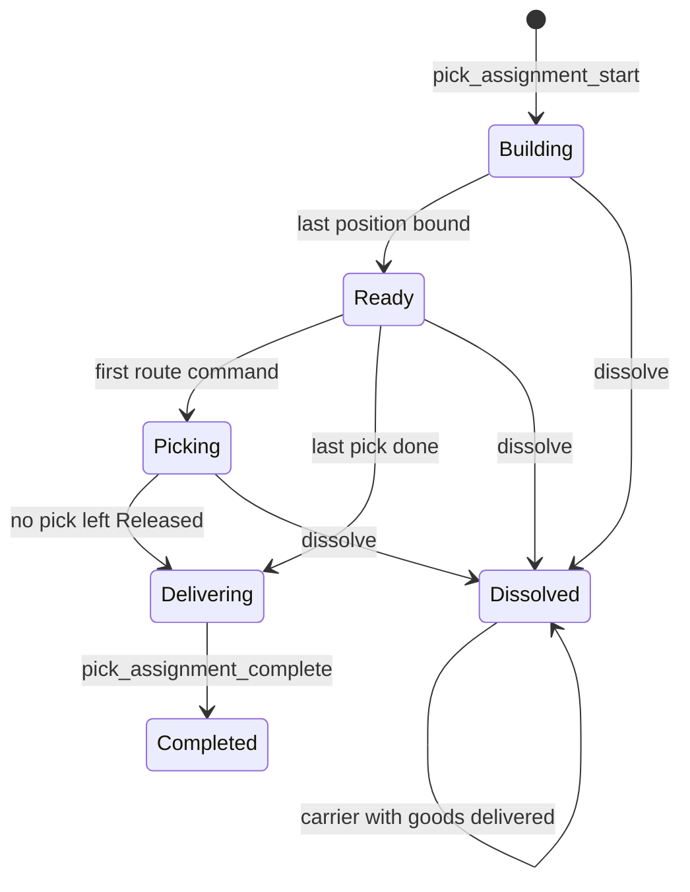
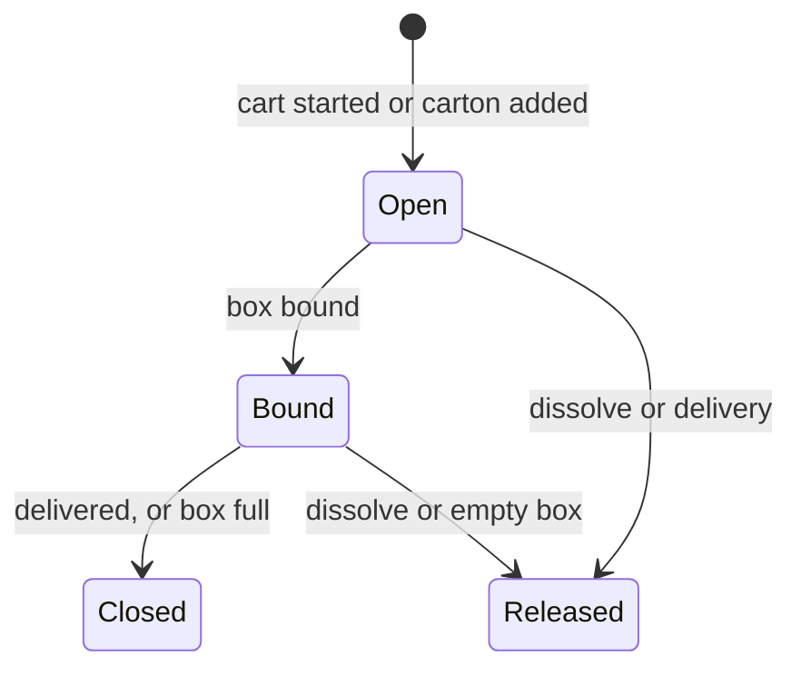
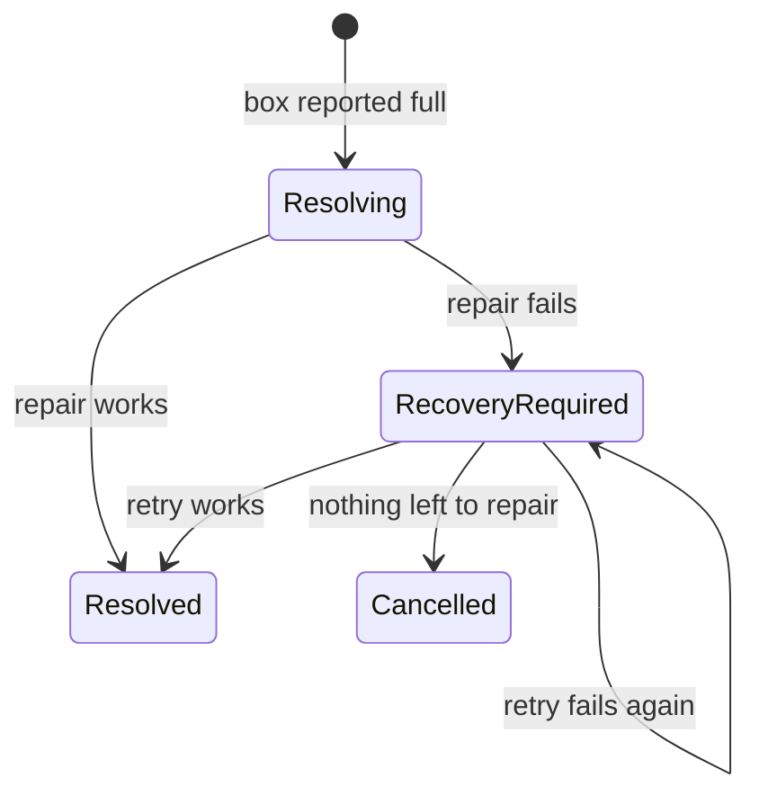

# Statuses of a task, a pick, a pick assignment and a box-full exception

**What this shows.** The statuses that picking moves, and for each arrow the code that writes it. An arrow that no code writes is not drawn.

## 1. Task

- `InProgress` is written by the generic progress doors and by counts. **No pick door writes it.** A pick task goes `Assigned` to `Completed` or `Shorted` in one commit.
- `Cancelled` is declared and nothing writes it. A task whose pick is removed is deleted. An order cancel can delete a task in any status.
- A task made for a split row of a full box is created and handed to the holder in the same transaction. It is never visible as `Created`.
- Going back to `Created` clears holder, claim, start and lease and keeps `Qty Done`. The reason decides the `How Returned` value: [page 30](30-task-return-paths.md).
- An escalated task is a `Created` task with `escalated_at` set. The pool does not offer it.

## 2. Pick (`pick_detail`)

- `Cancelled` is a dead value. A reservation that is given back is deleted, not marked.
- A pick is executable only in `Released`. Dispatch, commit, short, skip and reject all check it.
- A short with 0 found also ends in `Shorted`.

## 3. Pick assignment (a cart)

- `Building`, `Ready`, `Picking` and `Delivering` are live: they hold an operator, a cart, boxes and picks.
- A dissolve of a `Delivering` cart is refused (`PICK_ASSIGNMENT_DELIVERING`). A dissolved cart that still carries goods is delivered later by `pick_assignment_complete`. It stays `Dissolved` and gets `delivered_at`.
- The delivery rules ask that no stop is left. In practice only a `Delivering` cart passes them.
- Who can dissolve and when: [page 30](30-task-return-paths.md).

## 4. Position of a cart

- `Closed` carries a reason: `Delivered` or `CartonFull`. A box closed full stays on the cart until delivery.
- A `Released` place is never used again by that assignment. The position number is unique over all statuses.

## 5. Box-full exception

- `Resolving` is written and left inside one transaction. Nobody sees it on the list. `Reported` exists in the enum and nothing writes it.
- `Resolved` and `Cancelled` are final.

## Where it comes from

| What | Source |
|---|---|
| Task statuses, `Cancelled` has no writer | `crates/libs/wms-lib-core/src/model/tasks/task.rs:39-56` |
| `Created` on insert | `crates/libs/wms-tasks/src/service/draft.rs:241-262` |
| `Created` to `Assigned` (dispatch, set claim, held task, reassign) | `crates/libs/wms-lib-core/src/model/tasks/task.rs:654-678`, `:820-860`, `:933-955`, `:1617-1647` |
| `Assigned` to `InProgress` by the generic doors | `crates/libs/wms-tasks/src/service/lifecycle.rs:94-165`, `crates/libs/wms-tasks/src/domain/task/aggregate.rs:70-80` |
| No pick door calls the start or progress doors | `crates/libs/wms-outbound/src/picking/commands/commit.rs:350-359`, `crates/libs/wms-outbound/src/picking/commands/short.rs:401-412` (only `complete`) |
| `Completed` and `Shorted` | `crates/libs/wms-tasks/src/domain/task/aggregate.rs:120-165` and `crates/libs/wms-tasks/src/service/lifecycle.rs:166-216` |
| Back to `Created` | `crates/libs/wms-lib-core/src/model/tasks/task.rs:1512-1575`, `:1685-1706`, `:858-890`, `:1904-1923` |
| Task deleted | `crates/libs/wms-lib-core/src/model/tasks/task.rs:1797-1850` and `crates/libs/wms-outbound/src/service/status_manager/delete_task.rs:1-60` |
| Pick statuses | `crates/libs/wms-lib-core/src/model/outbound/pick_detail.rs:25-42` |
| `Allocated` to `Released` | `crates/libs/wms-outbound/src/picking/infrastructure/tasks.rs:88-104` |
| `Released` to `Allocated` | `crates/libs/wms-lib-core/src/model/outbound/pick_detail.rs:758-775` |
| `Picked` and `Shorted` | `crates/libs/wms-outbound/src/picking/commands/commit.rs:324` and `crates/libs/wms-outbound/src/picking/commands/short.rs:380-395` |
| Assignment statuses | `crates/libs/wms-lib-core/src/model/outbound/pick_assignment.rs:27-47` |
| `Building` on insert | `crates/libs/wms-lib-sql/sql/wms-app/migrations/050_pick_assignment.sql:28` |
| `Ready`, `Picking`, `Delivering` | `crates/libs/wms-lib-core/src/model/outbound/pick_assignment.rs:797-880` |
| `Dissolved` | `crates/libs/wms-lib-core/src/model/outbound/pick_assignment.rs:905-925` and `crates/libs/wms-outbound/src/domain/pick_assignment/aggregate.rs:538-581` |
| `Completed`, delivered but dissolved | `crates/libs/wms-lib-core/src/model/outbound/pick_assignment.rs:755-790` |
| Position statuses | `crates/libs/wms-lib-core/src/model/outbound/pick_assignment.rs:49-60`, `:1150-1160`, `:1170-1200`, `:1210-1235`, `:1250-1270` |
| Exception statuses | `crates/libs/wms-lib-core/src/model/outbound/pick_target_execution_exception.rs:38-53` and `:315-410` |

## Related pages

- [Task statuses and transitions (reference)](../../reference/tasks/90-task-statuses-and-transitions.md)
- [Order statuses and transitions](../../reference/outbound/90-order-statuses-and-transitions.md)
- [Task return paths](30-task-return-paths.md)
- [Box full](31-box-full-and-target-exceptions.md)
