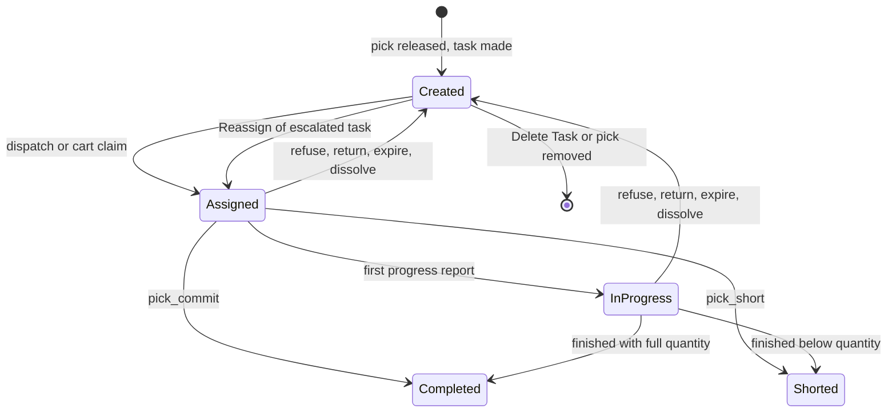
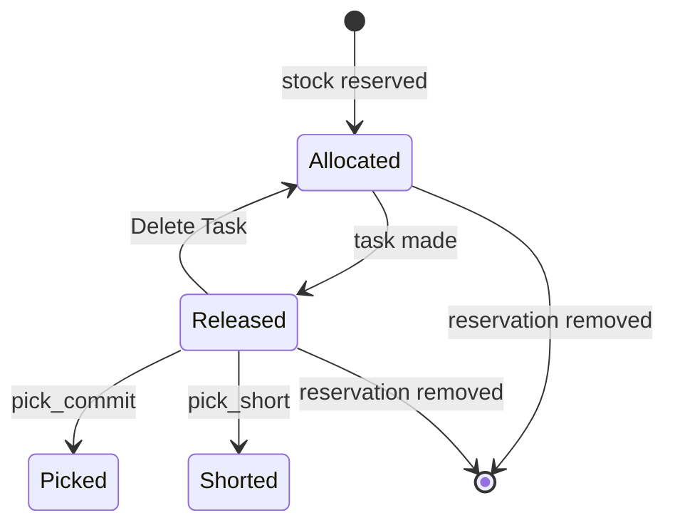
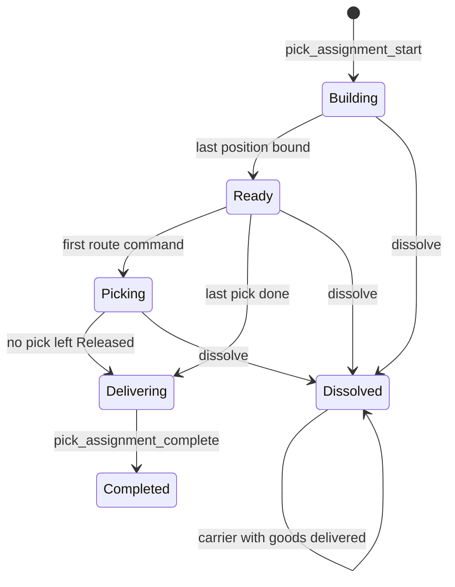
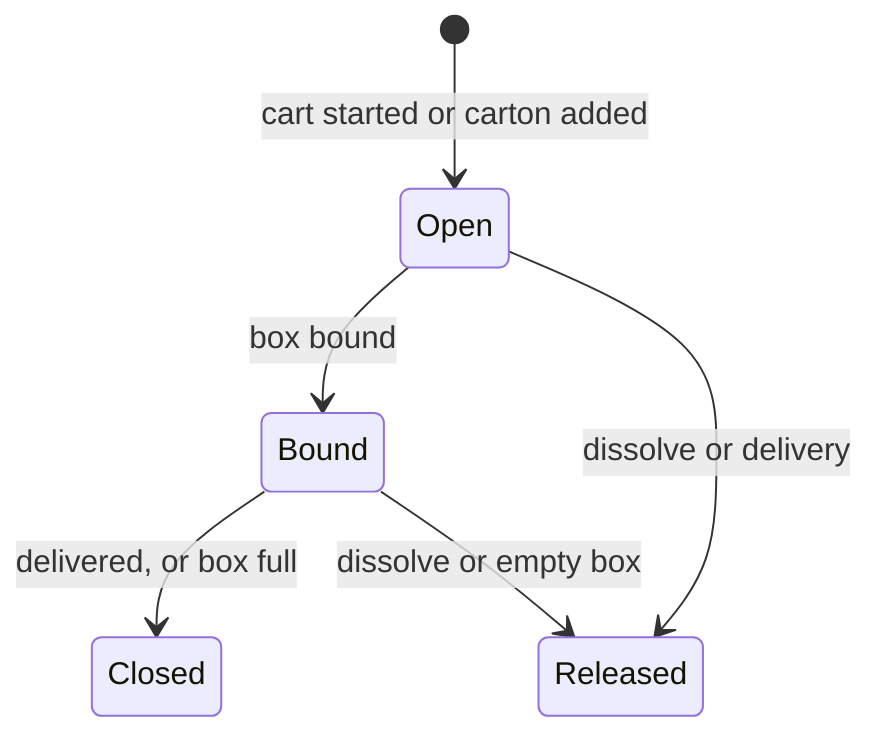
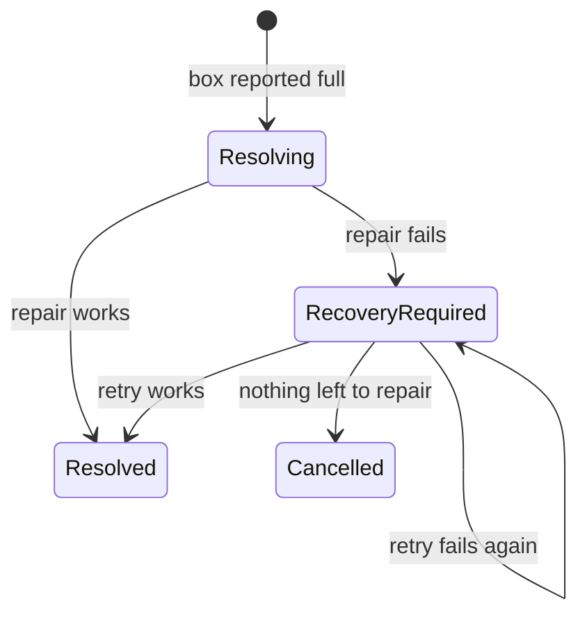

# Statuses of a task, a pick, a pick assignment and a box-full exception

**What this shows.** The statuses that picking moves, and for each arrow the code that writes it. An arrow that no code writes is not drawn.

## 1. Task

- `InProgress` is written by the generic progress doors and by counts. **No pick door writes it.** A pick task goes `Assigned` to `Completed` or `Shorted` in one commit.
- `Cancelled` is declared and nothing writes it. A task whose pick is removed is deleted. An order cancel can delete a task in any status.
- A task made for a split row of a full box is created and handed to the holder in the same transaction. It is never visible as `Created`.
- Going back to `Created` clears holder, claim, start and lease and keeps `Qty Done`. The reason decides the `How Returned` value: [page 30](30-task-return-paths.md).
- An escalated task is a `Created` task with `escalated_at` set. The pool does not offer it.

## 2. Pick (`pick_detail`)

- `Cancelled` is a dead value. A reservation that is given back is deleted, not marked.
- A pick is executable only in `Released`. Dispatch, commit, short, skip and reject all check it.
- A short with 0 found also ends in `Shorted`.

## 3. Pick assignment (a cart)

- `Building`, `Ready`, `Picking` and `Delivering` are live: they hold an operator, a cart, boxes and picks.
- A dissolve of a `Delivering` cart is refused (`PICK_ASSIGNMENT_DELIVERING`). A dissolved cart that still carries goods is delivered later by `pick_assignment_complete`. It stays `Dissolved` and gets `delivered_at`.
- The delivery rules ask that no stop is left. In practice only a `Delivering` cart passes them.
- Who can dissolve and when: [page 30](30-task-return-paths.md).

## 4. Position of a cart

- `Closed` carries a reason: `Delivered` or `CartonFull`. A box closed full stays on the cart until delivery.
- A `Released` place is never used again by that assignment. The position number is unique over all statuses.

## 5. Box-full exception

- `Resolving` is written and left inside one transaction. Nobody sees it on the list. `Reported` exists in the enum and nothing writes it.
- `Resolved` and `Cancelled` are final.
## Related pages

- [Task statuses and transitions (reference)](../../reference/tasks/90-task-statuses-and-transitions.md)
- [Order statuses and transitions](../../reference/outbound/90-order-statuses-and-transitions.md)
- [Task return paths](30-task-return-paths.md)
- [Box full](31-box-full-and-target-exceptions.md)
