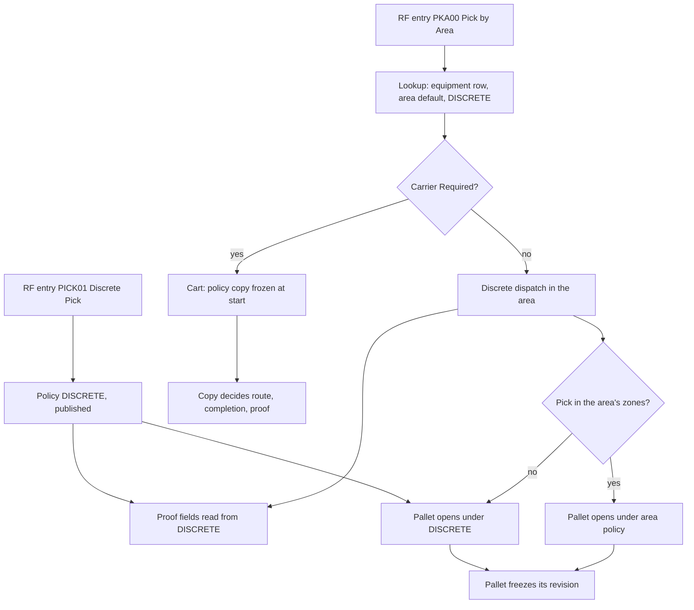

# Which picking policy is read for a pick

**What this shows.** For each part of picking, which policy revision the system reads: the policy of the area, the fallback `DISCRETE`, or a copy frozen on the cart or the pallet.

## Reading the diagram

- The lookup for `Pick by Area` is: the row of the area for the operator's equipment profile in `work_area_picking_policy`, else `work_area.picking_policy_code`, else `DISCRETE`. An operator who chose `On foot` has no profile, so the area default applies. A code with no published revision is an error (`picking policy {code} has no published revision`), not a silent `DISCRETE`.
- Only `Carrier Required` of the live policy decides, at dispatch, between a task and `Scan Carrier`. The shape check of the policy makes `Unit` = `PlannedTarget` always carry `Carrier Required` = Yes.
- A cart keeps the policy it started with. A new revision does not change a live assignment.
- The five source-proof fields of a **discrete** pick are read from the published revision of `DISCRETE` at the moment of each scan, whatever policy the area has. A policy of `Unit` = `Order` with another code contributes its pallet fields only. Its proof fields are never read for a discrete pick.
- A pallet freezes its revision when it is opened. A new revision does not change an open pallet.
- A pick that is taken through `PICK01` always opens its pallet under `DISCRETE`, because that entry sends no area. `pick_drop_open` receives `work_area_code` only from the `Pick by Area` flow.
- `Retire` is refused for `DISCRETE` and for any code an area uses.
## Related pages

- [Cart policy fields](51-influence-picking-policy.md)
- [Source proof fields](57-influence-source-proof.md)
- [Pallet fields](56-influence-pallet-fields.md)
- [Picking policy settings (reference)](../../admin/policies/21-picking-policy-settings.md)
- [Work areas, equipment and permissions](../../admin/policies/22-work-areas-equipment-and-permissions.md)
