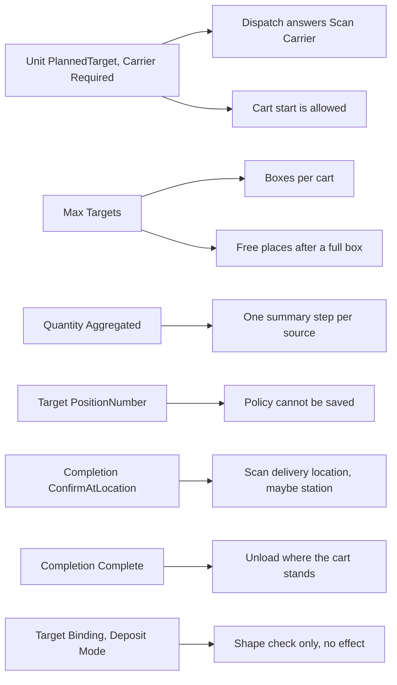

# Cart policy fields: what each one changes

**What this shows.** For the fields that shape a cart (carrier) policy, which decision each one changes and what the operator or supervisor sees.

## Reading the diagram

- **Unit and Carrier Required.** `Unit` = `PlannedTarget` needs `Carrier Required` = Yes. A policy with `Unit` = `Order` needs No and fixes every other field of the shape. When the area works by a carrier policy and the operator holds no task, the dispatch answers `Scan Carrier` with `max_targets` and claims nothing. If the operator already holds one single task, that task comes back first. `pick_assignment_start` refuses a policy that is not a carrier policy with `the work area does not pick onto a carrier`.
- **Max Targets** is 1 to 99. The real number of boxes is the smaller of this value and the `Positions` of the cart type. After a box is closed full, the free places for the new cartons are the numbers from 1 up to the same smaller value that no position has used.
- **Quantity.** `PerPick` makes every pick its own stop. `Aggregated` joins consecutive unskipped stops with the same owner, SKU, location and source LPN into one step. The internal lot must match too, unless `Loose Lot Source` is `NoConfirmation`. A serial-tracked SKU is never joined. Each place is still committed or shorted on its own, into its own box.
- **Target.** Only `ScanContainer` is accepted for a cart. `PositionNumber` is refused when the draft is saved or published, and again at cart start as a guard.
- **Completion** is frozen on the cart at start. `ConfirmAtLocation` makes the delivery require the scan of the delivery location. When the area has a pack station, that station is the delivery location and the loaded boxes are handed to the router. `Complete` finishes where the cart stands and never asks the router.
- **Target Binding** and **Deposit Mode** are checked by the shape rule only (`BeforeRoute` and `DirectToTarget` for a cart). The route guard for the deposit mode never fires after that. Which deposit a pick uses is decided by whether the pick belongs to a live assignment.
- The delivery location itself does not come from the policy. It is the owner field `Delivery location (picker carrier)`, else the `To Location` of the tasks when they all agree. See [delivery location](58-influence-delivery-destination.md).
- A cart that already started keeps its copy. New starts use the new revision.

## Where it comes from

| What | Source |
|---|---|
| Shape rules (`Order` and `PlannedTarget`) | `crates/libs/wms-outbound/src/domain/picking_policy/aggregate.rs:195-262` |
| `Max Targets` range | `crates/libs/wms-outbound/src/domain/picking_policy/aggregate.rs:195-199` |
| `Scan Carrier` answer | `crates/libs/wms-outbound/src/picking/commands/dispatch_next.rs:272-300` |
| Start refuses a non-carrier policy, router for `ConfirmAtLocation` | `crates/libs/wms-outbound/src/picking/commands/start.rs:193-218` |
| Capacity | `crates/libs/wms-outbound/src/domain/pick_assignment/aggregate.rs:50-55` |
| Free places after a full box | `crates/libs/wms-outbound/src/picking/target/close.rs:331-336` and `crates/libs/wms-outbound/src/domain/pick_assignment/tare.rs:200-212` |
| Summary step rule | `crates/libs/wms-outbound/src/domain/pick_assignment/route.rs:56-115` |
| Start guard for `Target` | `crates/libs/wms-outbound/src/domain/pick_assignment/aggregate.rs:240-260` |
| Delivery by `Completion` | `crates/libs/wms-outbound/src/domain/pick_assignment/delivery.rs:200-235` |
| Deposit mode guard | `crates/libs/wms-outbound/src/domain/pick_assignment/route.rs:249-262` |
| Retire is refused for `DISCRETE` and for codes areas use | `crates/libs/wms-outbound/src/service/picking_policy/lifecycle.rs:460-480` |

## Related pages

- [Which policy is read](50-influence-which-policy-applies.md)
- [How a cart is built](12-cart-assignment.md)
- [Drop-off of a cart](24-drop-off-cart.md)
- [Picking policy settings (reference)](../../admin/policies/21-picking-policy-settings.md)
