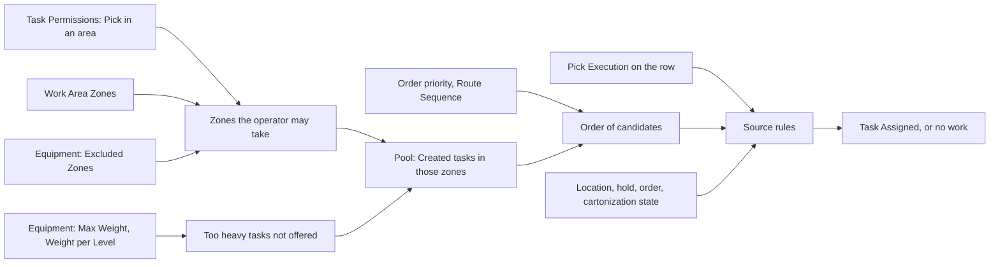

# Who gets which pick task

**What this shows.** Which settings decide whether an operator is offered a pick task, in which order the candidates are tried, and what the operator sees when nothing is offered.

## Reading the diagram

- **Task Permissions.** One row per operator, task type and work area. No row, no work. Without a row the operator gets `you have no right to take Pick tasks in any work area — ask a supervisor` (or `in work area X` when an area was named). The rights are read at every press. Nothing is cached.
- **Work Area Zones.** A work area is a list of putaway zones. A task belongs to the area of the zone of its `From` location. A zone can be in several areas.
- **Excluded Zones** of the operator's equipment profile are removed from the reachable zones. An operator `On foot` has no profile and excludes nothing. If every zone is excluded, the answer is the same `no right` message.
- **Max Weight** and **Weight Reduction per Level.** A task passes when its weight is at most `Max Weight` minus `Weight Reduction per Level` times the `Level` of its `From` location. `Max Weight` = 0, no profile, or an unknown task weight always passes. When only too-heavy tasks are left, the operator reads `there are Pick tasks in your work areas, but every one is heavier than your equipment lifts (up to N at ground level) — they wait for other equipment`. An inactive profile can no longer be chosen at `Pick by Area`, but its limits still apply to operators who already have it.
- **Order.** The candidate with the smallest order priority comes first (1 to 99, default 50), then the smallest `Route Sequence` of the source location (empty last), then the oldest, then the lowest id.
- **Pick Execution.** The same row must have `Pick Execution` on, in an area that contains the zone of the source location. It is off by default. It stops only **new** issue. A task already held, and its commits, continue. The RF shows `No eligible Pick work` (`No eligible Pick work in the area` on `PKA00`). The reason `PICK_EXECUTION_ROLLOUT_DISABLED` is in the diagnostics of the API answer only.
- **Source rules** skip a candidate and try the next: the pick is not `Released`, the order is not released or is closed, the location is missing, not `Ok` or flagged (a short blocks its location with `CycleCountActive`), an inventory hold covers the position, cartonization is `Pending`, `Blocked` or contradicts itself, the pick belongs to a continuation of a full box, or the task no longer matches its pick.
- **Max Concurrent Tasks** of the area and `TASK_MAX_CONCURRENT_DEFAULT` have no effect on picking beyond "greater than 0". An operator holds either one single pick task or one cart set. For other task types the limit works.
- **Allow Task Release** of the area is read when a pick is rejected on a cart, or when an API caller names the area. It is **not** read for a discrete reject on the RF, because `PICK11` sends no area. There `TASK_ALLOW_RELEASE_DEFAULT` decides. See [Task settings](55-influence-task-settings.md).
- The operator must be an active operator. A user becomes one when `RF device login` is on, the status is `Active`, and the user is assigned to the warehouse. The sync runs every 5 minutes or by the `Sync` button.
- The `Reassign` button of a supervisor does not check any of the rows above for the new holder. It checks only that the new holder is an active operator. See [page 30](30-task-return-paths.md).

## Where it comes from

| What | Source |
|---|---|
| Reachable zones | `crates/libs/wms-lib-core/src/model/tasks/operator_task_permission.rs:144-182` |
| `Pick Execution` gate | `crates/libs/wms-lib-core/src/model/tasks/operator_task_permission.rs:112-142` and `crates/libs/wms-outbound/src/picking/infrastructure/dispatch.rs:221-250` |
| Default off | `crates/libs/wms-lib-sql/sql/wms-app/migrations/039_pick_cutover_hardening.sql:5` |
| Pool filter, lift rule, order | `crates/libs/wms-lib-core/src/model/tasks/task.rs:618-650` and `:985-1027` |
| Lift capacity from the profile | `crates/libs/wms-tasks/src/service/claim.rs:165-187` and `crates/libs/wms-lib-core/src/model/equipment_profile.rs:55-88` |
| Concurrent limit is a `greater than 0` gate | `crates/libs/wms-tasks/src/service/candidate.rs:331-350`, limit used for other types at `crates/libs/wms-lib-core/src/model/tasks/task.rs:1287` |
| Source rules and codes | `crates/libs/wms-outbound/src/picking/infrastructure/dispatch.rs:22-70` and `:115-206` |
| Messages | `crates/libs/wms-tasks/src/error.rs:41-75` |
| Reject reads the area from the assignment, `PICK11` sends no area | `crates/libs/wms-outbound/src/picking/commands/reject.rs:70-90` and `:140-165`, `crates/libs/wms-lib-sql/sql/rf-screens/113_rf_inputs_fit_the_server_limits.sql` |
| Operator sync: who becomes an operator, and how often | `crates/libs/wms-lib-core/src/model/tasks/operator.rs:186-270` and `crates/services/app-server/src/services/cleanup_tasks.rs:150`, `:991-1010` |

## Related pages

- [How an operator takes a task](11-operator-takes-a-task.md)
- [Task settings](55-influence-task-settings.md)
- [Work areas, equipment and operator permissions (reference)](../../admin/policies/22-work-areas-equipment-and-permissions.md)
- [Task permissions](../../reference/tasks/52-task-permissions.md)
- [Operators](../../reference/tasks/50-operators-list.md)
