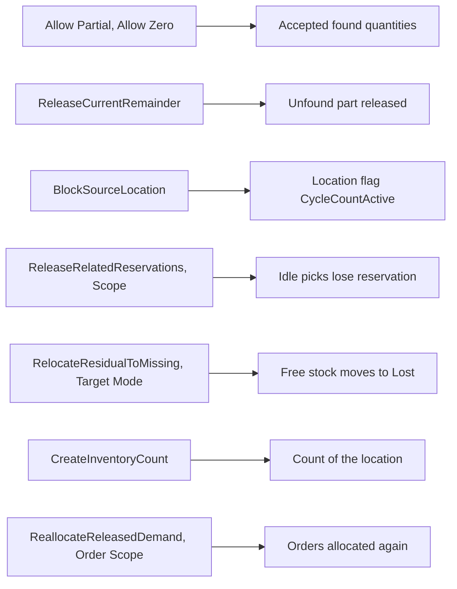

# Short reasons: what each setting changes

**What this shows.** For every field and action of a pick short reason that code reads, which decision it changes after an operator shorts a pick.

## Reading the diagram

- **Allow Partial and Allow Zero** are checked at once, in the short itself. A reason that does not allow the quantity refuses it: `selected short reason does not allow partial Pick` or `... zero Pick`. The seeded `LPN_NOT_FOUND` has `Allow Partial` off.
- **ReleaseCurrentRemainder** must be enabled or the reason cannot be published. It runs in the short itself.
- **BlockSourceLocation** runs in the short itself. It blocks the whole location, whatever its `Scope`. The answer of the short carries `location_blocked`. The next dispatch skips tasks from that location (`LOCATION_BLOCKED`). A count of the location lifts the flag again.
- **ReleaseRelatedReservations.** The `Scope` selects the picks: `EntireLocation` every live pick at the location, `CurrentSkuAtLocation` the same owner and SKU, `SameSourceStock` the same owner, SKU, lot and source container, `CurrentPick` or empty none. Of those, only picks whose task is `Created` with nothing done, or that have no task, and with nothing picked, are released. A pick whose task is held stays and its operator finishes it at the blocked location.
- **RelocateResidualToMissing** moves only the free residual. `Target Mode` = `ZoneMissingToLoc` takes the field `Missing To Location` of the zone of the source location, and fails if the zone has none. `FixedLocation` takes `Fixed Location`. Only `EntireLocation` scope is accepted at publish. It needs `BlockSourceLocation` and a `ReleaseRelatedReservations` whose scope is at least as wide.
- **CreateInventoryCount** requests an Event count of the location after the move. If the count cannot be made, the clean-up does not fail (unless `Required`, which publish refuses for this action). The location then stays blocked until someone counts it.
- **ReallocateReleasedDemand.** `Order Scope` = `CurrentOrder`, `OrdersWithReleasedReservations` or `CurrentAndAffectedOrders` (also the value when empty). An order that is still short after the re-allocation does not fail the clean-up: the short is its outcome.
- The steps run in the fixed order release, move, count, re-allocate. `Trigger After` does not change the order.

## Stored only. It has no effect today.

- Actions `HoldInventory`, `HoldContainer` and `RequestSupervisorReview`. No code runs them.
- `Required` on any action. The only reader is the count step, and publish refuses `Required` on the count.
- `Trigger After`. Publish checks its combinations. The order of the steps ignores it.
- `Supervisor Review`. No code reads it; no review step exists.
- `Scope` of every action except `ReleaseRelatedReservations` and `RelocateResidualToMissing` (publish checks the count's scope).
- `Published At` and `Retired At`.

## Where it comes from

| What | Source |
|---|---|
| Quantity checks, short transaction | `crates/libs/wms-outbound/src/picking/commands/short.rs:538-565` |
| Publish rules for actions | `crates/libs/wms-outbound/src/domain/pick_short_reason/aggregate.rs:52-170` |
| Enabled actions only | `crates/libs/wms-outbound/src/domain/pick_short_reason/aggregate.rs:56-60` and `:173-190` |
| Block the location | `crates/libs/wms-outbound/src/picking/commands/short.rs:392-402` and `crates/libs/wms-lib-core/src/model/location.rs:1239-1257` |
| Release related picks by scope, keep held ones | `crates/libs/wms-outbound/src/picking/remediation.rs:246-345` |
| Residual destination | `crates/libs/wms-outbound/src/picking/remediation.rs:419-447` |
| Count and its `required` flag | `crates/libs/wms-outbound/src/picking/remediation.rs:499-540` |
| Re-allocation, `Order Scope` | `crates/libs/wms-outbound/src/picking/remediation.rs:455-480` and `:559-590` |
| Fixed order of the steps | `crates/libs/wms-outbound/src/picking/remediation.rs:1-30` |
| `HoldInventory` and the others appear only as enum values | `crates/libs/wms-lib-core/src/model/outbound/pick_short_reason.rs:22-40` |
| Seeds | `crates/libs/wms-lib-sql/sql/wms-app/migrations/036_pick_short_reason.sql`, `crates/libs/wms-lib-sql/sql/wms-app/migrations/071_count_on_scan_and_putaway_exceptions.sql` |

## Related pages

- [What happens when the operator finds less stock](22-short-pick.md)
- [Pick short reasons (reference)](../../admin/policies/23-pick-short-reasons.md)
- [Inventory count policy](../../admin/policies/24-inventory-count-policy.md)
