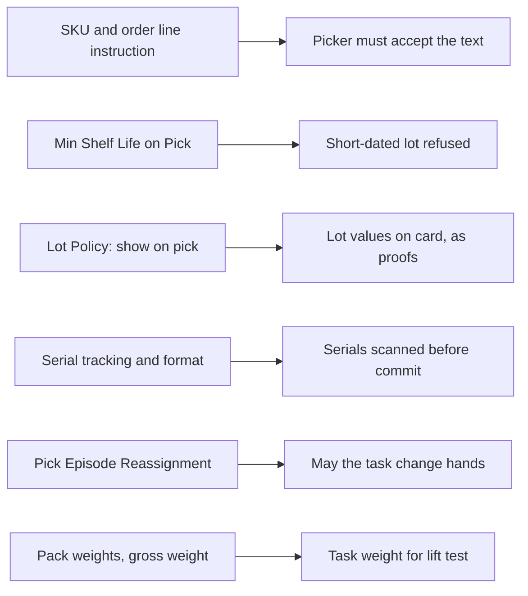

# SKU and lot settings that picking reads

**What this shows.** Which SKU, lot-policy and serial settings change a decision during a pick, and what the operator sees.

## Reading the diagram

- **Pick Instruction.** A standing text of the SKU, a one-off text of the order line, and for a `ShipAsIs` pick the fixed rule `Keep the factory package intact; do not place it in another carton.` The card shows them. `pick_commit`, and `pick_short` when stock is found, refuse until the picker accepted them: `Pick task N has instructions the picker has not acknowledged`.
- **Min Shelf Life on Pick** (days, empty counts as 0). At commit, and at a short with stock found, a reserved lot that does not expire LATER than today plus this number of days is refused with `SOURCE_EXPIRED` (a lot expiring exactly on today plus the number is refused; today is the warehouse day). A lot already expired is refused even when the number is 0 or empty. A lot with no expiration date is picked: there is no date to judge. Allocation uses the same kind of boundary (its own is the larger of this and the SKU's `shelf_life`), so a lot below it is normally not reserved in the first place. A short of a lot that is expired or below the minimum is allowed only with the reason `EXPIRED`.
- **Lot Policy.** Attributes marked "show on pick" appear on the pick card. Those whose physical check is not `NotVerifiable` and that have a reserved value are the ones the operator can be asked to confirm. See [source proof fields](57-influence-source-proof.md).
- **Serials.** If the SKU has serial tracking (`Continuous Serial Tracking`), the commit needs a completed pick serial episode. The number of serials follows the serial scope and the pack. Each scan is cut and checked by the SKU's parse mode, `Serial Length`, `Serial Mask Format` and `Serials per Barcode`. A serial must be active (or reserved for this order) and must match the lot, location and container of the pick. Without tracking, a serial scan is refused.
- **Pick Episode Reassignment** (`Block`, `Handover`, `CancelAndRestart`; default `Block`). It decides what happens to the scanned serials when the holder would change: reassign, return to pool, reject or lease expiry. `Block` keeps the task with its holder. `Handover` gives the open scan to the new holder. `CancelAndRestart` cancels it and keeps the scanned items for audit. An `Abandoned` scan blocks every door until a supervisor closes it. The same rule applies when another operator claims the task from the pool and scans.
- **Weights.** The weight of a task is the weight of its quantity from the SKU's pack items, or the SKU gross weight. An unknown weight is empty and always passes the lift test.
## Related pages

- [Source proof fields](57-influence-source-proof.md)
- [Location and zone settings](59-influence-location-and-zone-settings.md)
- [SKU-level settings (reference)](../../admin/policies/34-sku-level-settings.md)
- [Serial configuration](../../admin/policies/33-serial-configuration.md)
- [Lot policy and attributes](../../admin/policies/32-lot-policy-and-attributes.md)
