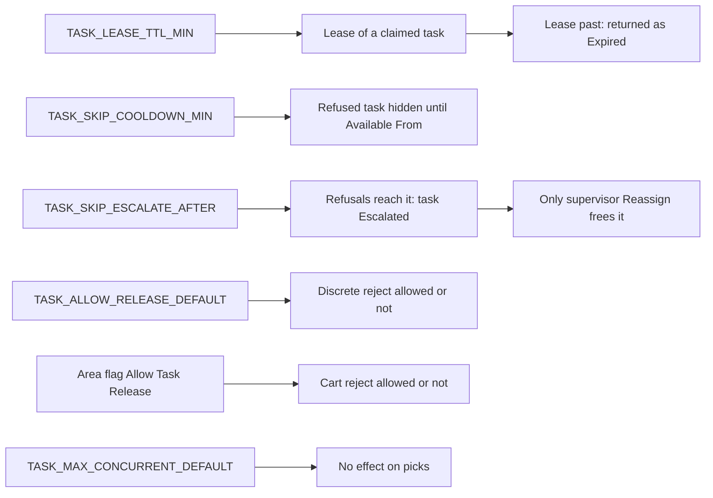

# Task settings: lease, cooldown, escalation and release

**What this shows.** What the five `TASK_*` system settings and the work area flags change for a pick task, and what the supervisor sees on the Task Board.

## Reading the diagram

- All five settings are read as whole numbers from `system_settings` (the value, else the default of the same row). They are read at every claim or renewal. Nothing is cached.
- **TASK_LEASE_TTL_MIN** (seed 15). A value of 0, a negative value or text that is not a number falls back to 15. A claim sets the lease to now plus this number of minutes. A cart set gets one lease for all its tasks. The lease is renewed by: a dispatch that resumes held work, every `pick_confirm_*` call, `pick_drop_open`, `pick_confirm_serial`, and `pick_assignment_bind_position`. A lease that has passed cannot be renewed (`lease has expired; claim the work again`).
- The loop that returns expired tasks runs every 60 seconds. For each warehouse it first dissolves cart assignments whose lease passed, then returns single tasks. A task can therefore sit about `TASK_LEASE_TTL_MIN` plus 1 minute before another operator gets it. A task whose SKU rule (`Block`) keeps it with its holder is not returned.
- **TASK_SKIP_COOLDOWN_MIN** (seed 10, same fallback rule). It applies only to `Refused` returns, for example `pick_reject`. The Task Board shows the moment as `Available From`. `Seized`, `HandedBack` and `Expired` returns set no cooldown.
- **TASK_SKIP_ESCALATE_AFTER** (seed 3, same fallback rule). Each refusal adds 1 to `Refusals`. When the count reaches the setting, `Escalated` is set. The task stays `Created`, but the pool does not offer it. `Reassign` clears the escalation and sets the counter to 0.
- **TASK_ALLOW_RELEASE_DEFAULT** (seed 1). 0 forbids the return, any other number allows it, and a missing or unreadable value allows it. It is read when the call names no work area. The RF screen for a discrete reject (`PICK11`) names none, so for it this setting decides. A refusal reads `returning a task is not allowed in this warehouse — ask a supervisor to move it`.
- **Allow Task Release** of the work area is read when the call names the area. On a cart the area is the one of the assignment. The refusal reads `returning a task is not allowed in work area X — ask a supervisor to move it`. The supervisor's own doors (`Return to Pool`, `Reassign`, `Dissolve`) are not gated by either.
- **TASK_MAX_CONCURRENT_DEFAULT** and **Max Concurrent Tasks** are used by the generic claim of other task types. A pick dispatch returns the held task first and uses the limit only as "greater than 0". A value of 0 or less for the global setting falls back to 1, and the area value cannot be below 1. So the limit never blocks a pick.

## Where it comes from

| What | Source |
|---|---|
| Lease, cooldown, escalation readers and fallbacks | `crates/libs/wms-tasks/src/service/claim.rs:26`, `:189-264` |
| Concurrent limit and release flag readers | `crates/libs/wms-tasks/src/service/work_area_rules.rs:50-103` |
| Setting reader (value, else default) | `crates/libs/wms-lib-core/src/model/sys_settings.rs:206-215` |
| Seeds | `crates/libs/wms-lib-sql/sql/wms-app/migrations/001_baseline.sql:9957-9961` |
| Refusal sets cooldown and counter, escalation | `crates/libs/wms-lib-core/src/model/tasks/task.rs:1512-1575` |
| Cooldown and escalation in the pool filter | `crates/libs/wms-lib-core/src/model/tasks/task.rs:999-1008` |
| `Available From` on the board | `crates/libs/wms-lib-sql/sql/wms-app/migrations/001_baseline.sql:6186-6212` |
| Release gate | `crates/libs/wms-tasks/src/service/release.rs:165-180` |
| Messages | `crates/libs/wms-tasks/src/error.rs:65-75` |
| Renewals | `crates/libs/wms-tasks/src/service/heartbeat.rs:1-45`, `crates/libs/wms-tasks/src/service/candidate.rs:170-190` and `:296-320`, `crates/libs/wms-outbound/src/picking/commands/bind_position.rs:1-45` |
| Loop of 60 seconds | `crates/services/app-server/src/services/cleanup_tasks.rs:142` and `:908-965` |
| Reassign resets escalation | `crates/libs/wms-lib-core/src/model/tasks/task.rs:1617-1647` |
| Limit used by the other task types | `crates/libs/wms-lib-core/src/model/tasks/task.rs:1280-1295` |

## Related pages

- [How a held pick task leaves its operator](30-task-return-paths.md)
- [Who gets which task](52-influence-who-gets-which-task.md)
- [Task statuses and transitions (reference)](../../reference/tasks/90-task-statuses-and-transitions.md)
- [System settings](../../admin/policies/42-system-settings.md)
- [Task Board](../../reference/tasks/10-task-board.md)
