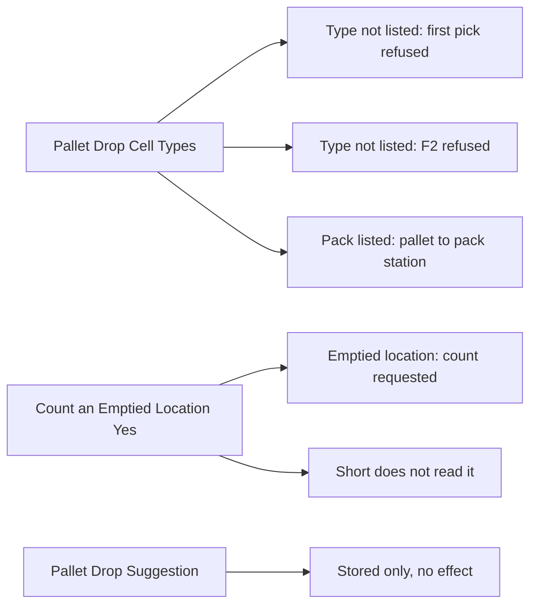

# Pallet fields of a picking policy: what they change

**What this shows.** What the two live fields `Pallet Drop Cell Types` and `Count an Emptied Location` change for a discrete pick, and the one field that changes nothing.

## Reading the diagram

- **Pallet Drop Cell Types** is a list of location types: `Door`, `Pickto`, `Sort`, `Stage`, `Pack`. It is a fence. It does not offer a location. The destination of a pallet always comes from the chain owner field `Delivery location (picker carrier)`, else the task's `To Location`.
- At the first deposit the system resolves the destination and checks its location type against the list of the pallet's frozen revision. If the type is not listed, the pick is refused: `a closed pallet may not stand in the location this pick goes to`, followed by the location and its type. If the revision lists `Pack` and exactly one pack station answers for the destination, the station replaces the destination.
- At `Close Pallet` the scanned location is checked again against the same list. A location that was retyped after the first pick is caught here: `a closed pallet cannot stand in a location of this type`.
- The list is read from the revision that the pallet froze when it was opened. For a pallet opened through `Pick by Area` for a pick in the area's zones, that is the revision of the area (for the shift's equipment). Otherwise it is `DISCRETE`. See [page 50](50-influence-which-policy-applies.md).
- **Count an Emptied Location.** After a full `pick_commit`, if the frozen revision of the pallet (or the copy on the cart) has the flag and the location holds no stock any more, the commit writes the event `process.inventory.count_requested` with source `PickToZero`. A subscriber later starts the count. A rolled-back commit asks for nothing. An empty container left in the location does not stop the count. A count can be refused later (a location type that is never counted, or a location frozen by another operation).
- **Pallet Drop Suggestion** has the single value `OwnerThenTask`. No code reads it. The chain is fixed in code.

## Stored only. It has no effect today.

- `Pallet Drop Suggestion` (`pallet_drop_suggestion`). A search of the Rust code finds it only in the policy model and in the code that copies a revision. No decision reads it.

## Where it comes from

| What | Source |
|---|---|
| Destination chain | `crates/libs/wms-outbound/src/picking/deposit/onto_pallet.rs:122-140` |
| First deposit: type check and `Pack` routing | `crates/libs/wms-outbound/src/picking/deposit/onto_pallet.rs:60-120` |
| Rule of the destination | `crates/libs/wms-outbound/src/domain/pick_drop/aggregate.rs:387-409` |
| List read from the frozen revision | `crates/libs/wms-outbound/src/picking/deposit/onto_pallet.rs:178-200` |
| Check at close | `crates/libs/wms-outbound/src/picking/commands/drop_close.rs:170-200` and `crates/libs/wms-outbound/src/domain/pick_drop/aggregate.rs:437-484` |
| Wording of the refusals | `crates/libs/wms-lib-core/src/model/narration/mod.rs:2335-2345` |
| Count request after a full commit | `crates/libs/wms-outbound/src/picking/emptied_location.rs:1-90` |
| List range and default | `crates/libs/wms-outbound/src/domain/picking_policy/aggregate.rs:35-60` and `:143-160` |
| `pallet_drop_suggestion` appears only in the model and its copies | `crates/libs/wms-lib-core/src/model/outbound/work_area_picking_policy.rs:274` and `crates/libs/wms-outbound/src/service/picking_policy/lifecycle.rs:583` |

## Related pages

- [Drop-off of a pallet](23-drop-off-pallet.md)
- [Delivery location](58-influence-delivery-destination.md)
- [Which policy is read](50-influence-which-policy-applies.md)
- [Inventory count policy](../../admin/policies/24-inventory-count-policy.md)
- [Picking policy settings (reference)](../../admin/policies/21-picking-policy-settings.md)
