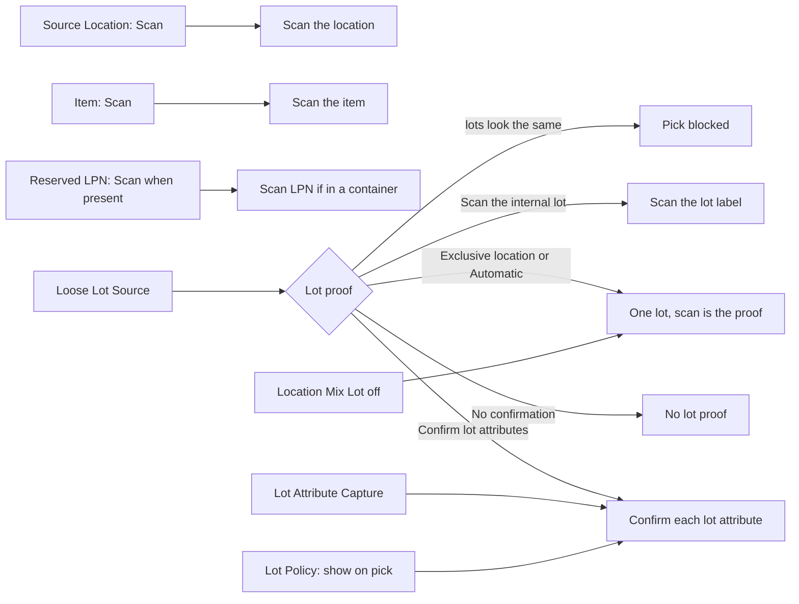

# Source proof fields: what the operator must scan

**What this shows.** How the five `Confirmation` fields of a picking policy, together with the Lot Policy of the SKU and the location, decide which proofs the RF asks at the shelf.

## Reading the diagram

- The order of the proofs is always: location, item, LPN, then the lot proof. The RF follows `verification.next` from the server. The quantity is never a proof.
- **Source Location** = `DisplayOnly` removes the location scan. The scan comes back anyway when the lot proof is "this location holds one lot": `Loose Lot Source` = `Exclusive location`, or `Automatic` for stock outside a container that has one lot and no checkable attribute.
- **Reserved LPN** asks for the LPN scan when the source stands in a container and either this field is `Scan when present` or `Loose Lot Source` is `Automatic`. `Do not confirm` alone does not remove the scan while `Automatic` is on.
- **Loose Lot Source** has five values. `Automatic` never asks for a lot label. It picks the proof from the structure of the
- A **checkable attribute** is one that the SKU's Lot Policy marks "show on pick", whose physical check is not `NotVerifiable`, and that has a reserved value. A `Visual` attribute counts only when `Lot Attribute Capture` is `Scan or manual entry`. A `Barcode` attribute is always scan only.
- When the plan cannot be made, the pick card says that the lot cannot be told apart. `pick_commit` and a short with some quantity found are refused. A zero short, a reject and the pallet step stay open. The fix is on the setting side: change `Loose Lot Source`, give the lots a checkable attribute, or keep one lot per location.
- For a discrete pick these five fields are read from the published revision of `DISCRETE` at each scan. For a cart they are read from the copy frozen at start. See [page 50](50-influence-which-policy-applies.md).
- The commit judges the plan again under the lock of the source location. It compares the frozen plan with the lots in the location now, checks the expiry of the reserved lot against `Min Shelf Life on Pick` of the SKU (the lot must expire later than the warehouse day plus that number) and checks holds. See [SKU, lot and location settings](54-influence-sku-and-lot-settings.md).
- An open confirmation episode keeps its frozen plan. A new episode, opened after the task changed hands, after a skip on a cart or after the pick finished, reads the policy again.
## Related pages

- [The RF pick journey for a discrete pick](20-rf-pick-discrete.md)
- [SKU, lot and location settings](54-influence-sku-and-lot-settings.md)
- [Which policy is read](50-influence-which-policy-applies.md)
- [Picking policy settings, section 7](../../admin/policies/21-picking-policy-settings.md)
- [Lot policy and attributes](../../admin/policies/32-lot-policy-and-attributes.md)
