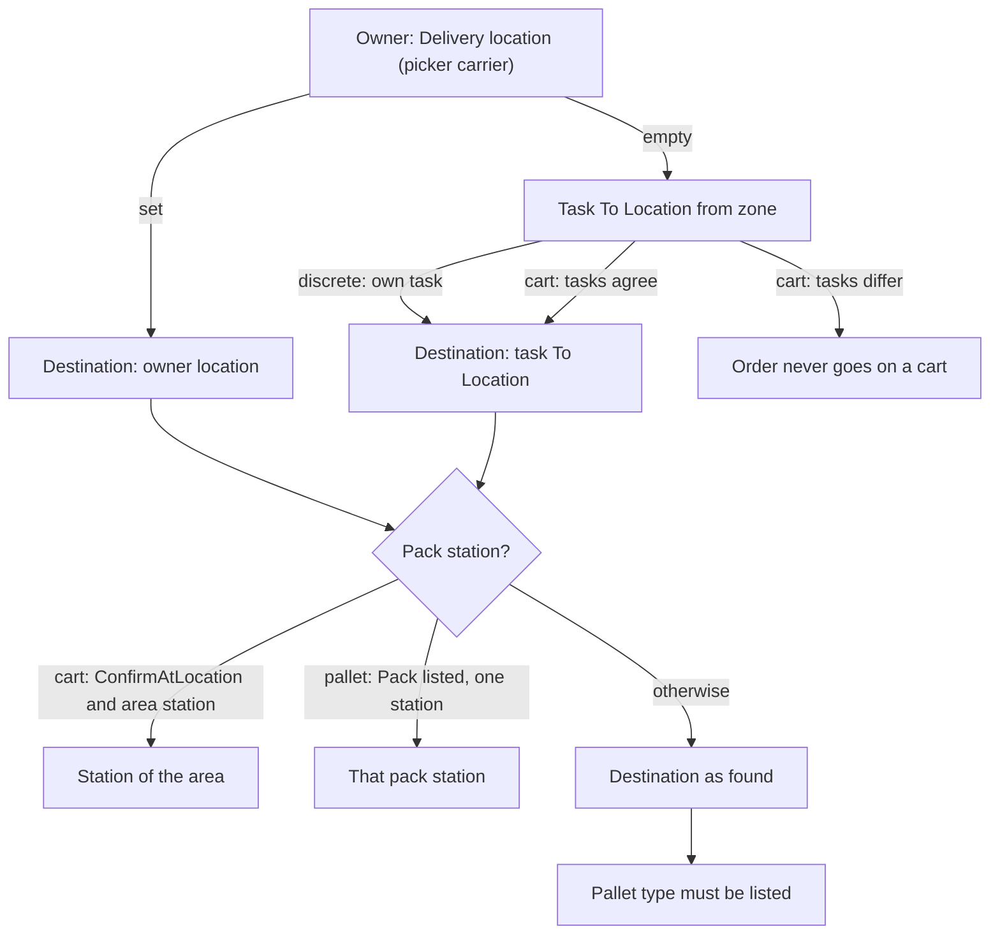

# Where picked goods are delivered

**What this shows.** How the delivery location of a pallet or a cart is found, and which settings can replace it with a pack station.

## Reading the diagram

- **Owner field.** `Delivery location (picker carrier)` is the column `owners.picking_toloc`. A database trigger accepts only a location of type `Pickto`, `Stage` or `Door`. It wins over everything below it.
- **Task To Location.** It was copied from the zone field `Picking To Location` of the source location when the task was made. A discrete pick uses the `To Location` of its own task. A cart uses all tasks of one order: if they all name the same location it is the destination. If they differ, or one has none, and the owner names none, the order is never taken onto a cart.
- **Cart.** All targets of one cart go to one location. The first target chosen fixes it. A cart with `Completion` = `Complete` is not routed to a station. A cart with `ConfirmAtLocation` is routed to the pack station of its work area (`Pack station` on the area) if there is one.
- **Pallet.** A discrete pallet has no area of its own. The router looks at the destination location, its putaway zone, the work areas that list the zone, and their stations. It routes only if exactly one distinct station answers. It asks only if the pallet's frozen revision lists `Pack`.
- With a station, the goods go there and the router gets a hand-off when the pallet is closed or the cart is delivered. The packing step waits at the station for `Pack`.
- The destination is frozen: on the cart at start, on the pallet at its first deposit. Edits afterwards apply to the next cart or pallet.
- If nothing names a destination for a discrete pick, the deposit is refused: `this pick has no destination location — neither its owner nor its task names one`.
## Related pages

- [Drop-off of a pallet](23-drop-off-pallet.md)
- [Drop-off of a cart](24-drop-off-cart.md)
- [Pallet fields](56-influence-pallet-fields.md)
- [Owner settings](../../admin/policies/41-owner-settings-and-policy-resolution.md)
- [Work areas, equipment and permissions](../../admin/policies/22-work-areas-equipment-and-permissions.md)
