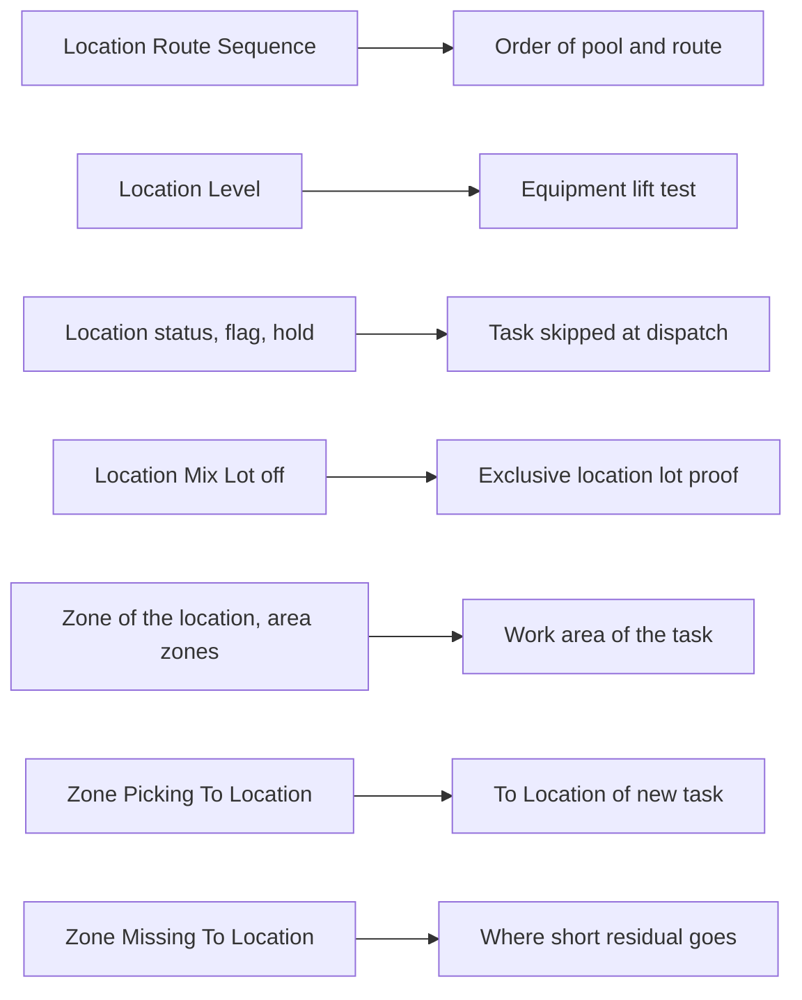

# Location and zone settings that picking reads

**What this shows.** Which fields of a location and of a putaway zone change a picking decision, and what the operator or supervisor sees.

## Reading the diagram

- **Route Sequence** is plain text. Candidates are sorted by it ascending, an empty value last. In the pool it comes after the order priority. On a cart, stops that are not skipped are walked in this order, then by location code. The first location on the walk is also a ranking key when a cart chooses its targets.
- **Level.** The lift test is `task weight <= Max Weight - Weight Reduction per Level x Level`. It applies only to operators whose equipment has `Max Weight` above 0.
- **Status and Flag.** Dispatch hands out a task only when the source location has status `Ok` and no flag. A short with `BlockSourceLocation` sets the flag `CycleCountActive`. A task that is already held can still be committed or shorted under that flag. An inventory hold that blocks outbound flow on the lot, location or container makes the candidate `INVENTORY_HOLD`, and the commit refuses `SOURCE_ON_HOLD`.
- **Mix Lot** = off, together with `Loose Lot Source` = `Exclusive location` and exactly one lot in the location, lets the location scan prove the lot. With `Exclusive location` set and a location that allows mixing, the plan cannot be made and the pick is blocked.
- **Putaway Zone and Work Area Zones.** A task belongs to the work area of the zone of its `From` location. A zone can be in more than one area. Rights are granted per area. A zone removed from an area hides its tasks from operators who relied on it. Held tasks stay.
- **Picking To Location** of the zone of the source location becomes the `To Location` of the task **when the task is made**. The task keeps that value. A later edit of the zone does not change tasks that exist. The destination of a discrete pallet or a cart then goes through the chain in [page 58](58-influence-delivery-destination.md).
- **Missing To Location** of the zone is read when a short with `RelocateResidualToMissing` and `Target Mode` = `ZoneMissingToLoc` runs. If the zone has none, that clean-up fails.
- The type of a location matters for pallets: see [pallet fields](56-influence-pallet-fields.md).

## Where it comes from

| What | Source |
|---|---|
| Pool order | `crates/libs/wms-lib-core/src/model/tasks/task.rs:630-641` |
| Cart route order | `crates/libs/wms-outbound/src/domain/pick_assignment/route.rs:26-47` |
| Cart ranking by first location | `crates/libs/wms-outbound/src/picking/grouping/planned_target.rs:98-130` |
| Lift test uses `Level` | `crates/libs/wms-lib-core/src/model/tasks/task.rs:1010-1027` |
| Status, flag, hold at dispatch | `crates/libs/wms-outbound/src/picking/infrastructure/dispatch.rs:158-174` |
| A held task may finish under a count | `crates/libs/wms-outbound/src/picking/infrastructure/dispatch.rs:76-100` |
| Hold at commit | `crates/libs/wms-outbound/src/picking/confirmation/at_commit.rs:138-145` |
| `Mix Lot` in the plan | `crates/libs/wms-outbound/src/picking/confirmation/source_facts.rs:121-130` and `crates/libs/wms-outbound/src/domain/pick_confirmation/plan.rs:255-262` |
| Area of a task | `crates/libs/wms-lib-core/src/model/tasks/task.rs:999-1008` and `crates/libs/wms-lib-core/src/model/tasks/operator_task_permission.rs:155-182` |
| Zone `Picking To Location` read at task creation | `crates/libs/wms-outbound/src/picking/infrastructure/tasks.rs:52-85` and `crates/libs/wms-lib-core/src/model/putawayzone.rs:354-368` |
| Task snapshot test leaves `to_location` out | `crates/libs/wms-outbound/src/picking/infrastructure/dispatch.rs:208-217` |
| Zone `Missing To Location` | `crates/libs/wms-outbound/src/picking/remediation.rs:419-447` and `crates/libs/wms-lib-core/src/model/putawayzone.rs:370-390` |

## Related pages

- [SKU and lot settings](54-influence-sku-and-lot-settings.md)
- [Delivery location](58-influence-delivery-destination.md)
- [Who gets which task](52-influence-who-gets-which-task.md)
- [Location settings (reference)](../../admin/policies/03-location-settings.md)
- [Putaway zone settings (reference)](../../admin/policies/02-putaway-zone-settings.md)
