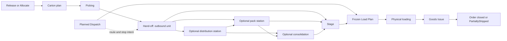

# After picking: what is built

**What this shows.** The outbound capabilities that can follow picking, and the point where planning becomes a physical and financial warehouse departure.

This area covers cartonization, packing, distribution and consolidation, staging, dispatch and load planning, physical loading, Goods Issue and order closure. A site uses only the branches its work-area and dispatch settings require.

`Loaded` is not shipment. Physical loading records what is on the transport; Goods Issue is the separate irreversible command that deducts stock, updates serials and order quantities, and marks the Load and Dispatch shipped.

## What is built

| Part | Status | Where to continue |
|---|---|---|
| Cartonization plan and exception recovery | Built. Runs from Release/Allocate; supervisors can retry or resolve execution exceptions. | [10](10-cartonization-plan-journey.md), [15](15-cartonization-box-full-exception.md), [16](16-cartonization-exception-recovery.md) |
| Hand-off from picking | Built. The route can send a unit to a distribution station, pack station, consolidation station or Stage. | [20](20-flow-handoff-to-pack-station.md), [21](21-flow-influence-station-routing.md) |
| Packing: verify or repack | Built on RF. Void, reopen and packing-exception recovery are available as controlled commands. | [30](30-packing-verify-journey.md), [31](31-packing-repack-journey.md), [32](32-packing-void-and-reopen.md), [33](33-packing-influence-when-packed.md), [34](34-packing-influence-weights-printer-station.md) |
| Distribution station and consolidation | Built. Station boxes can be sorted; boxes from compatible orders can be consolidated onto one outbound pallet. | API reference: `station_*` and `consolidation_*`; administrator setup guide is still to be written. |
| Dispatch planning | Built in the web UI and API. A Dispatch freezes stops and order intent; it does not move or ship stock. | [40](40-dispatch-planning.md), [Outbound Setup](../../admin/06-outbound-setup.md#10-dispatch-loading-and-goods-issue) |
| Staging | Built as API and RF flow. Assignment and physical confirmation are separate commands. | API reference: `stage_unit_*`; operator guide is still to be written. |
| Load planning and loading | Built in web UI, API and RF. A reviewed Load Plan is frozen before a Load opens; every physical unit is reviewed before confirmation. | [Outbound Setup](../../admin/06-outbound-setup.md#10-dispatch-loading-and-goods-issue) |
| Goods Issue | Built. Use `shipment_order_ship` for one complete order or `confirm_shipment` for a complete Load. | [Order closure](50-order-closure.md), [API workflow](../../api/08-workflows-by-example.md#step-7-confirm-goods-issue) |
| Order closure | Built. Complete-order Goods Issue closes automatically; a partial Load can leave an order `PartiallyShipped`. | [50](50-order-closure.md) |

## Important boundaries

- A Dispatch and a frozen Load Plan are commitments of intent, not proof that goods moved.
- A scan review is read-only. The matching confirm command records the physical act.
- A `Loaded` Load still owns warehouse stock. Only Goods Issue records departure.
- An order cannot use direct `Ship order` while it belongs to an active Load.
- There is no generic shipment reversal. Use the immutable shipment history as the receipt and follow the site's controlled correction process.
- Some implementation README files under the reserved `loading/` and `shipping/` directories still describe the original placeholder layout. The active implementation is under `service/load`, `service/load_plan`, `domain/load`, `domain/load_plan` and `domain/shipment_order/shipping.rs`.

## Where it comes from

| Claim | Source |
|---|---|
| Consolidation commands and queries | `crates/libs/wms-outbound/src/consolidation/` |
| Staging assignment, confirmation and transfer | `crates/libs/wms-outbound/src/service/staging/` |
| Dispatch lifecycle | `crates/libs/wms-outbound/src/service/dispatch/` |
| Load Plan lifecycle | `crates/libs/wms-outbound/src/service/load_plan/`, `domain/load_plan/` |
| Load review, confirmation, completion and shipment | `crates/libs/wms-outbound/src/service/load/` |
| Direct order Goods Issue | `crates/libs/wms-outbound/src/domain/shipment_order/shipping.rs` |
| RF Loading and shipment screens | `crates/libs/wms-lib-sql/sql/rf-screens/128_uc_loading.sql`, `129_uc_load_shipment.sql` |
| Web screens | `crates/libs/wms-lib-sql/sql/wms-meta-ui/migrations/20261015141427_*` through `20261015141536_*` |

## Related pages

- [Outbound Setup](../../admin/06-outbound-setup.md)
- [Packing (operator)](../../operator/10-packing-verify.md)
- [Order statuses and transitions](../../reference/outbound/90-order-statuses-and-transitions.md)
