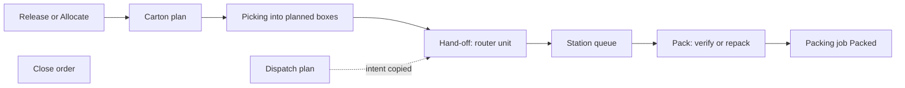

# After picking: what is built

**What this shows.** The parts of the outbound flow after reservation and picking that exist in code today, and the parts that do not.

This area covers cartonization, the pack station, dispatch planning and order closure. Everything on these pages was checked against the code. A diagram is drawn only for a part that exists.

The dotted line is a copy of the dispatch intent at hand-off. The last two nodes are not linked on purpose: a packed job does not change the order, and closing an order does not depend on packing.

## What is built

| Part | Status | Page |
|---|---|---|
| Cartonization plan (which box each pick goes into) | Built. Runs inside Release and Allocate. | [10](10-cartonization-plan-journey.md) |
| Cartonization settings and their effects | Built. Some policy fields are stored only. | [11](11-cartonization-influence-policy-and-pack-level.md), [12](12-cartonization-influence-policy-header.md), [13](13-cartonization-influence-cartons-and-pack-item.md), [14](14-cartonization-influence-unplaced-reasons.md) |
| Box full at the floor, and its recovery | Built. | [15](15-cartonization-box-full-exception.md), [16](16-cartonization-exception-recovery.md) |
| Hand-off from picking to a pack station | Built. Only for areas with a pack station. | [20](20-flow-handoff-to-pack-station.md), [21](21-flow-influence-station-routing.md) |
| Packing: verify a box | Built. RF screens `PACK00` to `PACK04`. | [30](30-packing-verify-journey.md) |
| Packing: repack a pallet | Built. RF screens `PACK10` to `PACK14`. | [31](31-packing-repack-journey.md) |
| Packing: void and reopen | Built as API. No RF screen. | [32](32-packing-void-and-reopen.md) |
| When the packing job is `Packed` | Built. | [33](33-packing-influence-when-packed.md) |
| What packing reads (weights, printer, serial) | Built. | [34](34-packing-influence-weights-printer-station.md) |
| Dispatch planning (trip, stops, orders) | Built as API. It plans only. | [40](40-dispatch-planning.md) |
| Order closure | Built as API. Reachable only by cancelling every line. | [50](50-order-closure.md) |

## Not built yet in code

- **Sorting and consolidation (put wall).** Not built yet in code. The router knows a `Consolidate` step in its type, but the code always sets `consolidation_required` to false, and there is no module, table or RPC for sorting. The designs are in `docs/superpowers/specs/2026-10-05-sort-and-pack-modules-design.md` and `docs/superpowers/specs/2026-10-06-post-pick-pack-consolidation-flow-v0.5.md`.
- **Staging.** Not built yet in code. `Stage` is a location type and a router value. The router does not route it (`Stage` is never required). A dispatch can hold a "stage hint", which is stored only.
- **Loading.** Not built yet in code. `crates/libs/wms-outbound/src/loading/README.md` says "reserved; no compiled Rust module yet", and `lib.rs` has no `loading` module.
- **Ship confirm and shipping.** Not built yet in code. `crates/libs/wms-outbound/src/shipping/README.md` says the same. Nothing writes `qty_shipped`. `serial_ship` exists as a separate serial command (Picked to Shipped) that no order command calls.
- **Recovery of a packing discrepancy.** Not built yet in code. A reported packing exception has no command that resolves it.
- **Waves** come before picking and are not in this area.

## Where it comes from

| Claim | Source |
|---|---|
| Modules of the crate: no loading or shipping | `crates/libs/wms-outbound/src/lib.rs:21` |
| Consolidation is never required | `crates/libs/wms-outbound/src/flow/advance.rs:183` |
| Stage, Ship and None are never required | `crates/libs/wms-outbound/src/flow/resolve.rs:60` |
| Router lists what is not built | `crates/libs/wms-outbound/src/flow/README.md:94` |
| Loading is a placeholder | `crates/libs/wms-outbound/src/loading/README.md:3` |
| Shipping is a placeholder | `crates/libs/wms-outbound/src/shipping/README.md:3` |
| Nothing writes `qty_shipped` | `crates/libs/wms-lib-core/src/model/outbound/shipment_order_line.rs:154` |
| The `confirm_shipment` stub was removed from the RPC list | `crates/services/app-server/src/web/rpcs/contexts/tasks.rs:92` |
| `serial_ship` is a standalone command | `crates/services/app-server/src/web/rpcs/serial_commands_rpc.rs:78` |
| Packing exceptions: no command sets `Resolved` | `crates/libs/wms-lib-core/src/model/outbound/packing_exception.rs:35` |

## Related pages

- [Cartonization: how it works](../../admin/policies/30-cartonization-overview.md)
- [Packing (operator)](../../operator/10-packing-verify.md)
- [Order statuses and transitions](../../reference/outbound/90-order-statuses-and-transitions.md)
