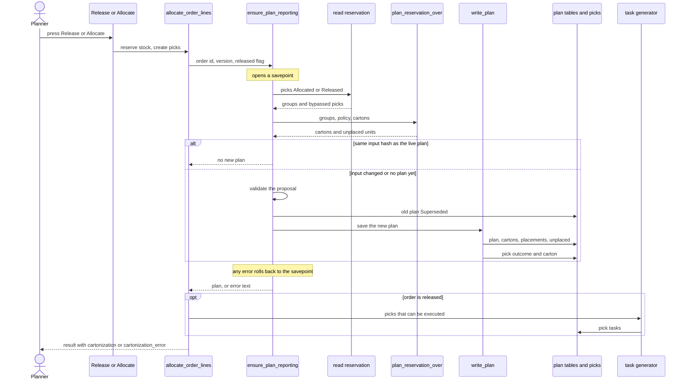

# Cartonization: how a plan is made

**What this shows.** The steps from "Release" or "Allocate" on an order to a saved carton plan, and how the plan reaches the pickers.

There is no button and no RPC for cartonization. It runs inside the reserve command. If it fails, the reservation stays and the command result carries the error text.

## What the steps mean

| Step | What happens |
|---|---|
| Savepoint | The whole attempt is nested in the reserve transaction. A failure undoes only the plan, not the reservation. |
| Read reservation | Only picks with status `Allocated` or `Released` are read. A pick quantity becomes whole units of the pick's pack level. |
| Bypassed picks | A pick skips the solver when its pack level is unknown, is a factory package, is not cartonized, or no policy resolves. See [11](11-cartonization-influence-policy-and-pack-level.md). |
| Input hash | After release, if the hash of the input equals the live plan, nothing is rewritten. |
| After release | The engine plans only the new work around boxes that already stand. Before release it makes a full new plan. |
| Write | Plan status is `Planned`, or `PlannedWithExceptions` if any unit is unplaced. A pick that spans two cartons is split into two pick rows. |
| Tasks | Only picks whose outcome is `Planned`, `ShipAsIs` or `Bypassed` get a task. `Pending` and `Blocked` get none. Tasks are created only when the order is released. |

Plans are also marked after other commands: `Unallocate` and `Delete Selected` (picks) call `plan_lost_its_work`, which sets the live plan to `Superseded` or `Stale`.
## Related pages

- [Cartonization policy: how it works](../../admin/policies/30-cartonization-overview.md)
- [Cartonization policy settings](../../admin/policies/31-cartonization-policy-settings.md)
- [Releasing an order](../../reference/outbound/35-releasing-an-order.md)
- [Cartons tab](../../reference/outbound/14-cartons-tab.md)
- [Overview of this area](00-overview.md)
