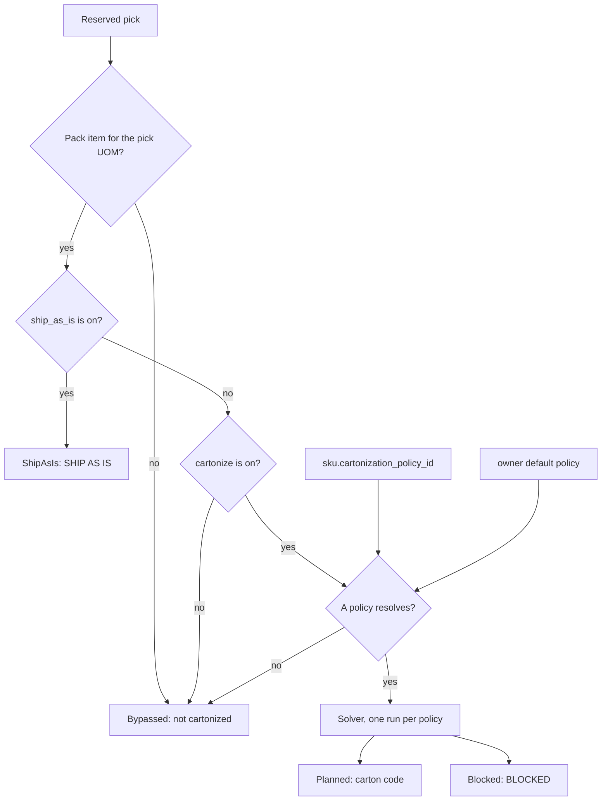

# Cartonization: which picks go to the solver

**What this shows.** For one reserved pick: which settings decide if it gets a planned carton, goes without a box, or ships as is.

The checks run in this fixed order. The first one that matches wins.

## How to read it

| Node | Setting | What it changes |
|---|---|---|
| Pack item for the pick UOM | The SKU pack and its items | The pack item whose UOM equals the pick UOM is the "level". No such item means `Bypassed`. |
| `ship_as_is` is on | Pack item, API only (no screen field) | The pick gets outcome `ShipAsIs` with a frozen proof of the pack item. It is never solved. |
| `cartonize` is on | Pack item, "Cartonize" checkbox | Off means `Bypassed`. A pick of that level gets the normal destination, no carton. |
| A policy resolves | SKU "Cartonization Policy", else owner default | The SKU value wins. If both are empty the pick is `Bypassed`. |
| Solver, one run per policy | The policy | Picks of different policies are solved apart and never share a carton. |
| `Planned` | Result | The pick has a carton code. It gets a task. |
| `Blocked` | Result | The pick has an unplaced unit and no placed unit. It gets no task until the data is fixed and the order is reserved again. See [14](14-cartonization-influence-unplaced-reasons.md). |

`Bypassed` and `ShipAsIs` picks are executable. They get tasks with the normal destination (or the factory package). `Pending` (the default before any plan) and `Blocked` get no task.

## Stored only. It has no effect today.

These are on the policy screen but the planning code does not use them to decide anything:

- Policy `Active` checkbox. The engine loads the policy by id whatever this flag says. Only the save rule reads it (an active policy needs one active carton).
- Policy `Name`, `Description`, carton `Description`.
- Policy `Solver` and `Algorithm` (one value each).
- `Maximum candidates`. It is saved and goes into the plan fingerprint only.
- The six "Exception handling" drop-downs. Every unplaced unit gets action `Stop`.

## Where it comes from

| Claim | Source |
|---|---|
| Level is the pack item of the SKU pack with the pick UOM | `crates/libs/wms-outbound/src/cartonization/read_from_db.rs:252` |
| Level fields read: size, weight, rotation | `crates/libs/wms-outbound/src/cartonization/read_from_db.rs:261` |
| Policy is looked up per SKU and owner | `crates/libs/wms-outbound/src/cartonization/read_from_db.rs:199` |
| SKU policy first, else owner default | `crates/libs/wms-lib-core/src/model/sku.rs:915` |
| No level gives `Bypassed` | `crates/libs/wms-outbound/src/cartonization/reservation.rs:130` |
| Factory package is tested before `cartonize` | `crates/libs/wms-outbound/src/cartonization/reservation.rs:136` |
| `cartonize` off gives `Bypassed` | `crates/libs/wms-outbound/src/cartonization/reservation.rs:151` |
| No policy gives `Bypassed` | `crates/libs/wms-outbound/src/cartonization/reservation.rs:163` |
| Bypassed and `ShipAsIs` outcomes are written | `crates/libs/wms-outbound/src/cartonization/write.rs:217` |
| One run per policy partition | `crates/libs/wms-outbound/src/cartonization/plan.rs:123` |
| Task eligibility per outcome | `crates/libs/wms-outbound/src/cartonization/handoff.rs:27` |
| `Blocked` only when no placement exists | `crates/libs/wms-lib-core/src/model/outbound/pick_detail.rs:474` |
| New picks start as `Pending` | `crates/libs/wms-lib-sql/sql/wms-app/migrations/007_a_pick_says_which_carton_it_goes_into.sql:42` |
| Screen words for the outcomes | `crates/libs/wms-lib-sql/sql/wms-meta-ui/migrations/015_the_order_screen_shows_the_cartonization.sql:55` |
| The engine does not read the policy `Active` flag | `crates/libs/wms-outbound/src/cartonization/plan.rs:124` |
| `Maximum candidates` only validated and put in the snapshot | `crates/libs/wms-outbound/src/cartonization/snapshot.rs:120` |
| `Solver` only copied to the snapshot | `crates/libs/wms-outbound/src/cartonization/snapshot.rs:114` |
| Unplaced action is always `Stop` | `crates/libs/wms-outbound/src/cartonization/write.rs:556` |

## Related pages

- [Cartonization policy settings](../../admin/policies/31-cartonization-policy-settings.md)
- [SKU-level settings](../../admin/policies/34-sku-level-settings.md)
- [Owner settings and policy resolution](../../admin/policies/41-owner-settings-and-policy-resolution.md)
- [Plan journey](10-cartonization-plan-journey.md)
- [Overview of this area](00-overview.md)
