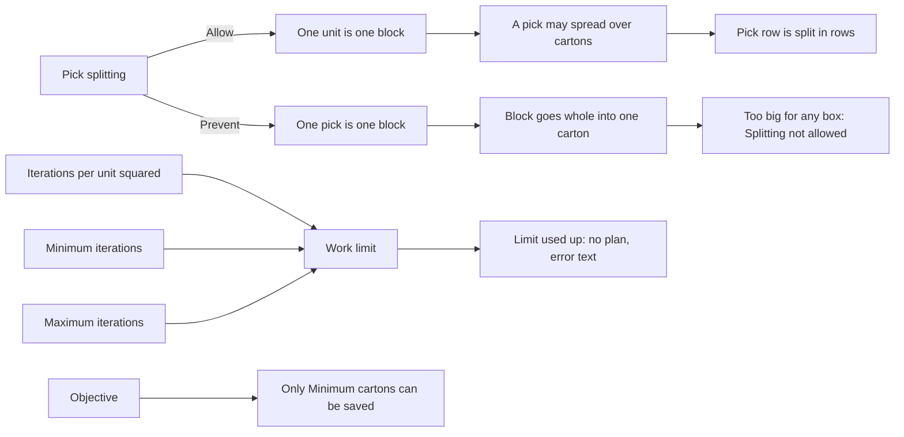

# Cartonization: what the policy header changes

**What this shows.** Each policy header setting that the planning code reads, the decision it changes, and what you see after.

## How to read it

| Setting (screen label) | Decision it changes | What you see |
|---|---|---|
| **Pick splitting** = `Allow` | Every physical unit is its own block. The solver may put units of one pick in different cartons. | A pick that crosses cartons is split into several pick rows, one per carton. |
| **Pick splitting** = `Prevent` | All units of one pick form one block. The block goes whole into one carton or stays unplaced. | If every unit fits alone but the whole pick fits no carton, the reason is "Splitting not allowed". The pick has no placement, so it is `BLOCKED`. |
| **Iterations per unit squared**, **Minimum iterations**, **Maximum iterations** | The work limit is `iterations x units x units`, held between the minimum and the maximum. One step is one check of unit, carton, point and turn. | When the work reaches the limit there is no partial plan. The reserve command still succeeds and its result carries "cartonization solver budget exceeded after N of LIMIT iterations". |
| **Objective** | Save accepts only `Minimum cartons`. The solver opens as few cartons as it can, then moves each new carton into the smallest box that holds the load. | The other three values are refused on save: they are not built. |

Numbers: with the defaults (30, 50,000, 2,000,000) 12 units give a limit of 50,000 (30 x 144 = 4,320 is raised to the minimum). 100 units give 300,000. 400 units give 2,000,000 (30 x 160,000 is cut to the maximum).

## Not in this diagram

- Settings on the carton rows and the pack item: see [13](13-cartonization-influence-cartons-and-pack-item.md).
- Settings that are stored only: see [11](11-cartonization-influence-policy-and-pack-level.md).
- `Version`: not a setting. Save sends the version you loaded. Another save in between is refused with a version conflict.
## Related pages

- [Cartonization policy settings](../../admin/policies/31-cartonization-policy-settings.md)
- [Cartonization: how it works](../../admin/policies/30-cartonization-overview.md)
- [Plan journey](10-cartonization-plan-journey.md)
- [Overview of this area](00-overview.md)
