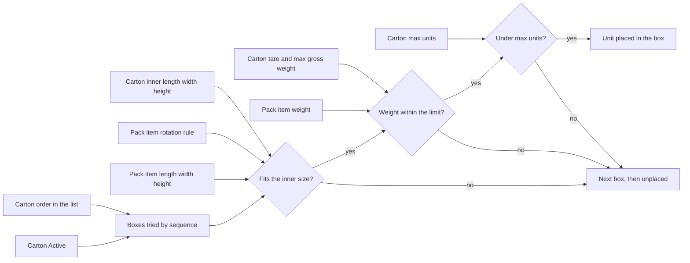

# Cartonization: what box rows and pack data change

**What this shows.** How the carton rows of a policy and the size, weight and turn rule of the pack item decide where a unit goes.

## How to read it

| Setting | Where | Decision it changes |
|---|---|---|
| **Active** (carton row) | Policy, "Cartons in solver order" | Only active rows are candidates. An inactive row is a draft. |
| Order in the list | Same block, move up or down | The screen order is saved as `sequence` 10, 20, 30. A block that fits no open carton opens the first box in this order that fits. |
| **Inner length / width / height** | Carton row | A unit fits if its three sizes fit inside in some allowed turn. |
| **Length / Width / Height** | Pack item | Any side of 0 means "no dimensions". The unit is unplaced before any packing. |
| **Rotation rule** | Pack item, API only | `All90` any turn, `None` natural position only, `UprightOnly` turn around the vertical axis only. |
| **Weight** | Pack item | 0 or less means unknown. |
| **Tare weight**, **Maximum gross weight** | Carton row | If the max gross weight is above 0, tare plus all units must stay within it, and every unit must have a known weight. With 0 there is no weight check. |
| **Maximum units** | Carton row | 0 means no limit. Otherwise a carton takes at most that many units. |

After the first pass, each new box is tried in every smaller active box, smallest volume first. The first smaller box that holds all its units, within its own weight and count limits, replaces it.

Example (policy defaults seeded as `STD`): BOX-S inner 300 x 200 x 150 mm, tare 200 g, max gross 5,000 g, 20 units. A unit of 310 x 100 x 100 mm fits no turn of BOX-S, so it goes to the first box in the list that takes it.

## What you see

- The Cartons tab shows each planned carton with its planned weight.
- When a unit fits no box, it is unplaced. The reason and where to fix it are in [14](14-cartonization-influence-unplaced-reasons.md).
- The box tare is copied to the new container when the plan creates it. Packing uses that tare later: see [33](34-packing-influence-weights-printer-station.md). Changing the tare later does not change containers that already exist.

## Not shown on a screen

- `Rotation rule` and `Factory package` have no screen field. They are set through `create_pack_with_items`, `update_pack_with_items` and `update_pack_item`.
- Tare type (`Any box that fits` or a handling unit type) on a carton row does not change the plan. It is checked on save and when the picker scans a real box for the planned position (see [15](15-cartonization-box-full-exception.md)).
## Related pages

- [Cartonization policy settings](../../admin/policies/31-cartonization-policy-settings.md)
- [SKU-level settings](../../admin/policies/34-sku-level-settings.md)
- [Policy header](12-cartonization-influence-policy-header.md)
- [Overview of this area](00-overview.md)
