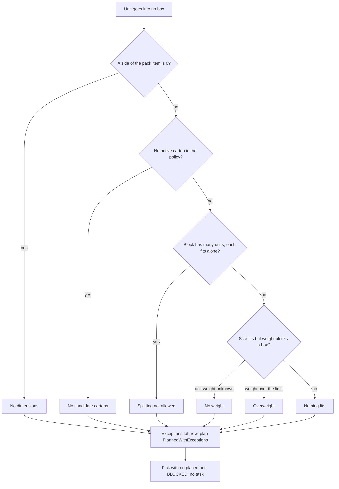

# Cartonization: why a unit is not placed

**What this shows.** The checks the solver makes, in order, when a unit goes into no box, and what the order screen shows for each reason.

Check 0 runs before any packing. Checks 1 to 4 run only after the solver found no place, in the order drawn. "Nothing fits" is the default answer, so it comes last.

## What you see and what fixes it

| Reason on the Exceptions tab | Hint on the screen | What to change |
|---|---|---|
| No dimensions | fix on the pack card | Length, width and height of the pack item. |
| No weight | fix on the pack card | Weight of the pack item, or set every carton's max gross weight to 0. |
| No candidate cartons | fix in the policy | Add or activate a carton row. |
| Splitting not allowed | fix in the policy | Set **Pick splitting** to `Allow`. |
| Overweight | fix in the policy | Raise the max gross weight of a carton, or correct a wrong pack item weight. |
| Nothing fits | fix in the policy | Add a bigger carton. A max-units limit that blocks the unit is also reported as "Nothing fits". |

The action on every row is always "Stop this line". The six "Exception handling" drop-downs on the policy are read and then ignored. Save refuses `Ship as is`.

To recover, fix the data, then reserve or release the order again. The plan input holds sizes, weights, rotation rule and the whole policy. If any of them changed, the plan is recalculated. If nothing changed, the old result stays.

## Where it comes from

| Claim | Source |
|---|---|
| Missing size is tested before packing | `crates/libs/wms-outbound/src/cartonization/pack.rs:295` |
| Order of the other reasons | `crates/libs/wms-outbound/src/cartonization/pack.rs:574` |
| No active carton | `crates/libs/wms-outbound/src/cartonization/pack.rs:582` |
| Splitting prevented | `crates/libs/wms-outbound/src/cartonization/pack.rs:613` |
| No weight or overweight | `crates/libs/wms-outbound/src/cartonization/pack.rs:623` |
| Default answer | `crates/libs/wms-outbound/src/cartonization/pack.rs:629` |
| Unit-count limit is not a weight reason | `crates/libs/wms-outbound/src/cartonization/pack.rs:714` |
| Action is always `Stop` | `crates/libs/wms-outbound/src/cartonization/write.rs:556` |
| Plan status with unplaced units | `crates/libs/wms-outbound/src/cartonization/write.rs:142` |
| Pick with no placement is `Blocked` | `crates/libs/wms-outbound/src/cartonization/write.rs:619` |
| Reason and fix hint on the tab | `crates/services/web-ui-server/src/extensions/customization/shipment_order/cell_renderers.rs:82` |
| Screen words | `crates/libs/wms-lib-sql/sql/wms-meta-ui/migrations/015_the_order_screen_shows_the_cartonization.sql:93` |
| `Blocked` picks get no task | `crates/libs/wms-outbound/src/cartonization/handoff.rs:65` |
| Save refuses `ShipAsIs` on the six drop-downs | `crates/libs/wms-lib-core/src/model/policies/cartonization_aggregate.rs:167` |
| Changed input gives a new plan | `crates/libs/wms-outbound/src/cartonization/ensure.rs:194` |

## Related pages

- [Exceptions tab](../../reference/outbound/15-cartonization-exceptions-tab.md)
- [Cartonization: how it works](../../admin/policies/30-cartonization-overview.md)
- [Cartons and pack item](13-cartonization-influence-cartons-and-pack-item.md)
- [Overview of this area](00-overview.md)
