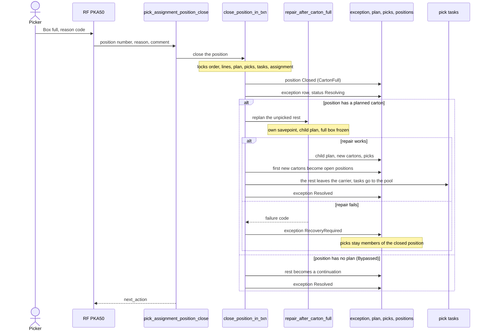

# Cartonization: a box is full at the floor

**What this shows.** What happens when the picker reports that the real box is full before the plan says so (`CARTON_FULL`).

The picker uses RF screen `PKA50` (F2 "Box full" on the route screen). The reason is one of six codes: `MASTER_DATA_DIMENSIONS`, `PROTECTIVE_PACKAGING`, `ORIENTATION_NOT_FEASIBLE`, `PRODUCT_OR_CARTON_DEFORMED`, `SOLVER_LAYOUT_NOT_FEASIBLE`, `OTHER` (needs a comment).

## Rules in the diagram

- The full box stays on the carrier until delivery. It keeps only what was picked.
- The repair makes new whole cartons for the unpicked rest. Every other standing carton takes nothing new during this repair.
- A failed repair never undoes the close. The fact is kept as `RecoveryRequired`. See [16](16-cartonization-exception-recovery.md).
- A replay with a new key on a position that is already closed full answers the existing exception.
- `pick_assignment_position_close` is a stateless command. Roles: Admin, Manager, Supervisor, Operator.
## Related pages

- [Cartonization: how it works](../../admin/policies/30-cartonization-overview.md)
- [Picking (operator)](../../operator/09-picking.md)
- [Recovery of a failed repair](16-cartonization-exception-recovery.md)
- [Overview of this area](00-overview.md)
