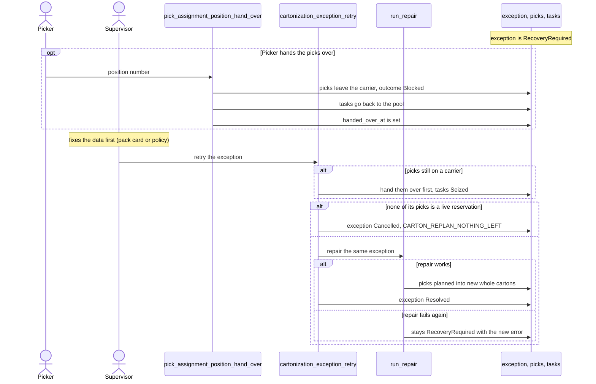

# Cartonization: recovery of a failed box-full repair

**What this shows.** The two ways out of `RecoveryRequired`: the picker hands the picks over, or a supervisor retries the repair.

While an exception is `RecoveryRequired`, its picks stay members of the closed position. The route, dissolve and delivery refuse them with `CARTON_REPLAN_REQUIRED`.

## Rules in the diagram

- Retry is a stateless command for Admin, Manager and Supervisor. It does not change data. Fix the pack card or the policy first. With nothing changed, the same answer comes back.
- The screen is Task Manager, "Pick Target Exceptions". The read RPC is `cartonization_exception_list`.
- `Resolved` and `Cancelled` are final. A retry of a finished exception answers its stored result.
## Related pages

- [Cartonization: how it works](../../admin/policies/30-cartonization-overview.md)
- [Box is full at the floor](15-cartonization-box-full-exception.md)
- [Working with tasks from the order](../../reference/outbound/41-working-with-tasks-from-the-order.md)
- [Overview of this area](00-overview.md)
