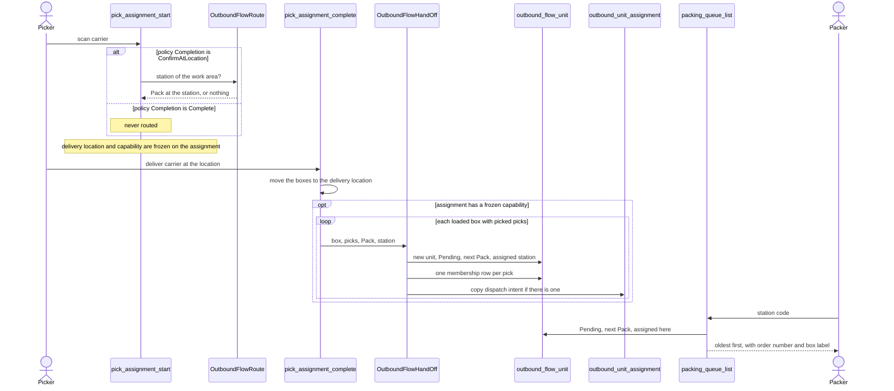

# From picking to the pack station

**What this shows.** How a picked box becomes a waiting unit at a pack station, and how the station sees its queue.

This page focuses on the hand-off to packing. The outbound flow can also continue through consolidation and order control before staging; see the [post-pick overview](00-overview.md).

## Rules in the diagram

- No station on the work area means no routing. Picking works as before and no unit is made.
- The decision is made once at start and never recomputed. The hand-off copies it.
- One pick belongs to exactly one unit. A second hand-off of the same pick is refused.
- A unit is one box off a carrier (`Box`), or one closed discrete pallet (`Pallet`). For a pallet the same hand-off runs when the pallet is closed (`pick_drop_close`). See [21](21-flow-influence-station-routing.md) for the pallet rules.
- A station code that no location has is refused with `STATION_UNKNOWN`, not answered with an empty queue.
- Not built: re-route or reassign of a unit.
## Related pages

- [Picking (operator)](../../operator/09-picking.md)
- [Which settings send a unit to a station](21-flow-influence-station-routing.md)
- [Packing: verify a box](30-packing-verify-journey.md)
- [Overview of this area](00-overview.md)
