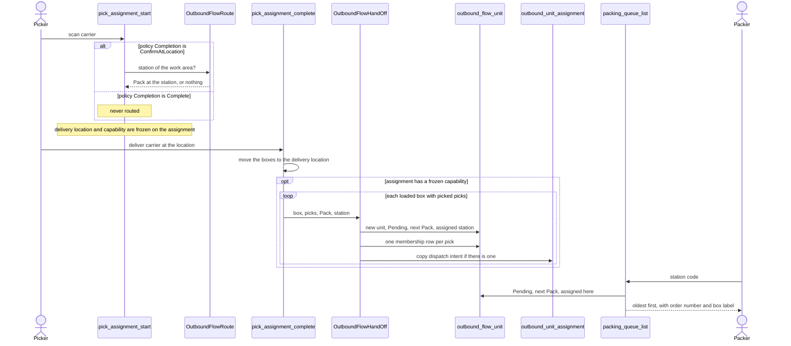

# From picking to the pack station

**What this shows.** How a picked box becomes a waiting unit at a pack station, and how the station sees its queue.

The "router" (`wms-outbound::flow`) only decides what comes next and where. It moves no stock and packs nothing. At this time the only next step it knows is `Pack`.

## Rules in the diagram

- No station on the work area means no routing. Picking works as before and no unit is made.
- The decision is made once at start and never recomputed. The hand-off copies it.
- One pick belongs to exactly one unit. A second hand-off of the same pick is refused.
- A unit is one box off a carrier (`Box`), or one closed discrete pallet (`Pallet`). For a pallet the same hand-off runs when the pallet is closed (`pick_drop_close`). See [21](21-flow-influence-station-routing.md) for the pallet rules.
- A station code that no location has is refused with `STATION_UNKNOWN`, not answered with an empty queue.
- Not built: re-route or reassign of a unit.

## Where it comes from

| Claim | Source |
|---|---|
| Router answers the station only when the policy completes at a location | `crates/libs/wms-outbound/src/picking/commands/start.rs:205` |
| `Complete` is never routed | `crates/libs/wms-outbound/src/picking/commands/start.rs:217` |
| Capability is frozen on the assignment | `crates/libs/wms-outbound/src/picking/commands/start.rs:376` |
| Station of a work area | `crates/libs/wms-outbound/src/flow/route.rs:32` |
| No station gives no routing | `crates/libs/wms-outbound/src/flow/resolve.rs:124` |
| Delivery hands off each loaded box | `crates/libs/wms-outbound/src/picking/completion/confirm_at_location.rs:197` |
| Hand-off writes the unit and the pick membership | `crates/libs/wms-outbound/src/flow/hand_off.rs:40` |
| One unit per pick | `crates/libs/wms-outbound/src/flow/hand_off.rs:27` |
| Dispatch intent copied to the unit | `crates/libs/wms-outbound/src/flow/hand_off.rs:63` |
| Pallet hand-off at close | `crates/libs/wms-outbound/src/picking/commands/drop_close.rs:231` |
| Station queue query | `crates/libs/wms-lib-core/src/model/outbound/outbound_flow_unit.rs:503` |
| Queue RPC | `crates/services/app-server/src/web/rpcs/packing_rpc.rs:62` |
| Unknown station is refused | `crates/libs/wms-outbound/src/flow/queries/queue.rs:42` |
| Re-route is not built | `crates/libs/wms-outbound/src/flow/README.md:94` |

## Related pages

- [Picking (operator)](../../operator/09-picking.md)
- [Which settings send a unit to a station](21-flow-influence-station-routing.md)
- [Packing: verify a box](30-packing-verify-journey.md)
- [Overview of this area](00-overview.md)
